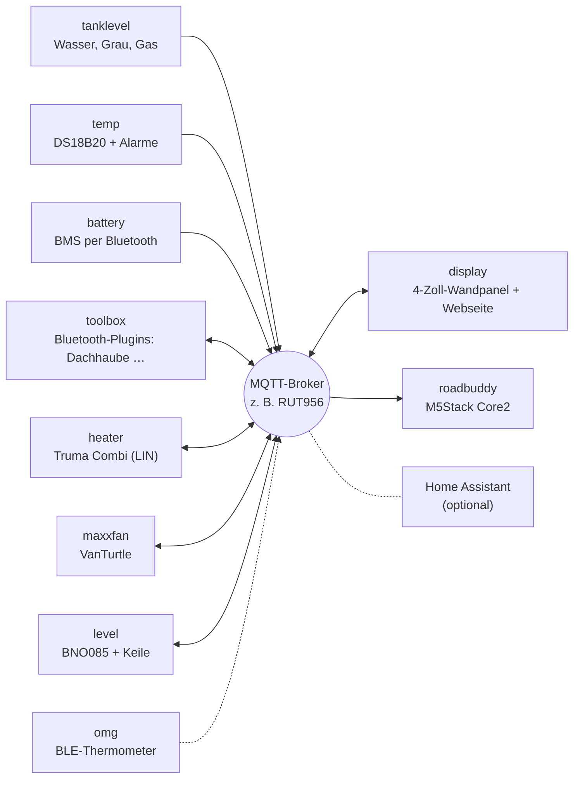

# camper-mqtt

🇬🇧 [English](README.md) · 🇩🇪 Deutsch

Elektronik für den Camper, die über **MQTT** zusammenspielt: Tanks, Temperaturen, Batterien, Heizung, Dachlüfter, Dachhaube, Ausrichtung und zwei Displays. Jedes Gerät ist ein ESP8266/ESP32 mit eigener **Arduino**-Firmware, eigener Web-Oberfläche und Home-Assistant-Discovery. Die Geräte und Displays reden direkt über den Broker miteinander, z. B. den MQTT-Broker des LTE-Routers. Home Assistant kann mitlesen, muss aber nicht laufen.

## Warum?

Angefangen hat alles mit Home Assistant und ESPHome. Für den Camper wurde mir das mit der Zeit zu viel: ein Server, der immer laufen muss, damit irgendetwas angezeigt wird, eine YAML-Konfiguration pro Gerät, Updates, die nebenbei etwas verändern, und viele Teile, die alle zusammenpassen müssen. Ein Fahrzeug ist oft tagelang ohne Netz und nur mit Batterie unterwegs, da wollte ich etwas Einfacheres und Robusteres.

Deshalb gilt hier:

- **Jedes Gerät funktioniert für sich allein** – mit eigener Web-Oberfläche zum Einstellen und Anschauen, auch ohne Display und ohne Server.
- **MQTT ist die einzige Verbindung.** Der Broker läuft ohnehin auf dem Router. Displays lesen direkt vom Broker.
- **Home Assistant ist eine Option, keine Voraussetzung.** Discovery ist eingebaut, wer HA nutzt, bekommt alle Geräte automatisch.
- **Updates über den Browser**, mit Prüfung der Datei und Rückfall auf die alte Firmware, wenn etwas schiefgeht.

Das ist keine Kritik an ESPHome oder Home Assistant – beide sind großartig. Für dieses eine Fahrzeug passte ein schlankerer Aufbau einfach besser.



## Geräte

| Ordner | Hardware | Aufgabe | Basis-Topic |
| --- | --- | --- | --- |
| [`firmware/tanklevel`](firmware/tanklevel) | ESP32-C3 | Frischwasser + Grauwasser (Votronic), Gasflasche (BLE) | `camper/tanklevel` |
| [`firmware/temp`](firmware/temp) | ESP8266 / ESP32-C3 | bis zu 8 DS18B20 (Kühlschrank, Gefrierfach …) mit Alarm-Grenzwerten | `camper/temp` |
| [`firmware/battery`](firmware/battery) | ESP32-C3 | Batterie-BMS per Bluetooth (Daly, Ective BM X): Ladestand, Strom, Zellen | `camper/battery` |
| [`firmware/toolbox`](firmware/toolbox) | ESP32-C3 | Bluetooth-Geräte als Plugins: Dachhaube RV Tech (Heki), Wasserpumpe CaraWater, WCS-Kühlschrank | `camper/toolbox` |
| [`firmware/heater`](firmware/heater) | ESP32 + LIN-Transceiver | Truma Combi / Vario Heat als iNet Box am CP Plus | `camper/heater` |
| [`firmware/maxxfan`](firmware/maxxfan) | ESP32-C3 + VanTurtle | MaxxFan-Dachlüfter | `camper/maxxfan` |
| [`firmware/level`](firmware/level) | ESP32 + BNO085 | Längs-/Querneigung und Keilhöhe für jedes Rad (Fork des Levelsensors von klehnst) | `camper/level` |
| [`firmware/omg`](firmware/omg) | ESP32 / ESP32-C3 | Bluetooth-Thermometer (Govee, Ruuvi, Xiaomi …) über OpenMQTTGateway | `camper/OMG` |
| [`firmware/display`](firmware/display) | Guition ESP32-4848S040 | 4"-Wandpanel + gleiche Webseite fürs Handy, zeigt und steuert alles, Wetter, Warnungen, Pushover | `camper/display` |
| [`firmware/roadbuddy`](firmware/roadbuddy) | M5Stack Core2 | kleines Akku-Display: Ausrichtung, Wasser, Gas | – (nur Empfänger) |

Nicht in diesem Repo: **Router-Daten (GPS, Mobilfunk)** sendet der RUT956 selbst per MQTT, siehe [Router-Daten im Display-README](firmware/display/README.md#router-daten-rut956).

- **Zu Hause testen:** [`tools/emulator`](tools/emulator) ist ein Python-Werkzeug mit lokaler Webseite. Es sendet die Topics aller Geräte, des Routers und von Zigbee mit änderbaren Werten, dazu Szenarien (Tanks laufen leer, Abfahrt, ein Gerät fällt aus …), so lassen sich die Displays ohne Fahrzeug testen
- Alle Topics auf einen Blick: [`docs/TOPICS.md`](docs/TOPICS.md)
- Klickbare Mockups aller Web-Oberflächen: [`docs/mockups/`](docs/mockups/index.html)
- Hinweise für KI-Assistenten und Mitwirkende: [`AGENTS.md`](AGENTS.md)

Die Doku der einzelnen Geräte ist auf Deutsch.

## Schnellstart

1. **Firmware holen:** Unter [Releases](https://github.com/hflocki/camper-mqtt/releases) die `.bin` des Geräts laden – oder selbst bauen (Arduino IDE oder `arduino-cli`, Board und Bibliotheken stehen in der README des Geräts).
2. **Einmal per USB flashen.** Danach gehen Updates über die Web-Oberfläche.
3. **Einrichten:** Ohne WLAN-Daten startet ein Access Point `Camper-<Gerät>-XXXXXX`. Verbinden, `http://192.168.4.1` öffnen, WLAN und MQTT-Broker eintragen.
4. Das Gerät meldet sich unter `camper/<gerät>/…` am Broker, das Display findet es von selbst.

## Gemeinsame Regeln

Alle Geräte halten sich an dasselbe Schema, damit Displays und Home Assistant sie ohne Sonderfälle verstehen:

| Was | Wie |
| --- | --- |
| Topics | `camper/<gerät>/…`, Werte **retained** |
| Verfügbarkeit | `camper/<gerät>/status` = `online` / `offline` als Last Will (retained, QoS 1) |
| Diagnose | `camper/<gerät>/info`: JSON mit Version, IP, Signal, Laufzeit |
| Befehle | `…/cmd/…` bzw. `…/set/…`, nicht retained |
| Home Assistant | Auto-Discovery unter `homeassistant/…`, ein Gerät pro Firmware |
| Einrichtung | Access Point `Camper-<Gerät>-XXXXXX`, Einstellungen im Browser unter `http://192.168.4.1` |
| Web-Oberfläche | Gleiche Optik auf allen Geräten, optionaler Login (HTTP Basic Auth); Login vergessen → `noauth` im seriellen Monitor bzw. Werkseinstellungen |
| Updates | Im Browser, mit Prüfung (falsches Gerät, `.merged.bin`, zu groß), Ereignis-Log und Rückfall auf die vorherige Firmware |
| Firmware-Version | `FW_VERSION` in der `config.h` des Geräts, sichtbar im Web-UI und in HA |

## Eigene Einstellungen (`config_local.h`)

Passwörter, WLAN und Broker gehören nicht ins Repo. Jedes Gerät hat dafür neben seiner `config.h` eine Vorlage `config_local.h.example`:

```bash
cd firmware/temp/camper_temp
cp config_local.h.example config_local.h   # then edit
```

Alles, was in `config_local.h` steht, gilt statt des Standardwerts aus `config.h`. Die Datei ist per `.gitignore` ausgeschlossen, landet also nie auf GitHub, und Updates oder Patches überschreiben sie nicht. Typisch:

| Wert | Wirkung |
| --- | --- |
| `DEFAULT_AP_PASSWORD` | Passwort des Setup-Access-Points |
| `DEFAULT_OTA_PASSWORD` | Passwort für Updates über den Netzwerk-Port der Arduino IDE |
| `DEFAULT_WIFI_SSID` / `DEFAULT_WIFI_PASSWORD` | WLAN, mit dem sich ein frisch geflashtes Gerät sofort verbindet |
| `DEFAULT_MQTT_SERVER`, `_USER`, `_PASSWORD` | Broker ab Werk |
| `DEFAULT_WEB_USER` / `DEFAULT_WEB_PASSWORD` | Login für die Web-Oberfläche ab Werk |

Außerdem lässt sich jeder andere Wert aus `config.h` überschreiben (Pins, Prefix, Tankgröße …).

Wichtig: WLAN, MQTT und Login ab Werk wirken nur, solange auf dem Gerät noch nichts gespeichert ist. Ein normales Update über bestehende Einstellungen ändert sie nicht. Neu übernommen werden sie nach **Werkseinstellungen** im Web-UI, nach dem Flashen mit **Erase All Flash Before Sketch Upload: Enabled** (Arduino IDE, Menü Werkzeuge) bzw. bei temp, tanklevel, level und battery nach dem Hochladen des LittleFS-Images. Die Passwörter für Access Point und OTA gelten dagegen immer sofort.

Der Road Buddy hat keine Einstellungsseite, nur eine Update-Seite; dort ist die ganze `config.h` die persönliche Datei (Vorlage `config.example.h`). Eine Firmware mit eigener `config.h` speichert die Zugangsdaten im Flash, damit die Actions-Firmware danach per Update-Seite installiert werden kann.

## Warnungen

`firmware/temp` meldet überschrittene Grenzwerte (z. B. „Kühlschrank über 8 °C seit 15 min“) unter `camper/temp/alarm_text`. Das Wandpanel zeigt diese, Heizungsfehler, Batterie-, Tank-, Frost- und Wetter-Warnungen in der Status-Kachel und als gelbes Band in der Kopfzeile, auf Wunsch auch per **Pushover** aufs Handy – mit eigener Dringlichkeit je Warnungsart bis hin zum Notfall, der klingelt, bis man ihn bestätigt. In Home Assistant gibt es dieselben Alarme als Binärsensoren.

## Fertige Firmware

Jeder Push baut alle Geräte per GitHub Actions ([`.github/workflows/build.yml`](.github/workflows/build.yml)), mit genau den Board-Paket- und Bibliotheksversionen aus den Geräte-READMEs. Die `.bin` liegt beim jeweiligen Lauf im Reiter **Actions** zum Download.

Ein Release für **ein** Gerät entsteht mit einem Tag `<gerät>-v<version>`:

```bash
git tag temp-v1.1.0
git push origin temp-v1.1.0
```

Dann wird nur dieses Gerät gebaut und die `.bin` ans Release gehängt. Alle Geräte spielen sie über ihre Web-Oberfläche ein (Road Buddy über seine Update-Seite). Bei temp, tanklevel, level, battery, maxxfan und toolbox liegt die Web-Oberfläche außerdem als `data/index.html.gz` im Sketch-Ordner und wird nach einem Update separat hochgeladen.

## Nur ein Gerät nachbauen

Einfach den Ordner des Geräts nehmen und dessen README folgen. Wer nicht das ganze Repo laden will:

```bash
git clone --filter=blob:none --sparse https://github.com/hflocki/camper-mqtt.git
cd camper-mqtt
git sparse-checkout set firmware/temp
```

## Neues Gerät

[`firmware/_template`](firmware/_template) ist ein lauffähiges Muster-Gerät mit allem Gemeinsamen (WLAN mit Setup-WLAN, Web-Oberfläche, Einstellungen, MQTT mit Home-Assistant-Discovery, Updates ohne USB). Ein Befehl kopiert es als neues Gerät, danach füllst du nur noch den Sensor-Teil (`sensor.cpp`). Anleitung: [`firmware/_template/ANLEITUNG.md`](firmware/_template/ANLEITUNG.md).

```bash
python firmware/_template/tools/new_device.py waste "Abwasser"
```

Jeder Ordner ist für sich vollständig: eigene README mit Hardware, Board-Einstellungen, Bibliotheken und Topics, Arduino-Sketch im Unterordner mit dem Namen der `.ino` (z. B. `camper_temp/`, Heizung `truma_heater/`). Gebaut wird nur mit Arduino (IDE oder `arduino-cli`), PlatformIO nur beim Bluetooth-Gateway `firmware/omg`, weil OpenMQTTGateway ein fremdes PlatformIO-Projekt ist.

## Mockups

Unter [`docs/mockups/`](docs/mockups/index.html) liegt von jeder Web-Oberfläche ein klickbares Mockup: die echte Seite aus der Firmware mit simulierten Daten. Knöpfe, Einstellungen, Speichern und Upload reagieren wie am Gerät, es wird aber nichts gesendet. `index.html` zeigt alle Geräte nebeneinander in Handygröße. Der Designentwurf, nach dem sich alle Seiten richten (Farben, Schrift, Symbole, Bausteine und Entwürfe der Display-Webseite), liegt in [`docs/mockups/design/`](docs/mockups/design/system.html) und ist im selben Index verlinkt.

Zum Ansehen den Ordner herunterladen und `index.html` im Browser öffnen. Nach Änderungen an einer Web-Oberfläche neu erzeugen (nur Python-Standardbibliothek, kein venv nötig):

```bash
python3 tools/mockups/make_mockups.py
```

Die Beispieldaten und das simulierte Verhalten stehen je Gerät in `tools/mockups/mock/<gerät>.js`, der gemeinsame Teil (fetch, WebSocket, Upload) in `core.js`. Bei einem neuen Gerät dort eine Datei anlegen und es in `make_mockups.py` eintragen. Der Road Buddy hat nur eine kleine Update-Seite und fehlt deshalb.

## Herkunft

Die Geräte waren vorher einzelne Repos (`camper-tanklevel`, `camper-temp`, `camper-heater`, `camper-maxxfan`, `camper-display`, `m5core2-roadbuddy`, `camper_toolbox`). Sie wurden hierher übernommen; die alten Repos sind archiviert bzw. werden es.

## Lizenzen

Jeder Ordner behält seine Lizenz:

| Ordner | Lizenz |
| --- | --- |
| `firmware/battery` | Apache-2.0 (Protokolle portiert aus [aiobmsble](https://github.com/patman15/aiobmsble)) |
| `firmware/heater` | GPL-3.0 (Protokoll-Logik portiert aus GPL-Projekten, siehe dortige README) |
| `firmware/level` | MIT ([klehnst](https://github.com/klehnst/ESP32-Adrafruit-BNO085-HomeAssistant-Caravan-Levelsensor-MQTT)) |
| `firmware/tanklevel`, `temp`, `maxxfan`, `display` | MIT |
| `firmware/toolbox` | MIT (Dachhauben-Protokoll portiert aus der HA-Integration rvtech-hacs) |
| `firmware/roadbuddy` | MIT |
