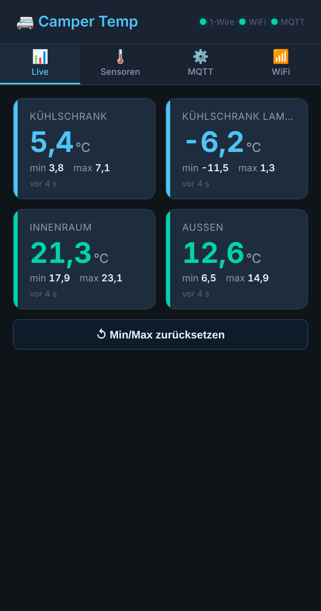
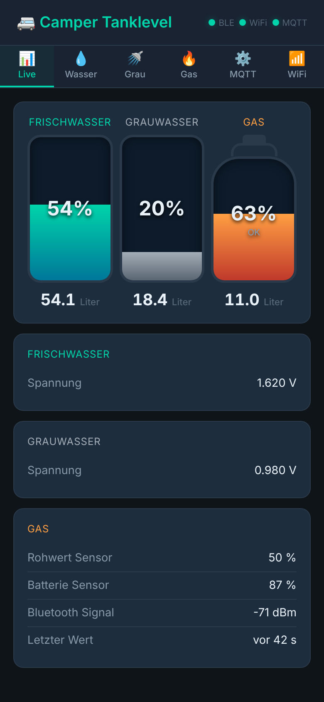
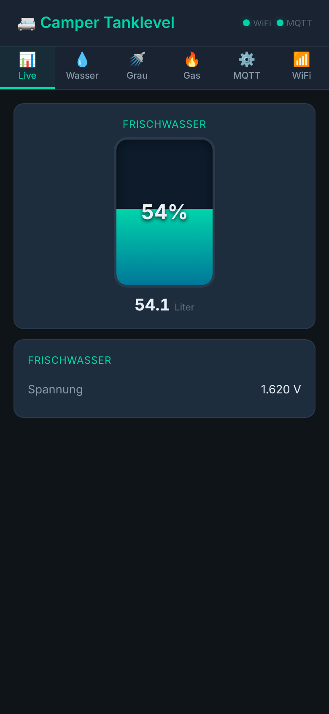
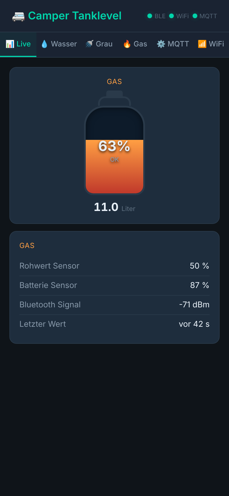
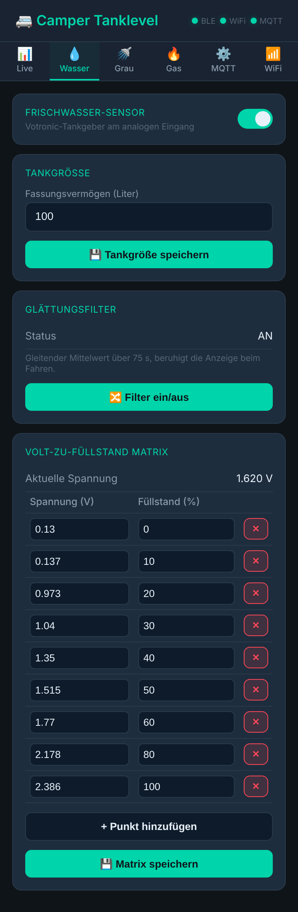
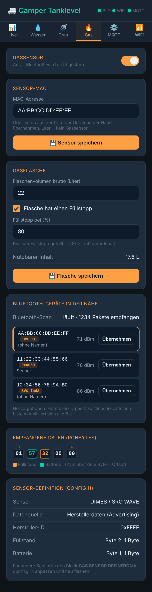
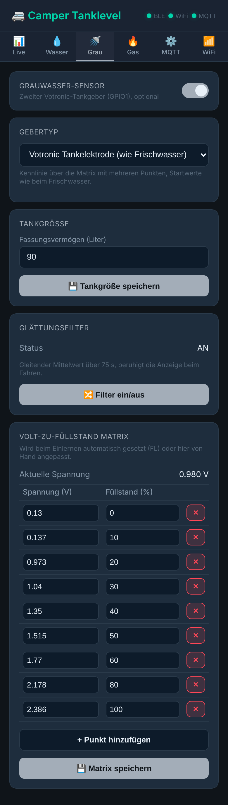
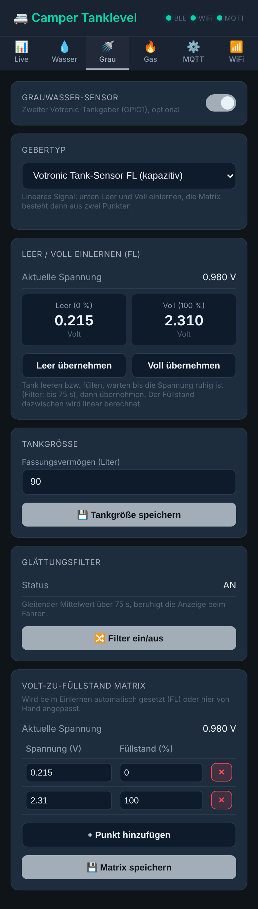
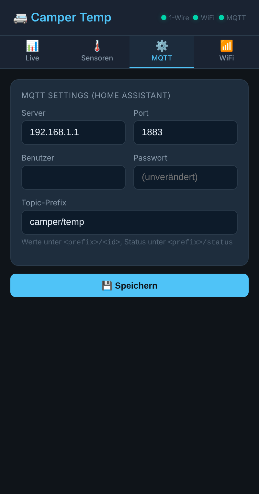
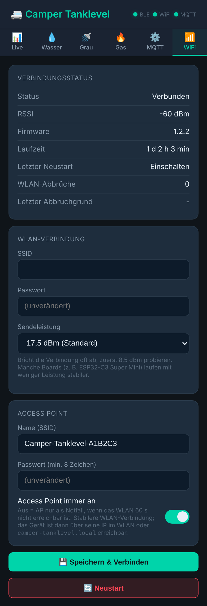

# Camper Tanklevel – Frischwasser, Grauwasser + Gas auf einem ESP32

Eine Firmware für **einen** ESP32-C3 (oder klassischen ESP32), die zwei Projekte zusammenfasst und um Grauwasser erweitert:

- **Frischwasser** aus [camper-waterlevel](https://github.com/hflocki/camper-waterlevel): Votronic-Tankgeber am analogen Eingang, Volt-zu-Füllstand-Matrix, Glättungsfilter
- **Grauwasser** (optional): zweiter Votronic-Geber, wahlweise Tankelektrode (wie Frischwasser) oder kapazitiver Tank-Sensor FL, mit eigener Tankgröße, Matrix und Filter
- **Gas** aus [camper-gaslevel](https://github.com/hflocki/camper-gaslevel): BLE-Gassensor (Standard: Rotarex DIMES / SRG WAVE), passiv über Bluetooth-Advertising, Füllstopp-Berechnung

Alle Werte gehen per **MQTT** (mit Home-Assistant-Discovery) raus und sind in einer gemeinsamen **Web-Oberfläche** zu sehen und einzustellen. Jeder Sensor lässt sich einzeln ein- und ausschalten.

## Web-Oberfläche

**Live**

| Wasser + Gas (Standard) | Wasser + Grau + Gas |
| --- | --- |
|  |  |

| Nur Wasser | Nur Gas |
| --- | --- |
|  |  |

**Einstellungen**

| Wasser | Gas |
| --- | --- |
|  |  |

| Grau: Tankelektrode | Grau: Tank-Sensor FL |
| --- | --- |
|  |  |

| MQTT | WiFi |
| --- | --- |
|  |  |

Die Bilder zeigen Beispieldaten.

## Ordner

```
_arduino/camper_tanklevel/        Sketch für die Arduino IDE (.ino + .cpp/.h)
_arduino/camper_tanklevel/web/    Quelle der Web-Oberfläche (index.html)
_arduino/camper_tanklevel/data/   LittleFS-Inhalt: index.html.gz (komprimiert, wird hochgeladen)
_platformio/                 platformio.ini, nutzt dieselben Quellen
```

| Datei | Inhalt |
| --- | --- |
| `config.h` | Pins, Standardwerte, **GAS SENSOR DEFINITION** (Byte-Zuordnung) |
| `water_sensor.cpp` | ADC für Frisch- und Grauwasser, gleitender Mittelwert, Interpolation über die Matrix |
| `gas_sensor.cpp` | NimBLE-Scan, Dekodierung, Geräteliste, Füllstopp |
| `mqtt_ha.cpp` | MQTT, HA-Discovery, Filter-Schalter |
| `webserver.cpp` | Web-UI (gzip), REST-API, Konfiguration in LittleFS |
| `wifi_manager.cpp` | WLAN mit AP-Fallback (Modem-Sleep für WiFi/BLE-Koexistenz) |

## Hardware

- ESP32-C3 Super Mini (getestet kompiliert) oder klassischer ESP32
| Sensor | ESP32-C3 | Klassischer ESP32 | `config.h` |
| --- | --- | --- | --- |
| Frischwasser (Votronic-Tankgeber) | **GPIO0** | GPIO34 | `ADC_PIN` |
| Grauwasser (Votronic-Tankgeber, optional) | **GPIO1** | GPIO35 | `GREY_ADC_PIN` |
| Gas (BLE) | keine Verkabelung, eingebautes Bluetooth | | |

Beide Tankeingänge müssen ADC1-Pins sein (ADC2 funktioniert nicht, solange WLAN aktiv ist). GPIO2 beim C3 nicht verwenden, das ist ein Boot-Pin. Verkabelung der Tankgeber wie im [camper-waterlevel](https://github.com/hflocki/camper-waterlevel#verkabelung) beschrieben, der Grauwasser-Geber bekommt eine eigene, gleich aufgebaute Messschaltung.

**Grauwasser-Geber** – im Tab **Grau** unter „Gebertyp“ wählbar (Werkseinstellung in `config.h`: `GREY_SENSOR_TYPE`):

| Gebertyp | Kalibrierung |
| --- | --- |
| Votronic Tankelektrode (wie Frischwasser) | Matrix mit mehreren Punkten, Startwerte wie beim Frischwasser |
| Votronic Tank-Sensor FL (kapazitiv) | Lineares Signal: bei leerem Tank „Leer übernehmen“, bei vollem Tank „Voll übernehmen“ |

Für Abwasser ist der kapazitive FL die robustere Wahl, weil sich Ablagerungen kaum auf den Messwert auswirken. Beim Wechsel des Gebertyps wird die Grauwasser-Matrix auf die Startwerte des Typs zurückgesetzt. Vor dem Anschluss mit dem Multimeter die Signalspannung bei leerem und vollem Tank prüfen: Liegt sie über ca. 2,5 V, ist ein Spannungsteiler nötig. Bei langer Leitung zum Tank hilft ein abgeschirmtes Kabel, der Glättungsfilter beruhigt den Wert zusätzlich.

## Arduino IDE

**Board-Einstellungen**

| Einstellung | Wert |
| --- | --- |
| Board | ESP32C3 Dev Module |
| USB CDC On Boot | Enabled |
| Flash Size | 4MB |
| Partition Scheme | ⚠️ **Minimal SPIFFS (1.9MB APP with OTA/190KB SPIFFS)** |

WiFi + Bluetooth ergeben ca. 1,43 MB Firmware und passen nicht in die Standard-Partition (1,2 MB).

**Libraries** (Bibliotheksverwalter)

| Library | Autor | getestet |
| --- | --- | --- |
| PubSubClient | Nick O'Leary | 2.8 |
| ArduinoJson | Benoit Blanchon | 7.4.2 |
| ESP Async WebServer | ESP32Async | 3.12.1 |
| Async TCP | ESP32Async | 3.5.0 |
| NimBLE-Arduino | h2zero | 2.5.1 |

Board-Paket: esp32 von Espressif, 3.x (getestet 3.3.9).

**LittleFS-Plugin installieren (einmalig)**

Die Arduino IDE 2.x kann von sich aus kein Dateisystem hochladen. Dafür braucht es das Plugin [arduino-littlefs-upload](https://github.com/earlephilhower/arduino-littlefs-upload) (Arduino IDE **2.2.1 oder neuer**, für die alte IDE 1.8 funktioniert es nicht).

1. Unter [Releases]([https://github.com/earlephilhower/arduino-littlefs-upload/releases/tag/1.6.3]) die Datei `arduino-littlefs-upload-x.y.z.vsix` herunterladen. **Nicht entpacken**, die `.vsix` bleibt so, wie sie ist.
2. In den Plugin-Ordner kopieren (Ordner vorher anlegen, falls es ihn nicht gibt):

   | System | Ordner |
   | --- | --- |
   | macOS / Linux | `~/.arduinoIDE/plugins/` |
   | Windows | `C:\Users\<Benutzername>\.arduinoIDE\plugins\` |

   Auf dem Mac im Terminal:
   ```bash
   mkdir -p ~/.arduinoIDE/plugins
   mv ~/Downloads/arduino-littlefs-upload-*.vsix ~/.arduinoIDE/plugins/
   ```
   Der Ordner beginnt mit einem Punkt und ist im Finder versteckt (`Cmd+Shift+.` blendet ihn ein).
3. Arduino IDE **komplett beenden** und neu starten. Danach taucht unter `Cmd+Shift+P` (Windows/Linux `Strg+Shift+P`) der Befehl **Upload LittleFS to Pico/ESP8266/ESP32** auf.

**Flashen**

1. In `config.h` `DEFAULT_OTA_PASSWORD` und `DEFAULT_AP_PASSWORD` ändern.
2. `camper_tanklevel.ino` öffnen. Der Ordner muss `camper_tanklevel` heißen, sonst will die IDE den Sketch verschieben.
3. Board-Einstellungen prüfen, vor allem **Partition Scheme: Minimal SPIFFS**. Port wählen.
4. Sketch hochladen.
5. **Serial Monitor schließen** (sonst ist der Port belegt).
6. `Cmd+Shift+P` → **Upload LittleFS to Pico/ESP8266/ESP32**.
7. ESP neu starten, Access Point `Camper-Tanklevel-XXXXXX` erscheint.

Der LittleFS-Upload überschreibt die gespeicherte Konfiguration (WLAN, MQTT, Matrix). Nach einem reinen Firmware-Update ist er nicht nötig, nur wenn sich die Web-Oberfläche geändert hat.


**Web-Oberfläche ändern:** Die Quelle ist `web/index.html`. Hochgeladen wird die komprimierte `data/index.html.gz` (ca. ein Viertel der Größe, lädt auf dem Handy deutlich schneller). Nach einer Änderung neu packen, dann LittleFS hochladen:

```
cd _arduino/camper_tanklevel
gzip -9 -n -c web/index.html > data/index.html.gz
```

PlatformIO erledigt das automatisch bei jedem Build (`_platformio/gzip_web.py`). Spätere Firmware-Updates gehen auch per OTA (`camper-tanklevel` unter Netzwerk-Ports).

## Erstbenutzung

1. Beim ersten Start läuft nur der Access Point **`Camper-Tanklevel-XXXXXX`** (Passwort aus `config.h`). `XXXXXX` sind die letzten 6 Stellen der WLAN-MAC des ESP, so lassen sich mehrere Geräte auseinanderhalten. Der Name ist im Tab WiFi änderbar.
2. Verbinden und `http://192.168.4.1` öffnen.
3. Tab **WiFi**: WLAN eintragen → Neustart.
4. Tab **MQTT**: Broker eintragen → Neustart.
5. Tab **Gas**: Sensor aus der Liste „Bluetooth-Geräte in der Nähe“ übernehmen, Flaschengröße und Füllstopp einstellen.
6. Tab **Wasser**: Tankgröße und ggf. Matrix anpassen (Standard: Votronic-Referenzwerte).
7. Optional Tab **Grau**: Grauwasser-Sensor einschalten (Neustart), Gebertyp wählen, Tankgröße einstellen und kalibrieren (Matrix bzw. Leer/Voll einlernen).

## Probleme beim Hochladen

**Firmware-Upload**

| Problem | Lösung |
| --- | --- |
| `Failed to connect to ESP32-C3` / `No serial data received` | ESP in den Flash-Modus bringen: **BOOT** gedrückt halten, kurz **RESET** drücken, BOOT loslassen, nochmal hochladen. |
| Kein Port in der IDE | Anderes USB-Kabel probieren, viele Kabel laden nur und übertragen keine Daten. Der C3 Super Mini braucht keinen Treiber, er meldet sich direkt per USB (Mac: `/dev/cu.usbmodem…`). |
| Port verschwindet nach dem Upload / anderer Port | Normal beim C3: der ESP startet neu und meldet sich neu am USB an. Port unter *Werkzeuge → Port* neu wählen. |
| `Sketch too big` / `text section exceeds available space` | Partition Scheme steht noch auf Default. **Minimal SPIFFS (1.9MB APP with OTA/190KB SPIFFS)** wählen. |
| Keine Ausgabe im Serial Monitor | *USB CDC On Boot* auf **Enabled**, 115200 Baud. Nach dem Ändern neu hochladen. |
| Kompilierfehler in `AsyncWebServer`/`AsyncTCP` | Falsche Library. Es muss die Version von **ESP32Async** sein (nicht die alte von me-no-dev). Alte Version im Bibliotheksverwalter entfernen. |
| Kompilierfehler mit `NimBLE`, z. B. `setScanCallbacks` | NimBLE-Arduino **1.x** installiert, nötig ist **2.x**. |
| Kompilierfehler mit `JsonDocument` | ArduinoJson **6.x** installiert, nötig ist **7.x**. |
| Viele Fehler in WiFi/ESP-Funktionen | Board-Paket esp32 **2.x** installiert, nötig ist **3.x**. |

**LittleFS-Upload (Web-Oberfläche)**

| Problem | Lösung |
| --- | --- |
| Befehl „Upload LittleFS…“ fehlt | Plugin liegt im falschen Ordner, ist entpackt, oder die IDE wurde nicht komplett neu gestartet. Siehe Installation oben. Arduino IDE 1.8 wird nicht unterstützt. |
| `Could not open <port>, the port doesn't exist` | Serial Monitor ist noch offen, schließen. Oder der Port hat sich nach dem Sketch-Upload geändert, neu wählen. |
| Upload läuft, bricht aber ab / falsches Board | Bekannter Fehler der IDE beim zuerst geöffneten Sketch: Board einmal auf irgendetwas anderes umstellen und wieder zurück, dann erneut versuchen. |
| Web-Seite zeigt nur „Please upload the LittleFS image“ | LittleFS wurde nicht hochgeladen, oder das Partition Scheme wurde nach dem LittleFS-Upload geändert. Mit **Minimal SPIFFS** Sketch und LittleFS beide nochmal hochladen. |
| Alte Web-Oberfläche nach Änderung | `web/index.html` geändert, aber nicht neu gepackt. `gzip`-Befehl oben ausführen, dann LittleFS hochladen. |

**Ohne Plugin:** Im Plugin gibt es auch **Build LittleFS image in sketch directory**, das erzeugt `mklittlefs.bin`. Die Datei lässt sich mit [esptool](https://github.com/espressif/esptool) direkt schreiben (`pip install esptool`):

```bash
esptool --chip esp32c3 --port /dev/cu.usbmodemXXXX write-flash 0x3D0000 mklittlefs.bin
```

`0x3D0000` ist die Startadresse des Dateisystems im Partition Scheme *Minimal SPIFFS*.

**Update per WLAN (OTA)**

| Problem | Lösung |
| --- | --- |
| Netzwerk-Port `camper-tanklevel` erscheint nicht | Rechner und ESP müssen im selben Netz sein. mDNS wird manchmal von Routern oder Gastnetzen blockiert. Unter macOS beim ersten Mal die Firewall-Abfrage für die Arduino IDE erlauben. |
| Passwortabfrage schlägt fehl | Es gilt `DEFAULT_OTA_PASSWORD` aus `config.h` in der Firmware, die **gerade auf dem ESP läuft**. |
| LittleFS per WLAN | Geht mit dem Arduino-Plugin nicht, nur per USB. PlatformIO kann es: `pio run -e esp32-c3-ota -t uploadfs`. |

**PlatformIO**

| Problem | Lösung |
| --- | --- |
| `platformio.ini` wird nicht gefunden | In VS Code den Ordner **`_platformio`** öffnen, nicht das ganze Repo. |
| Erster Build dauert sehr lange | Normal: Plattform, Toolchain und Libraries werden einmalig geladen (einige hundert MB). |
| Web-Oberfläche hochladen | In der PlatformIO-Seitenleiste unter *esp32-c3 → Platform* **Upload Filesystem Image**, oder `pio run -e esp32-c3 -t uploadfs`. Das gzip-Packen passiert automatisch. |


## MQTT / Home Assistant

Prefix (Web-UI) Standard `camper/tanklevel`:

| Topic | Wert |
| --- | --- |
| `<prefix>/status` | `online` / `offline` (Last Will) |
| `<prefix>/rssi` | WLAN-Signal |
| `<prefix>/water/liters`, `percent`, `voltage` | Frischwasser |
| `<prefix>/water/filter_active` | `ON` / `OFF` |
| `<prefix>/cmd/water/filter/set` | `ON` / `OFF` / `TOGGLE` |
| `<prefix>/grey/liters`, `percent`, `voltage` | Grauwasser (nur wenn eingeschaltet) |
| `<prefix>/grey/filter_active` | `ON` / `OFF` |
| `<prefix>/cmd/grey/filter/set` | `ON` / `OFF` / `TOGGLE` |
| `<prefix>/gas/level`, `raw_level`, `content` | Gas (nur nach erstem gültigen Wert) |
| `<prefix>/gas/battery`, `ble_rssi`, `ble_state` | Gassensor |

In Home Assistant erscheint **ein** Gerät „Camper Tanklevel“ mit allen Entitäten.

**Umstieg von den Einzelprojekten:** Die alten Geräte „Camper Wasserlevel Sensor“ und „Camper Gaslevel Sensor“ bleiben in HA stehen, weil ihre Discovery-Nachrichten retained sind. Zum Entfernen in HA unter *Einstellungen → Geräte* löschen oder die Topics `homeassistant/sensor/camper_water/#`, `homeassistant/switch/camper_water/#` und `homeassistant/sensor/camper_gaslevel/#` mit leerer Nachricht (retained) überschreiben.

## Sensoren ein- und ausschalten

Frischwasser und Gas sind standardmäßig an, Grauwasser ist aus. Jede Kombination ist möglich:

- **In `config.h`** (Werkseinstellung beim ersten Start):
  ```cpp
  #define WATER_ENABLED         1      // 1 = on, 0 = off
  #define GREY_ENABLED          0      // 1 = on, 0 = off
  #define GAS_ENABLED           1      // 1 = on, 0 = off
  ```
- **In der Web-UI:** oben im Tab **Wasser**, **Grau** bzw. **Gas** gibt es einen Schalter. Danach startet das Gerät neu.

Ein ausgeschalteter Sensor verschwindet von der Live-Seite und aus Home Assistant (die Entitäten werden per MQTT entfernt). Ist Gas aus, wird Bluetooth gar nicht gestartet.

## Anderer Gassensor

Block **GAS SENSOR DEFINITION** in `config.h` anpassen (Datenquelle, Hersteller-ID/UUID, Byte-Offsets). Der Tab **Gas** zeigt die empfangenen Rohbytes mit Offsets, damit sich die Zuordnung leicht finden lässt.

## Batterie des Gassensors

Der ESP scannt **passiv**: Er hört nur die Advertising-Pakete mit, die der Sensor ohnehin regelmäßig sendet. Es gibt keine Scan-Anfragen, keine Verbindung und kein Pairing. Die Batterielaufzeit des Sensors ändert sich dadurch nicht.

## Serieller Monitor

115200 Baud. Befehle: `read`, `scan` (BLE-Geräte), `filter` (Frischwasser-Filter umschalten), `help`.

## Versionen

Die laufende Version steht in der Web-UI im Tab **WiFi** und in Home Assistant in der Geräteinfo. Bei Änderungen `FW_VERSION` in `config.h` hochzählen.

| Version | Änderungen |
| --- | --- |
| 1.2.1 | Web-UI gzip-komprimiert (Quelle jetzt in `web/`), kompakte Tab-Leiste (Symbol über Text, passt bis 320 px) |
| 1.2.0 | Optionaler Grauwasser-Sensor an GPIO1: Votronic Tankelektrode oder Tank-Sensor FL (mit Leer/Voll-Einlernen), eigene Tankgröße, Matrix und Filter |
| 1.1.0 | Sensoren einzeln abschaltbar (`config.h` und Web-UI), AP-Name mit MAC-Endung, Live-Seite nur mit Anzeigen, Filter im Tab Wasser |
| 1.0.0 | Erste kombinierte Version aus camper-waterlevel und camper-gaslevel |

## Lizenz

MIT
