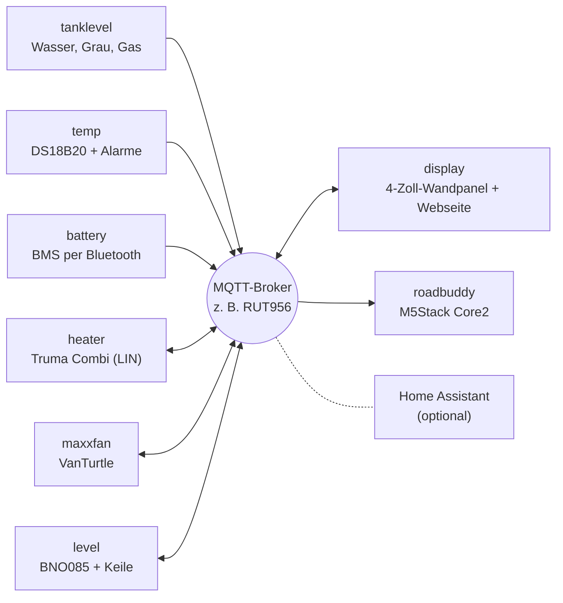

# camper-mqtt

Elektronik für den Camper, die über **MQTT** zusammenspielt: Tanks, Temperaturen, Batterien, Heizung, Dachlüfter, Ausrichtung und zwei Displays. Jedes Gerät ist ein ESP8266/ESP32 mit reiner **Arduino**-Firmware (kein ESPHome), eigener Web-Oberfläche und Home-Assistant-Discovery. Home Assistant ist optional: Die Geräte und Displays reden direkt über den Broker miteinander, z. B. den MQTT-Broker des LTE-Routers.



## Geräte

| Ordner | Hardware | Aufgabe | Basis-Topic |
| --- | --- | --- | --- |
| [`firmware/tanklevel`](firmware/tanklevel) | ESP32-C3 | Frischwasser + Grauwasser (Votronic), Gasflasche (BLE) | `camper/tanklevel` |
| [`firmware/temp`](firmware/temp) | ESP8266 / ESP32-C3 | bis zu 8 DS18B20 (Kühlschrank, Gefrierfach …) mit Alarm-Grenzwerten | `camper/temp` |
| [`firmware/battery`](firmware/battery) | ESP32-C3 | Batterie-BMS per Bluetooth (Daly, Ective BM X): Ladestand, Strom, Zellen | `camper/battery` |
| [`firmware/heater`](firmware/heater) | ESP32 + LIN-Transceiver | Truma Combi / Vario Heat als iNet Box am CP Plus | `camper/heater` |
| [`firmware/maxxfan`](firmware/maxxfan) | ESP32-C3 + VanTurtle | MaxxFan-Dachlüfter | `camper/maxxfan` |
| [`firmware/level`](firmware/level) | ESP32 + BNO085 | Längs-/Querneigung und Keilhöhe für jedes Rad (Fork des Levelsensors von klehnst) | `camper/level` |
| [`firmware/display`](firmware/display) | Guition ESP32-4848S040 | 4"-Wandpanel + gleiche Webseite fürs Handy, zeigt und steuert alles, Wetter, Warnungen | `camper/display` |
| [`firmware/roadbuddy`](firmware/roadbuddy) | M5Stack Core2 | kleines Akku-Display: Ausrichtung, Wasser, Gas | – (nur Empfänger) |

Dazu, nicht in diesem Repo:

- **Router-Daten (GPS, Mobilfunk):** Der RUT956 sendet sie selbst per MQTT, siehe [Router-Daten im Display-README](firmware/display/README.md#router-daten-rut956).

Hinweise für KI-Assistenten und Mitwirkende (Arbeitsweise, Bauen, Patches): [`AGENTS.md`](AGENTS.md).

Jeder Ordner ist für sich vollständig: eigene README mit Hardware, Board-Einstellungen, Bibliotheken und Topics, Arduino-Sketch unter `_arduino/` (bzw. `truma_heater/`), teils zusätzlich PlatformIO unter `_platformio/`.

## Mockups

Unter [`docs/mockups/`](docs/mockups/index.html) liegt von jeder Weboberfläche ein klickbares Mockup: die echte Seite aus der Firmware mit simulierten Daten. Knöpfe, Einstellungen, Speichern und Upload reagieren wie am Gerät, es wird aber nichts gesendet. `index.html` zeigt alle Geräte nebeneinander in Handygröße; die Geräte-Links im Display-Mockup führen zu den anderen Mockups.

Zum Ansehen den Ordner herunterladen und `index.html` im Browser öffnen. Nach Änderungen an einer Weboberfläche neu erzeugen (nur Python-Standardbibliothek, kein venv nötig):

```bash
python3 tools/mockups/make_mockups.py
```

Die Beispieldaten und das simulierte Verhalten stehen je Gerät in `tools/mockups/mock/<gerät>.js`, der gemeinsame Teil (fetch, WebSocket, Upload) in `core.js`. Bei einem neuen Gerät dort eine Datei anlegen und es in `make_mockups.py` eintragen. Der Road Buddy hat keine Weboberfläche und fehlt deshalb.

## Neues Gerät

[`firmware/_template`](firmware/_template) ist ein lauffähiges Muster-Gerät mit allem Gemeinsamen (WLAN mit Setup-WLAN, Web-Oberfläche, Einstellungen, MQTT mit Home-Assistant-Discovery, Updates ohne USB). Ein Befehl kopiert es als neues Gerät, danach füllst du nur noch den Sensor-Teil (`sensor.cpp`). Anleitung: [`firmware/_template/ANLEITUNG.md`](firmware/_template/ANLEITUNG.md).

```bash
python firmware/_template/tools/new_device.py waste "Abwasser"
```

## Gemeinsame Regeln

Alle Geräte halten sich an dasselbe Schema, damit Displays und Home Assistant sie ohne Sonderfälle verstehen:

| Was | Wie |
| --- | --- |
| Topics | `camper/<gerät>/…`, Werte **retained** |
| Verfügbarkeit | `camper/<gerät>/status` = `online` / `offline` als Last Will (retained, QoS 1) |
| Befehle | `…/cmd/…` bzw. `…/set/…`, nicht retained |
| Home Assistant | Auto-Discovery unter `homeassistant/…`, ein Gerät pro Firmware |
| Einrichtung | Ohne WLAN-Daten startet ein Access Point `Camper-<Gerät>-XXXXXX`, Einstellungen im Browser unter `http://192.168.4.1` |
| Web-Oberfläche | Gleiche Optik auf allen Geräten, optionaler Login (HTTP Basic Auth); Login vergessen → `noauth` im seriellen Monitor bzw. Werkseinstellungen |
| Firmware-Version | `FW_VERSION` in der `config.h` des Geräts, sichtbar im Web-UI und in HA |

## Eigene Einstellungen (`config_local.h`)

Passwörter, WLAN und Broker gehören nicht ins Repo. Jedes Gerät hat dafür neben seiner `config.h` eine Vorlage `config_local.h.example`:

```bash
cd firmware/temp/_arduino/camper_temp
cp config_local.h.example config_local.h   # then edit
```

Alles, was in `config_local.h` steht, gilt statt des Standardwerts aus `config.h`. Die Datei ist per `.gitignore` ausgeschlossen, landet also nie auf GitHub, und Updates oder Patches überschreiben sie nicht. Typisch:

| Wert | Wirkung |
| --- | --- |
| `DEFAULT_AP_PASSWORD` | Passwort des Setup-Access-Points |
| `DEFAULT_OTA_PASSWORD` | Passwort für Updates über den Netzwerk-Port der Arduino IDE |
| `DEFAULT_WIFI_SSID` / `DEFAULT_WIFI_PASSWORD` | WLAN, mit dem sich ein frisch geflashtes Gerät sofort verbindet |
| `DEFAULT_MQTT_SERVER`, `_USER`, `_PASSWORD` | Broker ab Werk |
| `DEFAULT_WEB_USER` / `DEFAULT_WEB_PASSWORD` | Login für die Web-Oberfläche ab Werk |

Außerdem lässt sich jeder andere Wert aus `config.h` überschreiben (Pins, Prefix, Tankgröße …).

Wichtig: WLAN, MQTT und Login ab Werk wirken nur, solange auf dem Gerät noch nichts gespeichert ist. Ein normales Update über bestehende Einstellungen ändert sie nicht. Neu übernommen werden sie nach **Werkseinstellungen** im Web-UI, nach dem Flashen mit **Erase All Flash Before Sketch Upload: Enabled** (Arduino IDE, Menü Werkzeuge) bzw. bei temp, tanklevel, level und battery nach dem Hochladen des LittleFS-Images. Die Passwörter für Access Point und OTA gelten dagegen immer sofort.

Der Road Buddy hat keine Web-Oberfläche; dort ist die ganze `config.h` schon die persönliche Datei (Vorlage `config.example.h`).

## Warnungen

`firmware/temp` meldet überschrittene Grenzwerte (z. B. „Kühlschrank über 8 °C seit 15 min“) unter `camper/temp/alarm_text`. Das Wandpanel zeigt diese, Heizungsfehler, Batterie- und Wetter-Warnungen in der Status-Kachel und als gelbes Band in der Kopfzeile, auf Wunsch auch per Pushover. Den Bildschirm weckt eine Warnung nur, wenn das in den Display-Einstellungen eingeschaltet ist. In Home Assistant gibt es dieselben Alarme als Binärsensoren.

## Fertige Firmware

Jeder Push baut alle Geräte per GitHub Actions ([`.github/workflows/build.yml`](.github/workflows/build.yml)), mit genau den Board-Paket- und Bibliotheksversionen aus den Geräte-READMEs. Die `.bin` liegt beim jeweiligen Lauf im Reiter **Actions** zum Download.

Ein Release für **ein** Gerät entsteht mit einem Tag `<gerät>-v<version>`:

```bash
git tag temp-v1.1.0
git push origin temp-v1.1.0
```

Dann wird nur dieses Gerät gebaut und die `.bin` ans Release gehängt. Heizung, MaxxFan und Display spielen sie direkt über ihr Web-UI ein; temp, tanklevel, level und battery per USB oder Arduino-OTA. Bei temp, tanklevel, level, battery und MaxxFan liegt die Web-Oberfläche zusätzlich als LittleFS-Image in `data/`.

## Nur ein Gerät nachbauen

Einfach den Ordner des Geräts nehmen und dessen README folgen. Wer nicht das ganze Repo laden will:

```bash
git clone --filter=blob:none --sparse https://github.com/hflocki/camper-mqtt.git
cd camper-mqtt
git sparse-checkout set firmware/temp
```

## Herkunft

Die Geräte waren vorher einzelne Repos (`camper-tanklevel`, `camper-temp`, `camper-heater`, `camper-maxxfan`, `camper-display`, `m5core2-roadbuddy`). Sie wurden mit ihrer kompletten Git-Historie hierher übernommen; die alten Repos sind archiviert.

## Lizenzen

Jeder Ordner behält seine Lizenz:

| Ordner | Lizenz |
| --- | --- |
| `firmware/battery` | Apache-2.0 (Protokolle portiert aus [aiobmsble](https://github.com/patman15/aiobmsble)) |
| `firmware/heater` | GPL-3.0 (Protokoll-Logik portiert aus GPL-Projekten, siehe dortige README) |
| `firmware/level` | MIT [klehnst](https://github.com/klehnst/ESP32-Adrafruit-BNO085-HomeAssistant-Caravan-Levelsensor-MQTT), |
| `firmware/tanklevel`, `temp`, `maxxfan`, `display` | MIT |
| `firmware/roadbuddy` | MIT |
