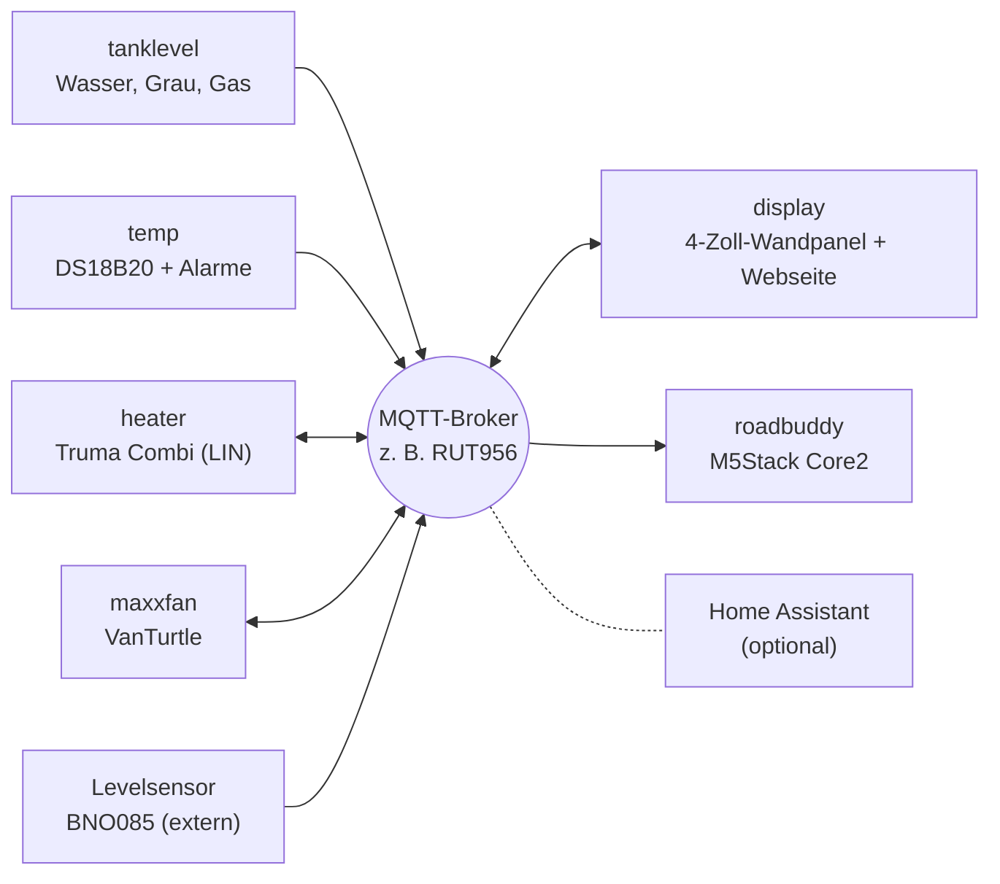

# camper-mqtt

Elektronik für den Camper, die über **MQTT** zusammenspielt: Tanks, Temperaturen, Heizung, Dachlüfter, Ausrichtung und zwei Displays. Jedes Gerät ist ein ESP8266/ESP32 mit reiner **Arduino**-Firmware (kein ESPHome), eigener Web-Oberfläche und Home-Assistant-Discovery. Home Assistant ist optional: Die Geräte und Displays reden direkt über den Broker miteinander, z. B. den MQTT-Broker des LTE-Routers.



## Geräte

| Ordner | Hardware | Aufgabe | Basis-Topic |
| --- | --- | --- | --- |
| [`firmware/tanklevel`](firmware/tanklevel) | ESP32-C3 | Frischwasser + Grauwasser (Votronic), Gasflasche (BLE) | `camper/tanklevel` |
| [`firmware/temp`](firmware/temp) | ESP8266 / ESP32-C3 | bis zu 8 DS18B20 (Kühlschrank, Gefrierfach …) mit Alarm-Grenzwerten | `camper/temp` |
| [`firmware/heater`](firmware/heater) | ESP32 + LIN-Transceiver | Truma Combi / Vario Heat als iNet Box am CP Plus | `camper/heater` |
| [`firmware/maxxfan`](firmware/maxxfan) | ESP32-C3 + VanTurtle | MaxxFan-Dachlüfter | `camper/maxxfan` |
| [`firmware/display`](firmware/display) | Guition ESP32-4848S040 | 4"-Wandpanel + gleiche Webseite fürs Handy, zeigt und steuert alles, Warnungen | `camper/display` |
| [`firmware/roadbuddy`](firmware/roadbuddy) | M5Stack Core2 | kleines Akku-Display: Ausrichtung, Wasser, Gas | – (nur Empfänger) |

Dazu, nicht in diesem Repo:

- **Levelsensor:** [ESP32-Adafruit-BNO085 Caravan-Levelsensor](https://github.com/klehnst/ESP32-Adrafruit-BNO085-HomeAssistant-Caravan-Levelsensor-MQTT) von klehnst. In seiner Weboberfläche den MQTT-Prefix auf `camper/level` stellen (ab Werk `wowa/level`).
- **Router-Daten (GPS, Mobilfunk):** Der RUT956 sendet sie selbst per MQTT, siehe [Router-Daten im Display-README](firmware/display/README.md#router-daten-rut956).

Jeder Ordner ist für sich vollständig: eigene README mit Hardware, Board-Einstellungen, Bibliotheken und Topics, Arduino-Sketch unter `_arduino/` (bzw. `truma_heater/`), teils zusätzlich PlatformIO unter `_platformio/`.

## Gemeinsame Regeln

Alle Geräte halten sich an dasselbe Schema, damit Displays und Home Assistant sie ohne Sonderfälle verstehen:

| Was | Wie |
| --- | --- |
| Topics | `camper/<gerät>/…`, Werte **retained** |
| Verfügbarkeit | `camper/<gerät>/status` = `online` / `offline` als Last Will (retained, QoS 1) |
| Befehle | `…/cmd/…` bzw. `…/set/…`, nicht retained |
| Home Assistant | Auto-Discovery unter `homeassistant/…`, ein Gerät pro Firmware |
| Einrichtung | Ohne WLAN-Daten startet ein Access Point `Camper-<Gerät>-XXXXXX`, Einstellungen im Browser unter `http://192.168.4.1` |
| Web-Oberfläche | Gleiche Optik auf allen Geräten, optionaler Login (HTTP Basic Auth); Login vergessen → `noauth` im seriellen Monitor bzw. Werkseinstellungen |
| Firmware-Version | `FW_VERSION` in der `config.h` des Geräts, sichtbar im Web-UI und in HA |

## Warnungen

`firmware/temp` meldet überschrittene Grenzwerte (z. B. „Kühlschrank über 8 °C seit 15 min“) unter `camper/temp/alarm_text`. Das Wandpanel zeigt diese und Heizungsfehler als rote Leiste, weckt dafür den Bildschirm und schaltet auf die Übersicht. In Home Assistant gibt es dieselben Alarme als Binärsensoren.

## Fertige Firmware

Jeder Push baut alle Geräte per GitHub Actions ([`.github/workflows/build.yml`](.github/workflows/build.yml)), mit genau den Board-Paket- und Bibliotheksversionen aus den Geräte-READMEs. Die `.bin` liegt beim jeweiligen Lauf im Reiter **Actions** zum Download.

Ein Release für **ein** Gerät entsteht mit einem Tag `<gerät>-v<version>`:

```bash
git tag temp-v1.1.0
git push origin temp-v1.1.0
```

Dann wird nur dieses Gerät gebaut und die `.bin` ans Release gehängt. Heizung, MaxxFan und Display spielen sie direkt über ihr Web-UI ein; temp und tanklevel per USB oder Arduino-OTA (deren Web-Oberfläche liegt zusätzlich als LittleFS-Image in `data/`).

## Nur ein Gerät nachbauen

Einfach den Ordner des Geräts nehmen und dessen README folgen. Wer nicht das ganze Repo laden will:

```bash
git clone --filter=blob:none --sparse https://github.com/hflocki/camper-mqtt.git
cd camper-mqtt
git sparse-checkout set firmware/temp
```

## Herkunft

Die Geräte waren vorher einzelne Repos (`camper-tanklevel`, `camper-temp`, `camper-heater`, `camper-maxxfan`, `camper-display`, `m5core2-roadbuddy`). Sie wurden mit ihrer kompletten Git-Historie hierher übernommen; die alten Repos sind archiviert.

## Lizenzen

Jeder Ordner behält seine Lizenz:

| Ordner | Lizenz |
| --- | --- |
| `firmware/heater` | GPL-3.0 (Protokoll-Logik portiert aus GPL-Projekten, siehe dortige README) |
| `firmware/tanklevel`, `temp`, `maxxfan`, `display` | MIT |
| `firmware/roadbuddy` | MIT |
