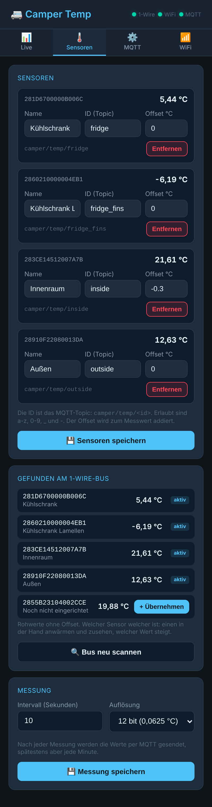

# Camper Temp – DS18B20-Temperaturen per MQTT und Web-Oberfläche

Firmware für einen ESP8266 (ESP-12E, NodeMCU, Wemos D1 mini) oder ESP32-C3, die bis zu **8 DS18B20-Temperatursensoren** an einem 1-Wire-Bus ausliest – z. B. Kühlschrank, Gefrierfach, Innenraum und außen.

- Sensoren werden am Bus **automatisch gefunden** und in der Web-UI benannt, keine Adressen im Code
- Werte per **MQTT** mit Home-Assistant-Discovery
- Web-Oberfläche mit Live-Werten, Min/Max seit Start, Offset-Korrektur je Sensor
- Gleicher Aufbau wie [camper-tanklevel](https://github.com/hflocki/camper-tanklevel): Access Point beim ersten Start, WLAN/MQTT im Browser einstellen, OTA-Updates

## Web-Oberfläche

| Live | Sensoren |
|---|---|
|  |  |

| MQTT | WiFi |
|---|---|
|  |  |

Die Bilder zeigen Beispieldaten.

## Ordner

```
_arduino/camper_temp/        Sketch für die Arduino IDE (.ino + .cpp/.h)
_arduino/camper_temp/web/    Quelle der Web-Oberfläche (index.html)
_arduino/camper_temp/data/   LittleFS-Inhalt: index.html.gz (komprimiert, wird hochgeladen)
_platformio/                 platformio.ini, nutzt dieselben Quellen
```

| Datei | Inhalt |
|---|---|
| `config.h` | Pin, Standardwerte, Anzahl Sensoren |
| `temp_sensor.cpp` | 1-Wire-Busscan, nicht blockierende Messung, Plausibilitätsprüfung, Min/Max |
| `mqtt_ha.cpp` | MQTT, HA-Discovery, Aufräumen gelöschter/umbenannter Sensoren |
| `webserver.cpp` | Web-UI (gzip), REST-API, Konfiguration in LittleFS |
| `wifi_manager.cpp` | WLAN mit AP-Fallback (ESP8266 und ESP32) |

## Hardware

| | ESP8266 (NodeMCU / D1 mini) | ESP32-C3 |
|---|---|---|
| DS18B20 DATA | **GPIO4** (D2) | GPIO4 |
| DS18B20 VDD | 3,3 V | 3,3 V |
| DS18B20 GND | GND | GND |

Zwischen DATA und 3,3 V gehört **ein 4,7-kΩ-Pull-up** (einmal pro Bus, nicht pro Sensor). Alle Sensoren hängen parallel an denselben drei Leitungen. Bei langen Leitungen (> 5 m) oder vielen Sensoren ggf. 2,2 kΩ verwenden. Beim ESP8266 GPIO0, GPIO2 und GPIO15 meiden (Boot-Pins). Anderer Pin: `ONEWIRE_PIN` in `config.h`.

## Arduino IDE

**Board-Einstellungen (ESP8266)**

| Einstellung | Wert |
|---|---|
| Board | NodeMCU 1.0 (ESP-12E Module) bzw. LOLIN(WEMOS) D1 R2 & mini |
| Flash Size | **4MB (FS:1MB OTA:~1019KB)** |

Board-Paket: esp8266 von ESP8266 Community, 3.1.x (getestet 3.1.2).
Für ESP32-C3: Board „ESP32C3 Dev Module“, USB CDC On Boot „Enabled“, Standard-Partition reicht (ca. 1,2 MB Firmware).

**Libraries** (Bibliotheksverwalter)

| Library | Autor | getestet |
|---|---|---|
| OneWire | Paul Stoffregen | 2.3.8 |
| DallasTemperature | Miles Burton | 4.0.6 |
| PubSubClient | Nick O'Leary | 2.8 |
| ArduinoJson | Benoit Blanchon | 7.4.2 |
| ESP Async WebServer | ESP32Async | 3.12.1 |
| ESP Async TCP (nur ESP8266) | ESP32Async | 2.0.0 |
| Async TCP (nur ESP32) | ESP32Async | 3.5.0 |

**Flashen**

1. In `config.h` `DEFAULT_OTA_PASSWORD` und `DEFAULT_AP_PASSWORD` ändern.
2. `camper_temp.ino` öffnen, Flash Size prüfen, hochladen.
3. Serial Monitor schließen, `Cmd+Shift+P` → **Upload LittleFS to Pico/ESP8266/ESP32** (Plugin [arduino-littlefs-upload](https://github.com/earlephilhower/arduino-littlefs-upload)).

Der LittleFS-Upload überschreibt die gespeicherte Konfiguration.

**Web-Oberfläche ändern:** Quelle ist `web/index.html`, hochgeladen wird `data/index.html.gz`. Nach einer Änderung neu packen, dann LittleFS hochladen:

```
cd _arduino/camper_temp
gzip -9 -n -c web/index.html > data/index.html.gz
```

PlatformIO erledigt das automatisch bei jedem Build (`_platformio/gzip_web.py`). Spätere Firmware-Updates gehen auch per OTA (`camper-temp` unter Netzwerk-Ports).

## Erstbenutzung

1. Beim ersten Start läuft nur der Access Point **`Camper-Temp-XXXXXX`** (Passwort aus `config.h`). `XXXXXX` sind die letzten 6 Stellen der WLAN-MAC.
2. Verbinden und `http://192.168.4.1` öffnen.
3. Tab **WiFi**: WLAN eintragen → Neustart.
4. Tab **MQTT**: Broker eintragen → Neustart.
5. Tab **Sensoren**: Unter „Gefunden am 1-Wire-Bus“ jeden Sensor mit **+ Übernehmen** hinzufügen, Name und ID vergeben, **Sensoren speichern**. Welcher Sensor welcher ist: einen in der Hand anwärmen und zusehen, welcher Wert steigt.

Eine feste IP vergibt man am einfachsten als DHCP-Reservierung im Router; im Netz ist das Gerät auch als `camper-temp.local` erreichbar.

## MQTT / Home Assistant

Prefix (Web-UI) Standard `camper/temp`:

| Topic | Wert |
|---|---|
| `<prefix>/status` | `online` / `offline` (Last Will) |
| `<prefix>/rssi` | WLAN-Signal |
| `<prefix>/<id>` | Temperatur in °C (2 Nachkommastellen), retained |
| `<prefix>/<id>/available` | `online` / `offline` – Sensor antwortet am Bus |

Gesendet wird nach jeder Messung (Intervall in der Web-UI, Standard 10 s), spätestens jede Minute. Liefert ein Sensor keinen gültigen Wert (abgezogen, Kabelbruch, 85-°C-Startwert), wird kein Wert gesendet und die Entität in HA als nicht verfügbar markiert.

In Home Assistant erscheint **ein** Gerät „Camper Temp“ mit einer Temperatur-Entität pro Sensor. Die `unique_id` basiert auf der Sensoradresse: Umbenennen oder eine neue ID behält die Historie. Wird ein Sensor entfernt, verschwindet auch seine Entität.

**Umstieg von ESPHome:** Das alte ESPHome-Gerät in HA unter *Einstellungen → Geräte & Dienste → ESPHome* löschen. Die Sensoradressen aus dem ESPHome-Log tauchen in der Web-UI unter „Gefunden am 1-Wire-Bus“ wieder auf (ESPHome schreibt sie in umgekehrter Byte-Reihenfolge: `0x0b000000671daa28` entspricht `28AA1D670000000B`).

## Serieller Monitor

115200 Baud. Befehle: `read` (Werte), `scan` (Bus neu durchsuchen), `bus` (gefundene Adressen), `help`.

## Versionen

Die laufende Version steht in der Web-UI im Tab **WiFi** und in Home Assistant in der Geräteinfo. Bei Änderungen `FW_VERSION` in `config.h` hochzählen.

| Version | Änderungen |
|---|---|
| 1.0.0 | Erste Version: bis zu 8 DS18B20, automatische Erkennung, Web-UI, MQTT mit HA-Discovery |

## Lizenz

MIT
