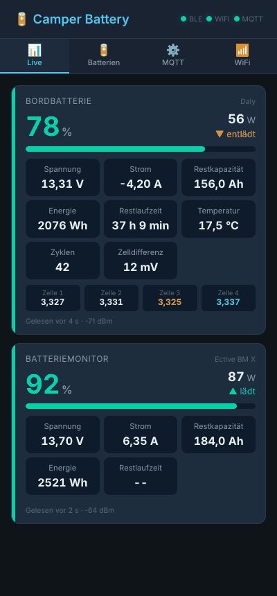
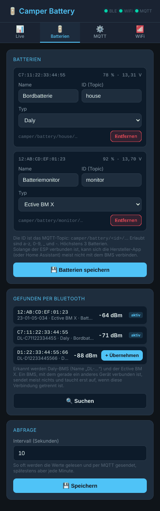

> [!WARNING]
> **IN ENTWICKLUNG – kein fertiges Projekt.** Mit echten BMS (Daly, Ective BM X) noch nicht getestet. Nutzung auf eigenes Risiko.

# Camper Battery – BMS per Bluetooth auslesen, Werte per MQTT

Firmware für einen ESP32-C3, der sich per Bluetooth mit bis zu **3 Batterie-BMS bzw. Batteriemonitoren** verbindet und ihre Werte per MQTT und in einer Web-Oberfläche bereitstellt – ohne ESPHome-Bluetooth-Proxy und ohne Home Assistant.

- Unterstützt: **Daly Smart BMS** (BLE-Name `DL-…`, beide Protokollvarianten) und **Ective BM X** Batteriemonitor (LiPower-Protokoll, Modbus RTU über BLE)
- BMS werden per Bluetooth **gesucht** und in der Web-UI übernommen, keine Adressen im Code
- Ladestand, Spannung, Strom, Leistung, Restkapazität, Energie, Restlaufzeit, bei Daly zusätzlich Zellspannungen, Zelldifferenz, Temperatur und Zyklen
- Werte per **MQTT** mit Home-Assistant-Discovery (ein HA-Gerät pro Batterie) und als JSON-Liste für Displays
- Optionaler Login für die Web-Oberfläche, Access Point beim ersten Start, OTA-Updates

Die Protokolle stammen aus [aiobmsble](https://github.com/patman15/aiobmsble) von Patrick Loschmidt (patman15), der Bibliothek hinter der Home-Assistant-Integration [BLE Battery Management](https://github.com/patman15/BMS_BLE-HA), und wurden nach C++ portiert.

## Web-Oberfläche

| Live | Batterien |
|---|---|
|  |  |

Die Bilder zeigen Beispieldaten. Die Tabs MQTT und WiFi sehen aus wie bei den anderen Geräten.

## Wie es funktioniert

BMS senden ihre Messwerte nicht von sich aus wie ein Gassensor. Man muss sich **verbinden** und sie abfragen. Der ESP hält deshalb zu jedem eingerichteten BMS eine **dauerhafte Bluetooth-Verbindung** und fragt alle 10 s ab (einstellbar 5–300 s). Bricht die Verbindung ab, verbindet er sich neu, bei Misserfolg mit wachsender Pause bis 2 min.

Solange der ESP verbunden ist, kann sich in der Regel **kein anderes Gerät** mit dem BMS verbinden: die Hersteller-App nicht und auch die BLE-Battery-Management-Integration in Home Assistant nicht. Zum Einrichten in der App die Batterie im ESP kurz entfernen oder den ESP stromlos machen. Wer bisher BMS_BLE in Home Assistant nutzt, löscht die dortigen Einträge, die Werte kommen dann per MQTT.

Die BLE-Arbeit läuft in einem eigenen Task. Web-Oberfläche und MQTT bleiben auch dann bedienbar, wenn ein Verbindungsaufbau einige Sekunden dauert.

## Ordner

```
_arduino/camper_battery/        Sketch für die Arduino IDE (.ino + .cpp/.h)
_arduino/camper_battery/web/    Quelle der Web-Oberfläche (index.html)
_arduino/camper_battery/data/   LittleFS-Inhalt: index.html.gz (komprimiert, wird hochgeladen)
```

| Datei | Inhalt |
|---|---|
| `config.h` | Standardwerte, Anzahl BMS, Zeiten |
| `bms_proto.cpp` | Protokolle: Anfragen bauen, Antworten prüfen (CRC) und dekodieren – ohne Arduino-Abhängigkeit |
| `bms_client.cpp` | BLE-Task: Suchen, Verbinden, Abfragen, Antworten zusammensetzen |
| `mqtt_ha.cpp` | MQTT, HA-Discovery, Aufräumen gelöschter/umbenannter Batterien |
| `webserver.cpp` | Web-UI (gzip), REST-API, Konfiguration in LittleFS |
| `wifi_manager.cpp` | WLAN mit AP-Fallback |

## Hardware

Ein **ESP32-C3** (z. B. Super Mini) reicht, sonst wird nichts angeschlossen. Jeder andere ESP32 mit Bluetooth LE geht auch (ESP32, ESP32-S3).

Empfehlung für den festen Einbau: **M5Stack AtomS3 Lite** (ESP32-S3). Zwei Kerne (WLAN und Bluetooth stören sich weniger), bessere Antenne als der C3 Super Mini, fertiges Gehäuse. Seine RGB-LED zeigt den Zustand:

| LED | Bedeutung |
| --- | --- |
| grün | alle eingerichteten BMS liefern Werte |
| gelb | mindestens ein BMS fehlt oder antwortet nicht |
| rot, blinkend | kein WLAN oder keine MQTT-Verbindung |
| blau | noch kein BMS eingerichtet (blinkend: Suche läuft) |

Die LED ist beim Board „M5AtomS3“ automatisch an. Andere Boards mit WS2812-LED: `STATUS_LED_PIN` in `config_local.h` setzen, Helligkeit mit `STATUS_LED_BRIGHTNESS` (Standard 24 von 255). Der ESP sollte nicht weiter als ein paar Meter von den BMS entfernt sein; Batteriekästen aus Metall dämpfen stark. Die Signalstärke jedes BMS steht in der Web-UI.

Mehr als 3 gleichzeitige Verbindungen erlaubt NimBLE in der Grundeinstellung nicht (`MAX_BMS` in `config.h`).

## Arduino IDE

> **Eigene Passwörter, WLAN und Broker:** `config_local.h.example` im Sketch-Ordner nach `config_local.h` kopieren und anpassen. Die Datei geht nicht nach GitHub. Details in der [Haupt-README](../../README.md#eigene-einstellungen-config_localh).

**Board-Einstellungen**

| Einstellung | ESP32-C3 Super Mini | M5Stack AtomS3 Lite |
|---|---|---|
| Board | ESP32C3 Dev Module | **M5AtomS3** (im esp32-Paket enthalten) |
| USB CDC On Boot | **Enabled** | **Enabled** |
| Flash Size | 4MB | 8MB |
| Partition Scheme | **Minimal SPIFFS (1.9MB APP with OTA/190KB SPIFFS)** | **8M with spiffs (3MB APP/1.5MB SPIFFS)** |

Board-Paket: esp32 von Espressif Systems, 3.3.x (getestet 3.3.2). Die Firmware ist ca. 1,4 MB groß, mit der Standard-Partition (1,2 MB) passt sie bei keinem der beiden. Wird der AtomS3 beim Hochladen nicht gefunden: Knopf am Gehäuse beim Einstecken des USB-Kabels ca. 2 s halten (Download-Modus).

**Libraries** (Bibliotheksverwalter)

| Library | Autor | getestet |
|---|---|---|
| NimBLE-Arduino | h2zero | 2.5.1 |
| PubSubClient | Nick O'Leary | 2.8 |
| ArduinoJson | Benoit Blanchon | 7.4.2 |
| ESP Async WebServer | ESP32Async | 3.12.1 |
| Async TCP | ESP32Async | 3.5.0 |

**Flashen**

1. `config_local.h` anlegen (siehe oben) oder in `config.h` `DEFAULT_OTA_PASSWORD` und `DEFAULT_AP_PASSWORD` ändern.
2. `camper_battery.ino` öffnen, Board-Einstellungen prüfen, hochladen.
3. Serial Monitor schließen, `Cmd+Shift+P` → **Upload LittleFS to Pico/ESP8266/ESP32** (Plugin [arduino-littlefs-upload](https://github.com/earlephilhower/arduino-littlefs-upload)).

Der LittleFS-Upload überschreibt die gespeicherte Konfiguration.

**Web-Oberfläche ändern:** Quelle ist `web/index.html`, hochgeladen wird `data/index.html.gz`:

```
cd _arduino/camper_battery
gzip -9 -n -c web/index.html > data/index.html.gz
```

Spätere Firmware-Updates gehen per OTA (`camper-battery` unter Netzwerk-Ports).

## Erstbenutzung

1. Beim ersten Start läuft nur der Access Point **`Camper-Battery-XXXXXX`**. `XXXXXX` sind die letzten 6 Stellen der WLAN-MAC.
2. Verbinden und `http://192.168.4.1` öffnen.
3. Tab **WiFi**: WLAN eintragen → Neustart.
4. Tab **MQTT**: Broker eintragen → Neustart.
5. Hersteller-App schließen und Home Assistant die Verbindung wegnehmen (BMS_BLE-Eintrag deaktivieren oder löschen).
6. Tab **Batterien** → **Suchen**. Gefundene BMS mit **+ Übernehmen** hinzufügen, Name und ID vergeben (z. B. „Bordbatterie“ / `house`), **Batterien speichern**.

Der Typ wird bei der Suche erkannt: Daly am Namen `DL-…`, der Ective BM X an seinem Bluetooth-Dienst `AF30` (sein Name ist meist ein Datum wie `23-01-05-034`). Er lässt sich in der Liste auch von Hand ändern.

## MQTT / Home Assistant

Prefix (Web-UI) Standard `camper/battery`, `<id>` ist die ID aus dem Tab Batterien:

| Topic | Wert |
|---|---|
| `<prefix>/status` | `online` / `offline` (Last Will) |
| `<prefix>/rssi` | WLAN-Signal |
| `<prefix>/<id>/available` | `online`, solange das BMS antwortet, sonst `offline` |
| `<prefix>/<id>/soc` | Ladestand in % |
| `<prefix>/<id>/voltage` | Spannung in V |
| `<prefix>/<id>/current` | Strom in A, **positiv = Laden**, negativ = Entladen |
| `<prefix>/<id>/power` | Leistung in W (Vorzeichen wie Strom) |
| `<prefix>/<id>/charge` | Restkapazität in Ah |
| `<prefix>/<id>/energy` | gespeicherte Energie in Wh (Spannung × Restkapazität) |
| `<prefix>/<id>/runtime` | Restlaufzeit in min beim Entladen, sonst `None` |
| `<prefix>/<id>/charging` | `ON` / `OFF` |
| `<prefix>/<id>/problem` | `ON`, wenn das BMS einen Fehler oder eine Schutzabschaltung meldet |
| `<prefix>/<id>/temperature` | Temperatur in °C, Mittel aller Fühler (nur Daly) |
| `<prefix>/<id>/cycles` | Ladezyklen (nur Daly) |
| `<prefix>/<id>/delta` | Differenz höchste − niedrigste Zelle in V (nur Daly) |
| `<prefix>/<id>/cell_1` … | Zellspannungen in V (nur Daly) |
| `<prefix>/batteries` | Alle Batterien als eine JSON-Liste für Displays: `[{"id":"house","name":"Bordbatterie","ok":true,"soc":78,"v":13.31,"a":-4.2,"w":-56}, …]` |

Alle Werte sind retained und werden nach jeder Abfrage gesendet, spätestens jede Minute. Antwortet ein BMS 2 Minuten lang nicht, wird es als nicht verfügbar gemeldet; die letzten Werte bleiben auf dem Broker stehen.

In Home Assistant erscheint ein Gerät „Camper Battery“ und darunter **ein Gerät pro Batterie** mit den Entitäten oben. Zellspannungen, Temperatur und Zyklen erscheinen nach der ersten Abfrage, wenn das BMS sie liefert. Die `unique_id` basiert auf der Bluetooth-Adresse: Umbenennen oder eine neue ID behält die Historie. Wird eine Batterie entfernt, verschwinden auch ihre Entitäten.

## Hinweise zu den BMS

**Daly:** Beide Protokollvarianten werden automatisch erkannt (ältere Module antworten auf `0xD2`, neuere auf `0x81`). Die MOSFET-Temperatur, die BMS_BLE zusätzlich abfragt, wird nicht gelesen; die Temperatur ist das Mittel der Batteriefühler.

**Ective BM X:** Das Gerät ist ein Batteriemonitor (Shunt), kein BMS: Zellspannungen, Temperatur und Zyklen gibt es dort nicht. Die Geräte-ID (`0x22`, `0x0B`, `0x08` oder `0x38`) wird beim ersten Abfragen erkannt. Die Laufzeit ist die Schätzung des Monitors selbst. Die Stromrichtung liest die Firmware aus Byte 12 der Antwort (1 = Entladen); BMS_BLE zeigt den Strom dort bisher immer negativ an. Stimmt das Vorzeichen beim Laden nicht, bitte die Rohdaten melden.

Weitere BMS-Typen aus aiobmsble (JBD, JK, Seplos, Topband/Ective-Akkus …) lassen sich nach demselben Muster in `bms_proto.cpp` ergänzen.

## Web-Login

Im Tab **MQTT** unter „Web-Oberfläche Login“ Benutzer und Passwort setzen. Dann fragt der Browser beim Öffnen danach (HTTP Basic Auth, gilt auch für die Live-Daten). Leerer Benutzer = kein Login. Login vergessen: im seriellen Monitor `noauth` senden.

## Serieller Monitor

115200 Baud. Befehle: `read` (Werte und Suchergebnisse), `scan` (Bluetooth-Suche), `noauth` (Web-Login entfernen), `help`.

## Versionen

Die laufende Version steht in der Web-UI im Tab **WiFi** und in Home Assistant in der Geräteinfo. Bei Änderungen `FW_VERSION` in `config.h` hochzählen.

| Version | Änderungen |
|---|---|
| 1.1.0 | Status-LED (M5Stack AtomS3 Lite automatisch, sonst `STATUS_LED_PIN`), AtomS3 als empfohlenes Board, CI-Build für ESP32-S3 |
| 1.0.0 | Erste Version: Daly Smart BMS und Ective BM X, bis zu 3 BMS, Web-UI, MQTT mit HA-Discovery |

## Fertige Firmware

Wird im Haupt-Repo per GitHub Actions gebaut, siehe [Fertige Firmware](../../README.md#fertige-firmware).

## Lizenz

Apache License 2.0, siehe [LICENSE](LICENSE). Die Protokoll-Logik ist aus [aiobmsble](https://github.com/patman15/aiobmsble) (Apache-2.0) von Patrick Loschmidt portiert.
