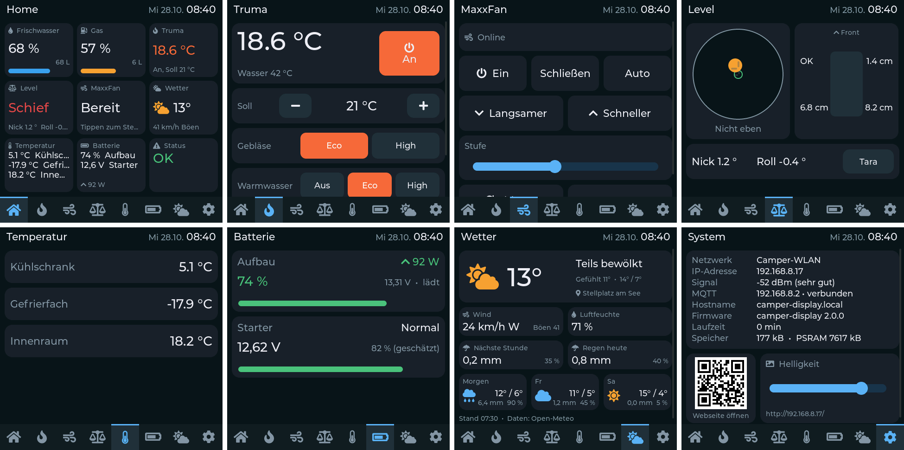
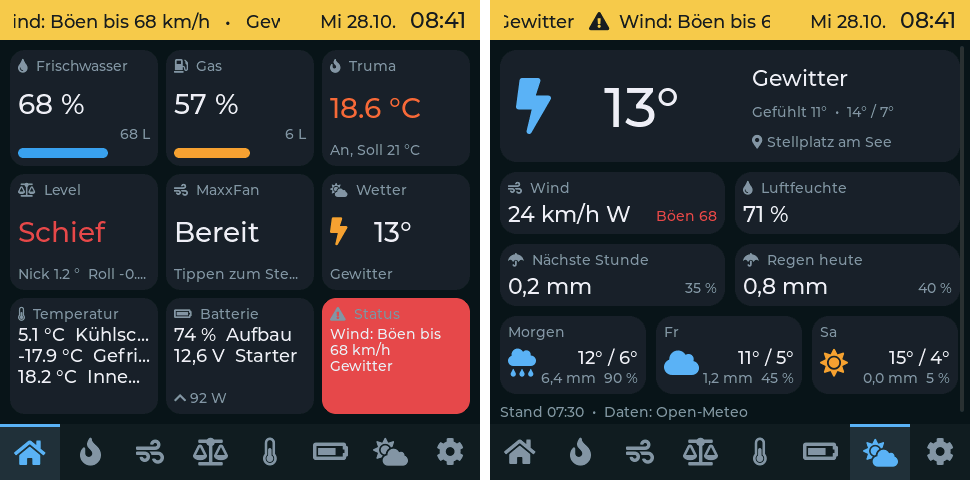

> [!WARNING]
> **IN ENTWICKLUNG – kein fertiges Projekt.** Am echten LIN-Bus (Truma) noch nicht getestet. Nutzung auf eigenes Risiko.


# Camper Display – Guition 4" Wandpanel + Webseite per MQTT

Firmware für das **Guition ESP32-4848S040** (4", 480×480 Touch, ESP32-S3, 16 MB Flash, 8 MB PSRAM). Das Display hängt fest an der Wand und zeigt alle Camper-Werte gesammelt an; dieselben Seiten gibt es zusätzlich als **Webseite** direkt vom Display – z. B. auf Handy oder Tablet im Bett. Beide werden live über **MQTT** versorgt und können steuern. Reines **Arduino**, ohne ESPHome und ohne Home Assistant als Voraussetzung.

Passt zu den anderen Projekten:

| Gerät | Repo | Standard-Topic |
| --- | --- | --- |
| Frischwasser, Grauwasser, Gas | [camper-tanklevel](../tanklevel) | `camper/tanklevel` |
| Ausrichtung (BNO085) | [camper-level](../level) | `camper/level` ¹ |
| Truma Combi Heizung | [camper-heater](../heater) | `camper/heater` ² |
| MaxxFan (VanTurtle) | [camper-maxxfan](../maxxfan) | `camper/maxxfan` |
| Temperaturen (DS18B20) | [camper-temp](../temp) | `camper/temp` |
| Batterien (Daly, Ective, BM2) | [camper-battery](../battery) | `camper/battery` |
| Router (GPS, Mobilfunk) | Teltonika RUT956, siehe [Router-Daten](#router-daten-rut956) | frei |
| Zigbee2MQTT & alles andere | eigene Seiten und Kacheln | frei |

¹ Wer noch die Original-Firmware von klehnst nutzt (ab Werk `wowa/level`): dort den MQTT-Prefix auf `camper/level` stellen oder hier unter *Topics der Geräte* `wowa/level` eintragen.
² Bis camper-heater 1.0 war der Standard `service/truma`. Ältere Geräte behalten ihre Einstellung; dann hier oder im Heizungs-Web-UI angleichen.

<p>

</p>
<p>

</p>
<p>
  
</p>

## Funktionen

- **Wandpanel** mit LVGL-Oberfläche: Icon-Leiste unten zum Wechseln der Seiten (oder wischen), deutsche Umlaute und Icons
- **Webseite** mit denselben Seiten, Werte in Echtzeit per WebSocket, für Handy optimiert (auf schmalen Bildschirmen Menü ☰ statt der Knopfleiste), hell/dunkel automatisch
- **⚡ Automationen:** Regeln wie „Tür auf → Eingangslicht an, Tür zu → nach 10 s aus, nur wenn dunkel“, siehe [Automationen](#automationen)
- **Display aufwecken:** Ist der Bildschirm gedimmt oder aus, zeigt die Webseite oben den Knopf **💡 Display an**.
- **Feste IP abgesichert:** Eine feste IP, die nicht funktionieren kann (Gateway außerhalb des Netzes, falsches Subnetz), wird beim Speichern abgelehnt. Verbindet sich das Display mit fester IP zwar mit dem WLAN, erreicht aber 3 Minuten lang den MQTT-Broker nicht, schaltet es bis zum nächsten Neustart auf DHCP (Hinweis auf der Systemseite). Auf der Systemseite gibt es außerdem den Knopf *Feste IP aus (DHCP)* – lange drücken, das Display startet mit DHCP neu
- **Geräte-Links (nur Webseite):** Unter *Einstellungen → 🔗 Geräte-Links* Name und Adresse der anderen Geräte eintragen (oder „Camper-Geräte vorschlagen“ für die `.local`-Namen). Die Seite **🔗 Geräte** zeigt sie als Buttons, die die jeweilige Konfigurationsseite in einem neuen Tab öffnen
- **Anzeigename:** Unter *Einstellungen → Display & Seiten* lässt sich ein Name eintragen (z. B. „Wohnraum“), der oben in der Mitte neben dem Seitentitel steht – am Display und auf der Webseite. Leer = kein Name
- **Übersicht ohne Scrollen:** 3 × 3 Kacheln, Standard: Frischwasser, Grauwasser, Gas, Truma, Level, MaxxFan, Temperatur (bis 3 Sensoren), Batterie (bis 3), jeweils mit Symbol statt Name (siehe *Symbole* unten) und Status (grün „OK“ oder die Warnungen auf Rot). Antippen öffnet die jeweilige Seite. **Welche Kachel wo steht, ist frei wählbar** (*Einstellungen → Display & Seiten → Kacheln der Übersicht*): zusätzlich einzelne Batterien (Batterie 1–3 groß), Uhr/Datum, eigene MQTT-Kacheln aus *Seiten & Kacheln* oder leer. Die Webseite übernimmt dieselbe Reihenfolge
- **Feste Seiten:** Home · Truma · MaxxFan · Level · Temperatur · Batterie · **Wetter** (einzeln abschaltbar) und **System** (Netzwerk, IP, Signal, MQTT, Firmware, Laufzeit, Speicher als Liste, dazu QR-Code und Helligkeit). Die Namen lassen sich unter *Einstellungen → Display & Seiten* ändern; sie erscheinen in der Kopfzeile, auf den Kacheln der Übersicht und auf der Webseite
- **Kopfzeile:** Seitenname · Anzeigename · Datum · Uhr. Antippen springt zur Übersicht. Bei Verbindungsproblemen steht dort „WLAN“ bzw. „MQTT“
- **Icon-Leiste unten:** ein Knopf je Seite (Home, Flamme, Lüfter, Waage, Thermometer, Batterie, Wetter, Zahnrad; eigene Seiten mit Listen-Icon). Die aktive Seite ist hervorgehoben. Mehr als 8 Seiten lassen sich in der Leiste seitlich schieben
- **Wetter** von [Open-Meteo](https://open-meteo.com) (kostenlos, ohne Konto): aktuelles Wetter, nächste Stunde, heute und 3 Tage Vorschau. Fester Ort oder GPS per MQTT (z. B. vom Router), siehe [Wetter](#wetter)
- **Warnungen:** Temperatur-Alarme von camper-temp, Heizungsfehler, Batterie- und Wetter-Warnungen erscheinen in der roten Status-Kachel der Übersicht und als **gelbes Band mit Lauftext** in der Kopfzeile. Wer möchte, dass eine neue Warnung das Display einschaltet, setzt unter *Einstellungen → Display & Seiten* den Haken **Neue Warnung schaltet das Display ein** (Standard aus); war es dunkel, springt es dann auf die Übersicht. Optional zusätzlich als **Push-Nachricht** per Pushover
- **Temperatur- und Batterie-Kachel frei belegbar:** unter *Einstellungen → Display & Seiten* je Kachel bis zu 3 Sensoren bzw. Batterien aus einer Liste wählen und dahinter das Symbol (Batterie, Starterbatterie, Wohnraum, Sonne, Solarpanel, Fahrzeug, Landstrom, Strom, Thermometer, Kühlschrank, Gefrierfach, Innenraum, Außen, Schlafen, Wasser, Heizung, Bad, Stauraum). Die Kachel zeigt dann Symbol und Wert in dieser Reihenfolge. Leer = die ersten 3, „Symbol automatisch“ wählt nach dem Namen (z. B. Kühlschrank 🧊, Gefrierfach ❄️, Außen 🌳, Aufbau 🏠, Solar ☀️, Starter 🚗). Meldet ein gewählter Sensor nichts, steht dort „--“
- **Eigene Seiten und Kacheln** für beliebige MQTT-Topics: *Wert*, *Schalter*, *Taster*, *Regler* – erscheinen automatisch auf Display **und** Webseite
- **Topic-Finder:** lauscht z. B. auf `zigbee2mqtt/#`, zeigt alle Geräte mit ihren JSON-Werten; ein Klick legt eine Kachel an (Temperatur, Luftfeuchte, Licht an/aus, Helligkeit …)
- **Setup-WLAN** wie bei den anderen Projekten: ohne WLAN-Daten oder nach 1 Minute ohne Verbindung öffnet sich `Camper-Display-XXXXXX`, Captive Portal unter `http://192.168.4.1`. Das Display zeigt dazu einen QR-Code zum Verbinden.
- **Stromausfallsicher:** keine SD-Karte, kein Dateisystem. Webseite und Oberfläche stecken in der Firmware, Einstellungen im NVS. Strom an → nach ca. 1–2 s läuft alles wieder.
- Bildschirm dimmt bzw. schaltet nach einstellbarer Zeit ab (Helligkeit gedimmt 0 = ganz aus), Berühren weckt (die erste Berührung löst nichts aus). Sofort ausschalten: **Kopfzeile lange drücken**, Knopf **Aus** auf der Systemseite oder **💤** oben auf der Webseite
- Uhrzeit per NTP, Firmware-Update über die Webseite (`.bin`-Datei, mit Fortschrittsbalken) oder Arduino-IDE-Netzwerkport
- **Einstellungen sichern und wiederherstellen** als JSON-Datei (ohne Passwörter)
- **Verlauf der letzten 24 h** als Kurven auf der Webseite: Temperaturen, Ladestand bzw. Spannung der Batterien
- **Warnungen für eigene Kacheln**, z. B. Landstrom über eine Zigbee-Messzange: Wert unter/über einer Grenze oder keine Daten mehr
- Eigene MQTT-Topics für Helligkeit, Bildschirm an/aus und Seitenwechsel (z. B. aus Home Assistant)

## Ordner

```
_arduino/camper_display/   Sketch für die Arduino IDE
_arduino/lv_conf.h         LVGL-Konfiguration (muss in den libraries-Ordner, siehe unten)
tools/embed_web.py         packt web/index.html in web_ui.h
tools/make_fonts.py        erzeugt die Schriften font_de_*.c neu
docs/                      Screenshots
```

| Datei | Inhalt |
| --- | --- |
| `config.h` | Pins, Panel-Variante, Drehung, Standardwerte, `FW_VERSION` |
| `display_hw.*` | ST7701-RGB-Panel, GT911-Touch (ohne Library), Hintergrundlicht, LVGL-Treiber |
| `ui.*` | Display-Oberfläche (alle Seiten) |
| `datastore.*` | zentrale Werte aller Geräte und Kacheln, Topic-Zuordnung |
| `mqtt_client.*` | MQTT, Befehle an die Geräte, Topic-Finder |
| `web.*`, `web_ui.h`, `web/index.html` | Webserver, WebSocket, Einstellungs-API, Firmware-Update |
| `wifi_manager.*` | WLAN, feste IP, Setup-AP, mDNS, NTP |
| `settings.*` | Einstellungen, Seiten und Kacheln im NVS |
| `notify.*` | Push-Nachrichten per Pushover (eigener Task, HTTPS mit Zertifikatsprüfung) |
| `otaprog.*` | Fortschritt des Firmware-Uploads für den Update-Bildschirm |
| `history.*` | 24-h-Verlauf der Temperaturen und Batterien im RAM |
| `rules.*` | Automationen (Regeln, eigener NVS-Bereich) |
| `icons.*` | Symbole und Auswahl für die Temperatur- und Batterie-Kachel |
| `weather.*` | Wetter von Open-Meteo (eigener Task), GPS-Position per MQTT, Wetter-Warnungen |
| `font_de_*.c` | Montserrat mit Umlauten + Font-Awesome-Icons, erzeugt mit `tools/make_fonts.py` |

## Hardware

**Guition ESP32-4848S040** (4"-86-Box-Panel, ST7701S über 16-Bit-RGB, GT911-Touch). Belegung wie in der Arduino_GFX-Vorlage `ESP32_4848S040_86BOX_GUITION`:

| Funktion | GPIO |
| --- | --- |
| Hintergrundlicht | 38 |
| ST7701 SPI (Init) | CS 39, SCK 48, MOSI 47 |
| RGB | DE 18, VSYNC 17, HSYNC 16, PCLK 21 |
| Touch GT911 (I2C) | SDA 19, SCL 45 |

- Bleibt das Bild schwarz oder sind die Farben falsch, in `config.h` `LCD_INIT_TYPE` von `9` auf `1` stellen (ältere Panel-Chargen).
- Hochkant/quer montiert: `LCD_ROTATION` (0–3). Touch dreht mit; falls Tipps trotzdem daneben liegen: `TOUCH_SWAP_XY` / `TOUCH_INVERT_X` / `TOUCH_INVERT_Y`.
- Versorgung im Camper über einen 12→5-V-Wandler auf den 5-V-Eingang des Boards (bzw. die 86-Box-Netzteilvariante nicht an 12 V hängen).

## Arduino IDE

> **Eigene Passwörter, WLAN und Broker:** `config_local.h.example` im Sketch-Ordner nach `config_local.h` kopieren und anpassen. Die Datei geht nicht nach GitHub. Details in der [Haupt-README](../../README.md#eigene-einstellungen-config_localh).

**Board-Paket:** esp32 von Espressif **3.3.x** (getestet mit 3.3.2)

| Einstellung | Wert |
| --- | --- |
| Board | ESP32S3 Dev Module |
| USB CDC On Boot | Enabled |
| Flash Size | 16MB (128Mb) |
| PSRAM | **OPI PSRAM** |
| Partition Scheme | 16M Flash (3MB APP/9.9MB FATFS) |
| Upload Speed | 921600 |

**Bibliotheken** (Bibliotheksverwalter):

| Bibliothek | Version |
| --- | --- |
| GFX Library for Arduino (moononournation) | 1.6.x |
| lvgl | **9.2.x** |
| ESP Async WebServer (ESP32Async) | 3.8.x |
| Async TCP (ESP32Async) | 3.4.x |
| PubSubClient (knolleary) | 2.8 |
| ArduinoJson (bblanchon) | 7.x |

**LVGL-Konfiguration:** `_arduino/lv_conf.h` in den Arduino-Bibliotheksordner kopieren, **neben** den Ordner `lvgl` (nicht hinein):

```
~/Documents/Arduino/libraries/lv_conf.h
~/Documents/Arduino/libraries/lvgl/
```

Dann `_arduino/camper_display/camper_display.ino` öffnen, kompilieren, hochladen. Die Firmware belegt ca. 1,9 MB von 3 MB.

Die Webseite liegt als lesbare Datei in `web/index.html`. Nach Änderungen daran `python3 tools/embed_web.py` ausführen (nur Python-Standardbibliothek, keine venv nötig) – das schreibt `web_ui.h` neu.

**Schriften:** Wer weitere Zeichen oder Icons braucht, trägt sie in `tools/make_fonts.py` ein und führt `python3 tools/make_fonts.py` aus. Das Skript braucht Node.js (`npx` lädt `lv_font_conv` 1.5.3) und die Schriftdateien aus `lvgl/scripts/built_in_font` der LVGL-Bibliothek; sonst nur die Python-Standardbibliothek.

## Einrichtung

1. Nach dem ersten Flashen zeigt das Display die Seite **System** mit einem QR-Code. Scannen (oder WLAN `Camper-Display-XXXXXX`, Passwort `display1234` – in `config.h` ändern) → die Einstellungsseite öffnet sich.
2. **WLAN** eintragen (Suchen-Knopf listet Netze), **MQTT-Broker** = IP des RUT956 → *Einstellungen speichern*. Das Display startet neu und verbindet sich.
3. Danach ist die Webseite unter `http://camper-display.local` bzw. der IP erreichbar; die System-Seite am Display zeigt die Adresse auch als QR-Code.
4. Unter **Topics der Geräte** prüfen, ob die Basis-Topics zu deinen Geräten passen (Standard: `camper/tanklevel`, `camper/level`, `camper/heater`, `camper/maxxfan`, `camper/temp`, `camper/battery`; MaxxFan-Port 0/1). Leeres Feld = Gerät nicht vorhanden.
5. Optional unter **System** ein Web-Passwort setzen – dann sind Einstellungen und Firmware-Update geschützt. Die Bedienseiten bleiben im eigenen WLAN offen.

## Seiten und Kacheln

Unter *Einstellungen → Seiten & Kacheln* beliebig viele eigene Seiten (max. 8) mit Kacheln (max. 40) anlegen. Jede Kachel erscheint auf dem Display und auf der Webseite.

| Typ | Anzeige | sendet |
| --- | --- | --- |
| Wert | Wert + Einheit | – |
| Schalter | An/Aus + Schalter | `Payload EIN` / `Payload AUS` an das Befehls-Topic |
| Taster | Knopf | `Payload` |
| Regler | Schieberegler (Min/Max/Schritt) | `Payload` mit `{v}` als Platzhalter, leer = nur die Zahl |

- **Status-Topic** ist das Topic, das gelesen wird; Wildcards sind hier nicht erlaubt.
- **JSON-Schlüssel** holt einen Wert aus JSON, auch verschachtelt (`update.state`). Leer = ganzer Payload.
- **Befehls-Topic** leer = Status-Topic + `/set` (Zigbee2MQTT-Konvention).

**Beispiel Zigbee2MQTT:**

| Kachel | Typ | Status-Topic | Schlüssel | Befehl |
| --- | --- | --- | --- | --- |
| Innentemperatur | Wert | `zigbee2mqtt/Sensor Wohnraum` | `temperature` | – |
| Licht Küche | Schalter | `zigbee2mqtt/Licht Küche` | `state` | `{"state":"ON"}` / `{"state":"OFF"}` |
| Dimmer | Regler 0–254 | `zigbee2mqtt/Licht Küche` | `brightness` | `{"brightness":{v}}` |

Am schnellsten geht es mit dem **Topic-Finder**: Filter `zigbee2mqtt/#` starten, kurz warten (retained Werte kommen sofort, andere bei der nächsten Änderung), dann beim gewünschten Gerät auf einen Schlüssel klicken. Für `state` und `brightness` werden Schalter bzw. Regler mit den passenden Befehlen vorbelegt. Danach *Seiten speichern*. Der Finder hört höchstens 15 Minuten mit und ignoriert `zigbee2mqtt/bridge/…`.

### Warnung an einer Kachel (z. B. Landstrom)

Kacheln vom Typ *Wert* und *Schalter* können eine Warnung auslösen. Sie erscheint wie die anderen Warnungen in der Status-Kachel, im gelben Band und per Pushover.

| Feld | Wirkung |
| --- | --- |
| Anzeige umbenennen | nur Typ *Wert*: empfangene Texte anders anzeigen, z. B. `close=Zu, open=Offen` (Groß-/Kleinschreibung egal) |
| Warnung | keine, *wenn Wert unter …* / *über …* den Grenzwert, oder *wenn Wert gleich …* einem Text (empfangen oder angezeigt, z. B. `open`) |
| Warnen, wenn keine Daten seit | Minuten ohne Nachricht auf dem Status-Topic, 0 = aus |
| Warntext | erscheint statt „<Name> zu niedrig/hoch“, z. B. „Landstrom weg“ |

**Türkontakt am RUT956** (Eingang als MQTT, z. B. Topic `camper/door` mit `{"Door":{"name":"din2","type":"Digital In","state":"close",…}}`): Kachel *Wert*, Status-Topic `camper/door`, Schlüssel `Door.state`, Anzeige umbenennen `close=Zu, open=Offen`, Warnung *wenn Wert gleich* `open`, Warntext `Tür offen`. Den genauen Text für „offen“ zeigt der Topic-Finder, sobald die Tür einmal offen war.

**Landstrom mit einer Tuya-Zigbee-Messzange** (über Zigbee2MQTT): Kachel *Wert* mit Status-Topic `zigbee2mqtt/<Name der Zange>`, Schlüssel `voltage`, Einheit `V`. Warnung *wenn Wert unter* `180`, Warntext `Landstrom weg`. Viele dieser Zangen hängen selbst am 230-V-Netz und schweigen, wenn der Landstrom fehlt. Deshalb zusätzlich *Warnen, wenn keine Daten seit* `10` Minuten eintragen; im Topic-Finder sieht man, wie oft die Zange sendet. Wer nur die Leistung hat, nimmt den Schlüssel `power` und warnt z. B. unter `1` W.

## MQTT

Das Display abonniert `<Basis-Topic>/#` jedes Geräts und die Topics der Kacheln. Befehle werden nicht retained gesendet.

**Gelesene Werte**

| Seite | Topics |
| --- | --- |
| Tanks | `water/percent`, `water/liters`, `grey/percent`, `grey/liters`, `gas/level`, `gas/content`, `status` |
| Ausrichtung | `pitch`, `roll`, `is_level`, `tolerance`, `wedge_fl/fr/rl/rr`, `status` |
| Heizung | `control_status/current_temp_room`, `room_setpoint`, `hvac_mode`, `fan_mode`, `water_mode`, `current_temp_water`, `operating_status_text`, `error_code`, `heater_error`, `decoke`, `decoke_remaining`, `alive`; `status` |
| MaxxFan | `p<n>/auto_hold`, `p<n>/led`, `status` |
| Temperaturen | `sensors` (JSON-Liste aller Sensoren mit Name, Wert und Alarm), `alarm_text`, `status` |
| Batterien | `batteries` (JSON-Liste aller Batterien mit Ladestand, Spannung, Leistung, Restlaufzeit, BM2-Zustand), `status`. Seite *Batterien*: je Batterie eine Karte mit Ladestand-Balken, Leistung (▲ lädt / ▼ entlädt), Restlaufzeit; beim BM2 Spannung und Zustand |

**Gesendete Befehle**

| Bedienung | Topic | Payload |
| --- | --- | --- |
| Heizung an/aus | `<heizung>/set/hvac_mode` | `heat` / `off` |
| Solltemperatur | `<heizung>/set/room_setpoint` | `5` … `30` (1 s nach dem letzten Tippen) |
| Gebläse | `<heizung>/set/fan_mode` | `eco` / `high` |
| Warmwasser | `<heizung>/set/water_mode` | `off` / `eco` / `high` |
| Freibrennen | `<heizung>/set/decoke` | `ON` / `OFF` (am Display lange drücken) |
| Lüfter-Tasten | `<maxxfan>/cmd/p<n>/<taste>` | `PRESS` (`on_off`, `auto`, `faster`, `slower`, `direction`, `close` = Haube schließen, ab camper-maxxfan 1.4.0) |
| Lüfter-Stufe | `<maxxfan>/cmd/p<n>/speed/set` | `1` … `10` |
| Sync AUS | `<maxxfan>/cmd/sync_off` | `PRESS` |
| Tara | `<level>/cmd/tare/set` | `PRESS` (am Display lange drücken) |

**Eigene Topics** (Basis `camper/display`)

| Topic | Inhalt |
| --- | --- |
| `camper/display/status` | `online` / `offline` (Last Will) |
| `camper/display/ip`, `/rssi`, `/brightness`, `/screen` | Zustand (retained) |
| `camper/display/cmd/brightness` | `5` … `100` |
| `camper/display/cmd/screen` | `ON` / `OFF` |
| `camper/display/cmd/page` | Seitenname (`Heizung`) oder Nummer (`0` = erste) |
| `camper/display/cmd/reboot` | beliebig |

Beispiel: `mosquitto_pub -h <broker> -t camper/display/cmd/screen -m OFF`

## Warnungen

Die Status-Kachel der Übersicht wird rot und zeigt die Warnungen, solange etwas nicht stimmt:

| Quelle | Wann |
| --- | --- |
| camper-temp | `alarm_text` ist nicht leer (Grenzwert eines Sensors länger als die eingestellte Verzögerung verletzt) |
| camper-heater | `control_status/heater_error` = `ON`, mit Fehlercode |
| Wetter | Böen ab dem eingestellten Wert (Standard 60 km/h) oder Gewitter, siehe [Wetter](#wetter) |
| camper-battery | Ladestand unter 20 % (`BAT_WARN_SOC` in `config.h`, mit Restlaufzeit), BM2-Zustand „Schwach“ oder „Kritisch“ (Starterbatterie), BMS meldet einen Fehler. Batterien ohne Verbindung lösen keine Warnung aus |

Warnungen von Geräten, die `offline` sind, werden nicht gezeigt (alte retained Werte sollen keinen Fehlalarm auslösen). Grenzwerte und Verzögerung stellt man direkt in camper-temp ein, nicht am Display.

### Push-Nachrichten (Pushover)

Das Display kann jede Warnung zusätzlich aufs Handy schicken, auch wenn niemand im Camper ist. Es läuft ohnehin immer und sieht alle Warnungen, deshalb sitzt das hier und nicht in den einzelnen Geräten.

1. Bei [pushover.net](https://pushover.net) anmelden, App aufs Handy. Der **User-Key** steht auf der Startseite.
2. Unter *Your Applications → Create an Application* eine Anwendung anlegen (Name z. B. „Camper“). Deren **API-Token** brauchst du.
3. Am Display unter *Einstellungen → 📲 Pushover*: Token und User-Key eintragen, **Warnungen senden** anhaken, *Einstellungen speichern*, dann **Testnachricht**.

| Einstellung | Wirkung |
| --- | --- |
| Warnungen senden | Eine Warnung wird gesendet, sobald sie 30 s ununterbrochen besteht (`PUSHOVER_STABLE_MS`) |
| Nachricht, wenn eine Warnung vorbei ist | „✓ Erledigt: Kühlschrank zu warm“, leise (Priorität −1) |
| Priorität | Normal, Hoch (klingelt auch in den Pushover-Ruhezeiten) oder Leise |
| Titel | Überschrift der Nachricht, Standard „Camper“ |

Eine Warnung wird pro Ereignis nur einmal gesendet. Ändert sich nur der Wert („9,2 °C“ → „9,8 °C“), kommt keine neue Nachricht. Geht ein Gerät offline, gilt seine Warnung nicht als erledigt. Ohne WLAN oder bei einem Serverfehler versucht das Display es bis zu 5-mal im Minutenabstand. Token und User-Key lassen sich auch in `config_local.h` vorbelegen (`DEFAULT_PUSHOVER_TOKEN`, `DEFAULT_PUSHOVER_USER`).

## Wetter

Unter *Einstellungen → 🌦 Wetter*:

| Einstellung | Wirkung |
| --- | --- |
| Wetter abrufen | schaltet die Abfrage ein. Das Display braucht dafür Internet über den Router |
| Ort suchen | Ortsname eingeben, *Suchen*, Treffer antippen. Das füllt Breiten-, Längengrad und Ortsnamen aus (die Suche läuft im Browser über Open-Meteo) |
| Breitengrad / Längengrad | fester Standort, z. B. `47.66` / `9.175`. Komma statt Punkt geht auch |
| Ortsname | steht auf der Wetterseite, nur zur Anzeige |
| GPS per MQTT | optional ein Topic mit der aktuellen Position, z. B. vom Router. Dann folgt das Wetter dem Fahrzeug; ohne Position gilt der feste Ort |
| Warnung ab Böen | km/h, 0 = keine Wind-Warnung |
| Aktualisieren | alle 15/30/60/120 Minuten, Standard stündlich. Fährt das Fahrzeug mehr als 5 km weiter, wird sofort neu abgefragt |

Das GPS-Topic darf JSON mit `lat`/`lon` (auch `latitude`/`longitude`, `lng`, Groß- und Kleinschreibung egal, Zahl oder Text) oder einfach `52.52,13.40` enthalten. Die Werte dürfen auch verschachtelt sein, wie beim RUT956 (`{"TIME":{…},"GPS":{"latitude":…,"longitude":…,"fix_status":1}}`). Meldet der Router `fix_status` 0 (kein GPS-Empfang), wird die Position ignoriert und der feste Ort bzw. die letzte Position bleibt.

Gespeicherte Änderungen (Ort, Ein/Aus) lösen sofort eine neue Abfrage aus, nicht erst nach dem Intervall. Klappt die Abfrage nicht, steht der Grund unten auf der Wetterseite (z. B. „Wetter: Fehler -1“) und im seriellen Log mit `[wx]`. Die Abfrage läuft per HTTPS mit Zertifikatsprüfung.

Bei GPS-Position sucht das Display den Ortsnamen über [OpenStreetMap Nominatim](https://nominatim.org) (kostenlos, ohne Konto und ohne Schlüssel) und zeigt ihn mit „(GPS)“ an. Abgefragt wird nur beim ersten Empfang und nach mehr als 5 km Fahrt, damit die Nutzungsregeln von Nominatim (höchstens eine Anfrage pro Sekunde, Anwendungsname im User-Agent) sicher eingehalten werden. Ohne GPS gilt der eingetragene Ortsname. Die Webseite zeigt zusätzlich die Kachel **📍 Standort** mit Ortsname, Koordinaten (Link zur Karte) und Quelle (GPS oder fester Ort).

Die Wetterseite zeigt das aktuelle Wetter mit gefühlter Temperatur, Höchst- und Tiefstwert, Wind mit Richtung und Böen, Luftfeuchte, Regen in der nächsten Stunde und heute sowie die nächsten 3 Tage. Für die Übersicht gibt es die Kachel **Wetter**. Bei Böen über dem Grenzwert und bei Gewitter erscheint eine Warnung (Kopfzeile, Status-Kachel, Pushover). Daten älter als 3 Stunden lösen keine Warnung aus.

Vorbelegen in `config_local.h`: `DEFAULT_WX_LAT`, `DEFAULT_WX_LON`, `DEFAULT_WX_NAME`, `DEFAULT_WX_TOPIC`, `DEFAULT_WX_GUST`.

## Automationen

Webseite → **⚡ Automationen**. Jede Regel hat:

| Teil | Felder | Beispiel Eingangslicht |
| --- | --- | --- |
| Wenn | Topic, JSON-Schlüssel, Bedingung (= ≠ < >), Wert | `camper/door`, `Door.state`, =, `open` |
| Dann senden | Befehls-Topic und Payload, sofort | `camper/zigbee/led_eingang/set`, `{"state":"ON"}` |
| Wenn nicht mehr erfüllt | Payload und Verzögerung in Sekunden | `{"state":"OFF"}` nach 10 s |
| Zeitraum | immer, von–bis (auch über Mitternacht) oder nur wenn dunkel | nur wenn dunkel |
| Anzeige | Symbol in der Status-Kachel solange erfüllt, optional als Warnung (Pushover) | 🚪 |

- Eine Regel reagiert nur auf **Wechsel**. Der erste empfangene Wert nach dem Start (z. B. retained) löst nichts aus.
- **Von Hand schalten geht immer.** Mit *Nur ausschalten, was diese Regel eingeschaltet hat* (Standard) bleibt ein Licht, das schon an war, an. Das Display liest dazu den Zustand der Lampe auf dem Befehls-Topic ohne `/set` mit (Zigbee2MQTT: `state`).
- Der Zeitraum gilt nur fürs Einschalten; ausgeschaltet wird immer.
- „Nur wenn dunkel“ nutzt Sonnenauf- und -untergang aus dem Wetter (Open-Meteo); ohne Wetterdaten gilt 18 bis 7 Uhr.
- Mehrere Lampen: Regel mit ⧉ kopieren und nur das Befehls-Topic ändern (z. B. später die Markisenbeleuchtung).
- Bis zu 16 Regeln, gespeichert im Display (auch in der Sicherung enthalten). Der Kasten über jeder Regel zeigt live, ob sie erfüllt ist und was sie zuletzt getan hat.
- Nur ein Symbol ohne Aktion (z. B. 🚪 für einen Fensterkontakt): Befehls-Topic leer lassen.

## Router-Daten (RUT956)

Der RUT956 kann GPS und Mobilfunkwerte selbst per MQTT senden, ganz ohne zusätzliche Firmware. Im Router unter **Services → Data to Server**:

1. Neue Instanz, **Server type: MQTT**, Server `127.0.0.1` (der Broker läuft auf dem Router), Port `1883`, ggf. Benutzer/Passwort.
2. Topic z. B. `camper/router/gps`, Format **Json**, Timer **Period** 60 s.
3. Datensammlung **Type: GPS** (Breite, Länge, Geschwindigkeit, Satelliten …). Eine zweite Instanz mit **Type: GSM** und Topic `camper/router/mobile` liefert Signal (RSSI, RSRP, SINR), Netzbetreiber und Modemtemperatur.

Das GPS-Topic kann man auch direkt unter *Einstellungen → 🌦 Wetter → GPS per MQTT* eintragen, dann folgt das Wetter dem Fahrzeug.

Am Display dann im **Topic-Finder** `camper/router/#` starten und die gewünschten Werte per Klick als Kacheln anlegen. Die genauen JSON-Schlüssel hängen von der Router-Firmware ab; der Finder zeigt sie an.

## Sichern, Update, Verlauf

**Einstellungen sichern:** *Einstellungen → 🔧 System → ⬇ Sichern* lädt eine JSON-Datei mit allen Einstellungen, Seiten und Kacheln herunter. Passwörter und Tokens (WLAN, MQTT, Web, Setup-WLAN, Pushover) sind nicht enthalten. *⬆ Einspielen* übernimmt die Datei; vorhandene Passwörter bleiben. WLAN, feste IP und Gerätename werden nur übernommen, wenn der Haken dafür gesetzt ist, damit ein zweites Display nicht dieselbe Adresse bekommt.

**Firmware-Update:** *🔧 System → Firmware-Update (.bin)*, Datei wählen, *Hochladen*. Die Webseite zeigt einen Fortschrittsbalken, das Display einen eigenen Update-Bildschirm mit Prozentanzeige. Während in den Flash geschrieben wird, kann das Bild flackern oder kurz verrutschen: Der Bildspeicher liegt im PSRAM, und der ist beim Schreiben in den Flash kurz blockiert. Das ist harmlos und nach dem Neustart vorbei.

**Verlauf:** Alle 5 Minuten merkt sich das Display jeden Temperatursensor und jede Batterie (Ladestand, beim BM2 die Spannung), 24 Stunden lang. Die Seiten *Temperatur* und *Batterie* der Webseite zeigen daraus Kurven. Der Verlauf liegt nur im Arbeitsspeicher: Nach einem Neustart oder Stromausfall beginnt er neu. Schrittweite und Länge: `HISTORY_STEP_S`, `HISTORY_POINTS` in `config.h`.

## Fertige Firmware

Wird im Haupt-Repo per GitHub Actions gebaut, siehe [Fertige Firmware](../../README.md#fertige-firmware).

## Hinweise

- Der MaxxFan meldet keine Drehzahl zurück. Die Lüfterseite zeigt deshalb nur Online-Status und Auto-Hold; die Stufe wird gesetzt, nicht gelesen.
- PubSubClient verwirft Nachrichten über 4 KB (`MQTT_BUFFER_SIZE`). Große Zigbee-Geräte-JSONs bitte in Zigbee2MQTT nicht unnötig aufblähen.
- Bubble-Richtung: Neigt sich der Punkt falsch herum, im Levelsensor die Montagerichtung prüfen.
- Lizenz: MIT. Schriften: Montserrat (OFL) und Font Awesome 5 Free (OFL), wie in LVGL enthalten.
