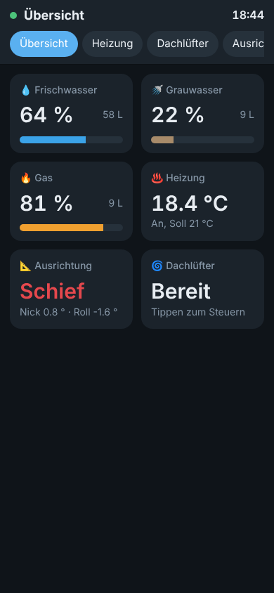
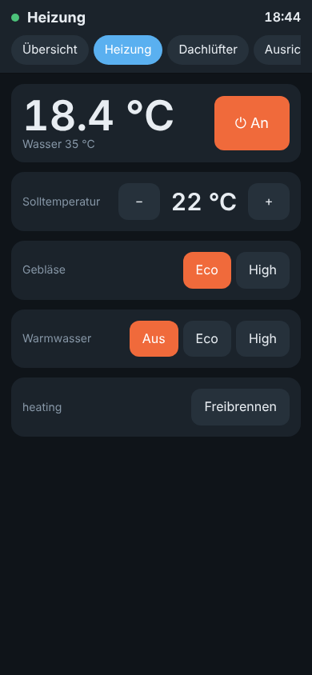
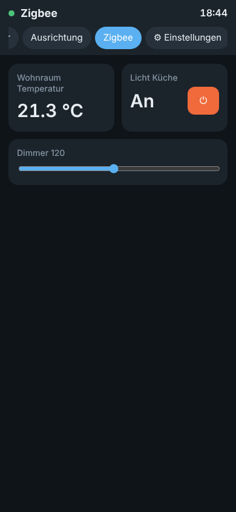

> [!WARNING]
> **IN ENTWICKLUNG – kein fertiges Projekt.** Am echten LIN-Bus noch nicht getestet. Nutzung auf eigenes Risiko.


# Camper Display – Guition 4" Wandpanel + Webseite per MQTT

Firmware für das **Guition ESP32-4848S040** (4", 480×480 Touch, ESP32-S3, 16 MB Flash, 8 MB PSRAM). Das Display hängt fest an der Wand und zeigt alle Camper-Werte gesammelt an; dieselben Seiten gibt es zusätzlich als **Webseite** direkt vom Display – z. B. auf Handy oder Tablet im Bett. Beide werden live über **MQTT** versorgt und können steuern. Reines **Arduino**, ohne ESPHome und ohne Home Assistant als Voraussetzung.

Passt zu den anderen Projekten:

| Gerät | Repo | Standard-Topic |
| --- | --- | --- |
| Frischwasser, Grauwasser, Gas | [camper-tanklevel](../tanklevel) | `camper/tanklevel` |
| Ausrichtung (BNO085) | [camper-level](../level) | `camper/level` ¹ |
| Truma Combi Heizung | [camper-heater](../heater) | `camper/heater` ² |
| MaxxFan (VanTurtle) | [camper-maxxfan](../maxxfan) | `camper/maxxfan` |
| Temperaturen (DS18B20) | [camper-temp](../temp) | `camper/temp` |
| Router (GPS, Mobilfunk) | Teltonika RUT956, siehe [Router-Daten](#router-daten-rut956) | frei |
| Zigbee2MQTT & alles andere | eigene Seiten und Kacheln | frei |

¹ Wer noch die Original-Firmware von klehnst nutzt (ab Werk `wowa/level`): dort den MQTT-Prefix auf `camper/level` stellen oder hier unter *Topics der Geräte* `wowa/level` eintragen.
² Bis camper-heater 1.0 war der Standard `service/truma`. Ältere Geräte behalten ihre Einstellung; dann hier oder im Heizungs-Web-UI angleichen.

<p>
  
</p>

## Funktionen

- **Wandpanel** mit LVGL-Oberfläche, Wischen oder Pfeile zum Blättern, deutsche Umlaute und Icons
- **Webseite** mit denselben Seiten, Werte in Echtzeit per WebSocket, für Handy optimiert, hell/dunkel automatisch
- **Feste Seiten:** Übersicht · Heizung · Dachlüfter · Ausrichtung · Temperaturen (einzeln abschaltbar) und **System** (IP, QR-Code, Helligkeit)
- **Warnungen:** Temperatur-Alarme von camper-temp und Heizungsfehler erscheinen als rote Leiste auf der Übersicht und als ⚠ in der Kopfzeile. Eine neue Warnung weckt das Display; war es dunkel, springt es auf die Übersicht. Optional zusätzlich als **Push-Nachricht** per Pushover
- **Eigene Seiten und Kacheln** für beliebige MQTT-Topics: *Wert*, *Schalter*, *Taster*, *Regler* – erscheinen automatisch auf Display **und** Webseite
- **Topic-Finder:** lauscht z. B. auf `zigbee2mqtt/#`, zeigt alle Geräte mit ihren JSON-Werten; ein Klick legt eine Kachel an (Temperatur, Luftfeuchte, Licht an/aus, Helligkeit …)
- **Setup-WLAN** wie bei den anderen Projekten: ohne WLAN-Daten oder nach 1 Minute ohne Verbindung öffnet sich `Camper-Display-XXXXXX`, Captive Portal unter `http://192.168.4.1`. Das Display zeigt dazu einen QR-Code zum Verbinden.
- **Stromausfallsicher:** keine SD-Karte, kein Dateisystem. Webseite und Oberfläche stecken in der Firmware, Einstellungen im NVS. Strom an → nach ca. 1–2 s läuft alles wieder.
- Bildschirm dimmt bzw. schaltet nach einstellbarer Zeit ab, Berühren weckt (die erste Berührung löst nichts aus)
- Uhrzeit per NTP, Firmware-Update über die Webseite oder Arduino-IDE-Netzwerkport
- Eigene MQTT-Topics für Helligkeit, Bildschirm an/aus und Seitenwechsel (z. B. aus Home Assistant)

## Ordner

```
_arduino/camper_display/   Sketch für die Arduino IDE
_arduino/lv_conf.h         LVGL-Konfiguration (muss in den libraries-Ordner, siehe unten)
tools/embed_web.py         packt web/index.html in web_ui.h
docs/                      Screenshots
```

| Datei | Inhalt |
| --- | --- |
| `config.h` | Pins, Panel-Variante, Drehung, Standardwerte, `FW_VERSION` |
| `display_hw.*` | ST7701-RGB-Panel, GT911-Touch (ohne Library), Hintergrundlicht, LVGL-Treiber |
| `ui.*` | Display-Oberfläche (alle Seiten) |
| `datastore.*` | zentrale Werte aller Geräte und Kacheln, Topic-Zuordnung |
| `mqtt_client.*` | MQTT, Befehle an die Geräte, Topic-Finder |
| `web.*`, `web_ui.h`, `web/index.html` | Webserver, WebSocket, Einstellungs-API, Firmware-Update |
| `wifi_manager.*` | WLAN, feste IP, Setup-AP, mDNS, NTP |
| `settings.*` | Einstellungen, Seiten und Kacheln im NVS |
| `notify.*` | Push-Nachrichten per Pushover (eigener Task, HTTPS mit Zertifikatsprüfung) |
| `font_de_*.c` | Montserrat mit Umlauten + Font-Awesome-Icons (mit `lv_font_conv` erzeugt) |

## Hardware

**Guition ESP32-4848S040** (4"-86-Box-Panel, ST7701S über 16-Bit-RGB, GT911-Touch). Belegung wie in der Arduino_GFX-Vorlage `ESP32_4848S040_86BOX_GUITION`:

| Funktion | GPIO |
| --- | --- |
| Hintergrundlicht | 38 |
| ST7701 SPI (Init) | CS 39, SCK 48, MOSI 47 |
| RGB | DE 18, VSYNC 17, HSYNC 16, PCLK 21 |
| Touch GT911 (I2C) | SDA 19, SCL 45 |

- Bleibt das Bild schwarz oder sind die Farben falsch, in `config.h` `LCD_INIT_TYPE` von `9` auf `1` stellen (ältere Panel-Chargen).
- Hochkant/quer montiert: `LCD_ROTATION` (0–3). Touch dreht mit; falls Tipps trotzdem daneben liegen: `TOUCH_SWAP_XY` / `TOUCH_INVERT_X` / `TOUCH_INVERT_Y`.
- Versorgung im Camper über einen 12→5-V-Wandler auf den 5-V-Eingang des Boards (bzw. die 86-Box-Netzteilvariante nicht an 12 V hängen).

## Arduino IDE

> **Eigene Passwörter, WLAN und Broker:** `config_local.h.example` im Sketch-Ordner nach `config_local.h` kopieren und anpassen. Die Datei geht nicht nach GitHub. Details in der [Haupt-README](../../README.md#eigene-einstellungen-config_localh).

**Board-Paket:** esp32 von Espressif **3.3.x** (getestet mit 3.3.2)

| Einstellung | Wert |
| --- | --- |
| Board | ESP32S3 Dev Module |
| USB CDC On Boot | Enabled |
| Flash Size | 16MB (128Mb) |
| PSRAM | **OPI PSRAM** |
| Partition Scheme | 16M Flash (3MB APP/9.9MB FATFS) |
| Upload Speed | 921600 |

**Bibliotheken** (Bibliotheksverwalter):

| Bibliothek | Version |
| --- | --- |
| GFX Library for Arduino (moononournation) | 1.6.x |
| lvgl | **9.2.x** |
| ESP Async WebServer (ESP32Async) | 3.8.x |
| Async TCP (ESP32Async) | 3.4.x |
| PubSubClient (knolleary) | 2.8 |
| ArduinoJson (bblanchon) | 7.x |

**LVGL-Konfiguration:** `_arduino/lv_conf.h` in den Arduino-Bibliotheksordner kopieren, **neben** den Ordner `lvgl` (nicht hinein):

```
~/Documents/Arduino/libraries/lv_conf.h
~/Documents/Arduino/libraries/lvgl/
```

Dann `_arduino/camper_display/camper_display.ino` öffnen, kompilieren, hochladen. Die Firmware belegt ca. 1,6 MB von 3 MB.

Die Webseite liegt als lesbare Datei in `web/index.html`. Nach Änderungen daran `python3 tools/embed_web.py` ausführen (nur Python-Standardbibliothek, keine venv nötig) – das schreibt `web_ui.h` neu.

## Einrichtung

1. Nach dem ersten Flashen zeigt das Display die Seite **System** mit einem QR-Code. Scannen (oder WLAN `Camper-Display-XXXXXX`, Passwort `display1234` – in `config.h` ändern) → die Einstellungsseite öffnet sich.
2. **WLAN** eintragen (Suchen-Knopf listet Netze), **MQTT-Broker** = IP des RUT956 → *Einstellungen speichern*. Das Display startet neu und verbindet sich.
3. Danach ist die Webseite unter `http://camper-display.local` bzw. der IP erreichbar; die System-Seite am Display zeigt die Adresse auch als QR-Code.
4. Unter **Topics der Geräte** prüfen, ob die Basis-Topics zu deinen Geräten passen (Standard: `camper/tanklevel`, `camper/level`, `camper/heater`, `camper/maxxfan`, `camper/temp`; MaxxFan-Port 0/1). Leeres Feld = Gerät nicht vorhanden.
5. Optional unter **System** ein Web-Passwort setzen – dann sind Einstellungen und Firmware-Update geschützt. Die Bedienseiten bleiben im eigenen WLAN offen.

## Seiten und Kacheln

Unter *Einstellungen → Seiten & Kacheln* beliebig viele eigene Seiten (max. 8) mit Kacheln (max. 40) anlegen. Jede Kachel erscheint auf dem Display und auf der Webseite.

| Typ | Anzeige | sendet |
| --- | --- | --- |
| Wert | Wert + Einheit | – |
| Schalter | An/Aus + Schalter | `Payload EIN` / `Payload AUS` an das Befehls-Topic |
| Taster | Knopf | `Payload` |
| Regler | Schieberegler (Min/Max/Schritt) | `Payload` mit `{v}` als Platzhalter, leer = nur die Zahl |

- **Status-Topic** ist das Topic, das gelesen wird; Wildcards sind hier nicht erlaubt.
- **JSON-Schlüssel** holt einen Wert aus JSON, auch verschachtelt (`update.state`). Leer = ganzer Payload.
- **Befehls-Topic** leer = Status-Topic + `/set` (Zigbee2MQTT-Konvention).

**Beispiel Zigbee2MQTT:**

| Kachel | Typ | Status-Topic | Schlüssel | Befehl |
| --- | --- | --- | --- | --- |
| Innentemperatur | Wert | `zigbee2mqtt/Sensor Wohnraum` | `temperature` | – |
| Licht Küche | Schalter | `zigbee2mqtt/Licht Küche` | `state` | `{"state":"ON"}` / `{"state":"OFF"}` |
| Dimmer | Regler 0–254 | `zigbee2mqtt/Licht Küche` | `brightness` | `{"brightness":{v}}` |

Am schnellsten geht es mit dem **Topic-Finder**: Filter `zigbee2mqtt/#` starten, kurz warten (retained Werte kommen sofort, andere bei der nächsten Änderung), dann beim gewünschten Gerät auf einen Schlüssel klicken. Für `state` und `brightness` werden Schalter bzw. Regler mit den passenden Befehlen vorbelegt. Danach *Seiten speichern*. Der Finder hört höchstens 15 Minuten mit und ignoriert `zigbee2mqtt/bridge/…`.

## MQTT

Das Display abonniert `<Basis-Topic>/#` jedes Geräts und die Topics der Kacheln. Befehle werden nicht retained gesendet.

**Gelesene Werte**

| Seite | Topics |
| --- | --- |
| Tanks | `water/percent`, `water/liters`, `grey/percent`, `grey/liters`, `gas/level`, `gas/content`, `status` |
| Ausrichtung | `pitch`, `roll`, `is_level`, `tolerance`, `wedge_fl/fr/rl/rr`, `status` |
| Heizung | `control_status/current_temp_room`, `room_setpoint`, `hvac_mode`, `fan_mode`, `water_mode`, `current_temp_water`, `operating_status_text`, `error_code`, `heater_error`, `decoke`, `decoke_remaining`, `alive`; `status` |
| MaxxFan | `p<n>/auto_hold`, `p<n>/led`, `status` |
| Temperaturen | `sensors` (JSON-Liste aller Sensoren mit Name, Wert und Alarm), `alarm_text`, `status` |

**Gesendete Befehle**

| Bedienung | Topic | Payload |
| --- | --- | --- |
| Heizung an/aus | `<heizung>/set/hvac_mode` | `heat` / `off` |
| Solltemperatur | `<heizung>/set/room_setpoint` | `5` … `30` (1 s nach dem letzten Tippen) |
| Gebläse | `<heizung>/set/fan_mode` | `eco` / `high` |
| Warmwasser | `<heizung>/set/water_mode` | `off` / `eco` / `high` |
| Freibrennen | `<heizung>/set/decoke` | `ON` / `OFF` (am Display lange drücken) |
| Lüfter-Tasten | `<maxxfan>/cmd/p<n>/<taste>` | `PRESS` (`on_off`, `auto`, `faster`, `slower`, `direction`) |
| Lüfter-Stufe | `<maxxfan>/cmd/p<n>/speed/set` | `1` … `10` |
| Sync AUS | `<maxxfan>/cmd/sync_off` | `PRESS` |
| Tara | `<level>/cmd/tare/set` | `PRESS` (am Display lange drücken) |

**Eigene Topics** (Basis `camper/display`)

| Topic | Inhalt |
| --- | --- |
| `camper/display/status` | `online` / `offline` (Last Will) |
| `camper/display/ip`, `/rssi`, `/brightness`, `/screen` | Zustand (retained) |
| `camper/display/cmd/brightness` | `5` … `100` |
| `camper/display/cmd/screen` | `ON` / `OFF` |
| `camper/display/cmd/page` | Seitenname (`Heizung`) oder Nummer (`0` = erste) |
| `camper/display/cmd/reboot` | beliebig |

Beispiel: `mosquitto_pub -h <broker> -t camper/display/cmd/screen -m OFF`

## Warnungen

Die Übersicht zeigt oben eine rote Leiste, solange etwas nicht stimmt:

| Quelle | Wann |
| --- | --- |
| camper-temp | `alarm_text` ist nicht leer (Grenzwert eines Sensors länger als die eingestellte Verzögerung verletzt) |
| camper-heater | `control_status/heater_error` = `ON`, mit Fehlercode |

Warnungen von Geräten, die `offline` sind, werden nicht gezeigt (alte retained Werte sollen keinen Fehlalarm auslösen). Grenzwerte und Verzögerung stellt man direkt in camper-temp ein, nicht am Display.

### Push-Nachrichten (Pushover)

Das Display kann jede Warnung zusätzlich aufs Handy schicken, auch wenn niemand im Camper ist. Es läuft ohnehin immer und sieht alle Warnungen, deshalb sitzt das hier und nicht in den einzelnen Geräten.

1. Bei [pushover.net](https://pushover.net) anmelden, App aufs Handy. Der **User-Key** steht auf der Startseite.
2. Unter *Your Applications → Create an Application* eine Anwendung anlegen (Name z. B. „Camper“). Deren **API-Token** brauchst du.
3. Am Display unter *Einstellungen → 📲 Pushover*: Token und User-Key eintragen, **Warnungen senden** anhaken, *Einstellungen speichern*, dann **Testnachricht**.

| Einstellung | Wirkung |
| --- | --- |
| Warnungen senden | Eine Warnung wird gesendet, sobald sie 30 s ununterbrochen besteht (`PUSHOVER_STABLE_MS`) |
| Nachricht, wenn eine Warnung vorbei ist | „✓ Erledigt: Kühlschrank zu warm“, leise (Priorität −1) |
| Priorität | Normal, Hoch (klingelt auch in den Pushover-Ruhezeiten) oder Leise |
| Titel | Überschrift der Nachricht, Standard „Camper“ |

Eine Warnung wird pro Ereignis nur einmal gesendet. Ändert sich nur der Wert („9,2 °C“ → „9,8 °C“), kommt keine neue Nachricht. Geht ein Gerät offline, gilt seine Warnung nicht als erledigt. Ohne WLAN oder bei einem Serverfehler versucht das Display es bis zu 5-mal im Minutenabstand. Token und User-Key lassen sich auch in `config_local.h` vorbelegen (`DEFAULT_PUSHOVER_TOKEN`, `DEFAULT_PUSHOVER_USER`).

## Router-Daten (RUT956)

Der RUT956 kann GPS und Mobilfunkwerte selbst per MQTT senden, ganz ohne zusätzliche Firmware. Im Router unter **Services → Data to Server**:

1. Neue Instanz, **Server type: MQTT**, Server `127.0.0.1` (der Broker läuft auf dem Router), Port `1883`, ggf. Benutzer/Passwort.
2. Topic z. B. `camper/router/gps`, Format **Json**, Timer **Period** 60 s.
3. Datensammlung **Type: GPS** (Breite, Länge, Geschwindigkeit, Satelliten …). Eine zweite Instanz mit **Type: GSM** und Topic `camper/router/mobile` liefert Signal (RSSI, RSRP, SINR), Netzbetreiber und Modemtemperatur.

Am Display dann im **Topic-Finder** `camper/router/#` starten und die gewünschten Werte per Klick als Kacheln anlegen. Die genauen JSON-Schlüssel hängen von der Router-Firmware ab; der Finder zeigt sie an.

## Fertige Firmware

Wird im Haupt-Repo per GitHub Actions gebaut, siehe [Fertige Firmware](../../README.md#fertige-firmware).

## Hinweise

- Der MaxxFan meldet keine Drehzahl zurück. Die Lüfterseite zeigt deshalb nur Online-Status und Auto-Hold; die Stufe wird gesetzt, nicht gelesen.
- PubSubClient verwirft Nachrichten über 4 KB (`MQTT_BUFFER_SIZE`). Große Zigbee-Geräte-JSONs bitte in Zigbee2MQTT nicht unnötig aufblähen.
- Bubble-Richtung: Neigt sich der Punkt falsch herum, im Levelsensor die Montagerichtung prüfen.
- Lizenz: MIT. Schriften: Montserrat (OFL) und Font Awesome 5 Free (OFL), wie in LVGL enthalten.
