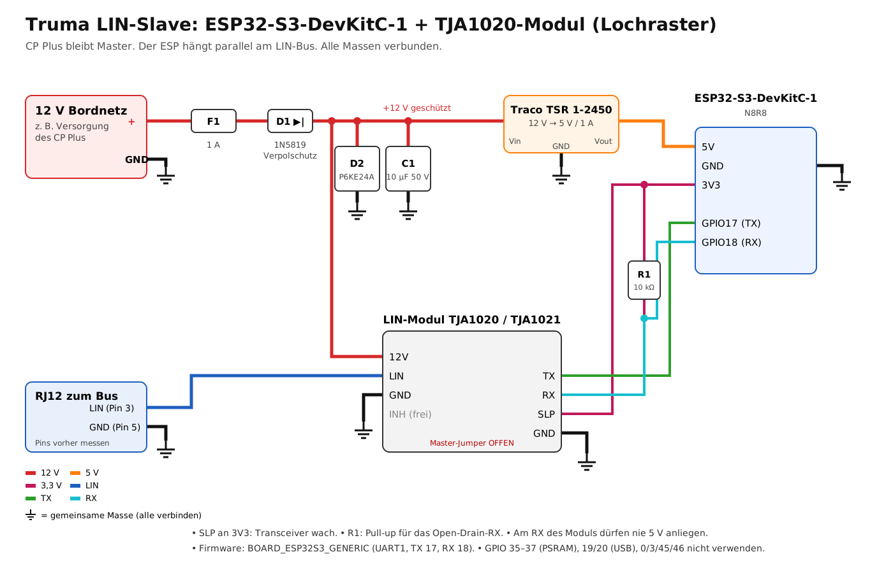

# Hardware & Verdrahtung

## Prinzip

```
 Truma Heizung ── LIN ── CP Plus (Master)
                   │
                   └── LIN-Transceiver ── UART ── ESP32 (Slave, iNet-Box-Emulation)
```

Der ESP hängt **parallel** am LIN-Bus, so wie eine echte iNet Box. Er ersetzt nichts und schaltet nichts um. Es gibt keinen Umschalter und keine Unterbrechung der Verbindung CP Plus ↔ Heizung.

## Variante A: smartavan heater controller

Fertige Platine, nichts zu verdrahten:

1. RJ12-Kabel vom CP Plus abziehen → in **IN** am smartavan-Board.
2. Kabel von **OUT** → zum CP Plus.
3. Genauso das JST-Stromkabel des CP Plus: IN ans Board, OUT zum CP Plus.
4. In `config.h` `BOARD_SMARTAVAN` aktivieren (statt des Standards `BOARD_ESP32C3_SUPERMINI`): UART2, TX = GPIO16, RX = GPIO17.

Vorher prüfen: Das Board muss an **12–14 V** stabil laufen, nicht nur an USB. Bei 12 V die 3,3 V am ESP messen, auch während WLAN sendet. Läuft es nur an USB, liegt ein Versorgungsproblem auf der Platine vor (Spannungsregler, Lötstelle, Masse).

## Variante B: eigener Aufbau mit ESP32 + LIN-Modul

### Teile

- ESP32-Board (ESP32, ESP32-S3 oder ESP32-C3)
- LIN-Transceiver-Modul mit **TJA1020** oder **TJA1021**. Üblich sind kleine Module mit Klemmen „GND / LIN / INH / 12V“ und „GND / RX / SLP / TX“.
- Step-down-Wandler 12 V → 5 V für den ESP (mind. 500 mA, für WLAN-Spitzen)
- RJ12-Verteiler (6P6C-Y-Adapter) oder RJ12-Kabel für den freien LIN-Anschluss der Heizung

### Anschluss

| LIN-Modul | an | Hinweis |
|---|---|---|
| 12V (VBAT) | Bordnetz +12 V (abgesichert, z. B. 1 A) | Versorgung des LIN-Treibers |
| GND (Busseite) | Fahrzeugmasse / Masse des LIN-Kabels | |
| LIN | LIN-Ader des RJ12 | |
| TX (TXD) | ESP `LIN_TX_PIN` | |
| RX (RXD) | ESP `LIN_RX_PIN` | Open Drain; der interne Pull-up des ESP wird von der Firmware eingeschaltet |
| SLP (NSLP / EN) | 3,3 V **oder** ESP-GPIO als `LIN_CS_PIN` | Muss HIGH sein, sonst schläft der Transceiver |
| GND (Logikseite) | ESP GND | |
| INH | nicht anschließen | |

Der Step-down hängt ebenfalls an +12 V und GND und versorgt den ESP über 5V/VIN. **Alle Massen verbinden**: Fahrzeug, LIN-Modul, Step-down, ESP.

### Standard-Pins der Profile

| Profil | UART | TX | RX | LEDs |
|---|---|---|---|---|
| `BOARD_SMARTAVAN` | 2 | 16 | 17 | – |
| `BOARD_ESP32_GENERIC` | 2 | 17 | 16 | MQTT 4, LIN 15 |
| `BOARD_ESP32S3_GENERIC` | 1 | 17 | 18 | – |
| `BOARD_ESP32C3_GENERIC` | 1 | 21 | 20 | – |
| `BOARD_ESP32C3_SUPERMINI` | 1 | 4 | 3 | LIN 8 (Onboard-LED) |

Andere Pins: In `config.h` im jeweiligen Profilblock ändern. Zusätzlich gibt es optional `LIN_CS_PIN` (SLP/EN), `LIN_FAULT_PIN`, `MQTT_LED_PIN`, `LIN_LED_PIN` und `LED_ACTIVE_LOW`.

Nicht verwenden:
- **ESP32:** GPIO 6–11 (Flash), 34–39 nur als Eingang (für RX ok, nicht für TX), Strapping-Pins 0/2/12/15 möglichst nicht für TX.
- **ESP32-S3:** GPIO 19/20 (USB), 26–37 je nach Modul (Flash/PSRAM).
- **ESP32-C3:** GPIO 18/19 (USB), Strapping-Pins 2/8/9 möglichst nicht.

### Wo an den Bus?

- **Freie RJ12-Buchse an der Heizung:** Die Combi hat zwei LIN-Buchsen, eine geht zum CP Plus, die andere ist für Zubehör (dort steckt sonst die iNet Box).
- **Oder** ein RJ12-Y-Adapter zwischen CP Plus und Heizung.

Vom RJ12-Kabel werden nur **LIN** und **GND** gebraucht. Die Aderfarben und die Zählweise der Pins unterscheiden sich je nach Kabel. Deshalb **messen statt raten**, bei eingeschaltetem CP Plus:
- **GND:** 0 V gegen Fahrzeugmasse.
- **LIN:** im Ruhezustand etwa Bordspannung (≈ 12 V). Mit dem Multimeter springt der Wert leicht, sobald das CP Plus sendet.

## Referenzaufbau: ESP32-S3-DevKitC-1 + TJA1020-Modul auf Lochraster

Konkreter Aufbau aus fertigen Modulen, der zum Profil `BOARD_ESP32S3_GENERIC` passt. Die Firmware muss dafür nicht angepasst werden.



Für den Aufbau mit LIN-Modul T151, vergossenem DC/DC-Wandler (8–32 V → 5 V) und durchgeschleiften JST- und RJ12-Buchsen gibt es einen Schaltplan und einen Lochraster-Plan mit Koordinaten und Verdrahtungsliste:

- [Schaltplan](docs/schaltplan.png)
- [Lochraster-Plan](docs/lochraster.png)

Beide Bilder werden von `docs/gen_schematic.py` und `docs/gen_layout.py` erzeugt (Python, `pip install cairosvg`).

### Einkaufsliste

| Teil | Typ | Hinweis |
|---|---|---|
| ESP32-Board | ESP32-S3-DevKitC-1 **N8R8** | 8 MB Flash, 8 MB PSRAM |
| LIN-Modul | TJA1020- oder TJA1021-Modul | Klemmen 12V/LIN/GND und TX/RX/SLP/GND |
| Spannungswandler | Traco TSR 1-2450 (6,5–36 V → 5 V, 1 A) | Schaltregler, stabile 5 V auch bei 14,4 V Ladespannung |
| F1 | Flachsicherung 1 A mit fliegendem Halter | so nah wie möglich an der 12-V-Quelle |
| D1 | 1N5819 (Schottky, bedrahtet) | Verpolschutz in Reihe, kostet nur ca. 0,3 V |
| D2 | P6KE24A (TVS, bedrahtet, unidirektional) | schluckt Spannungsspitzen; Ring zur 12-V-Seite |
| C1 | 10 µF / 50 V | Elko oder Keramik, nahe am Wandler-Eingang |
| R1 | 10 kΩ | Pull-up für RX nach 3,3 V |
| J1 | RJ12-Buchse 6P6C **auf Breakout-Platine** (Rastermaß 2,54 mm) | normale Print-Buchsen passen nicht ins Lochraster. Alternative: RJ12-Kabel aufschneiden und LIN/GND direkt anlöten |
| – | RJ12-Y-Verteiler **6-polig, alle 6 Kontakte 1:1** und ein kurzes RJ12-Kabel 6P6C | zwischen CP Plus und Heizung; viele Telefon-Verteiler sind nur 4-polig belegt |
| J2 | Schraubklemme 2-polig, 5 mm | 12 V und Masse |
| – | 2 × Buchsenleiste 1 × 22 (DevKit), Stift- oder Buchsenleiste fürs LIN-Modul | Module steckbar, damit sie tauschbar bleiben |
| – | Lochraster ca. 7 × 9 cm, Gehäuse mit Ausschnitten für RJ12 und USB | |
| optional | LED + 1 kΩ an einem freien GPIO (z. B. 4) | Status, in `config.h` als `LIN_LED_PIN` eintragen |

### Verdrahtung

| Von | Nach |
|---|---|
| 12 V → F1 → D1 (Anode) | D1 (Kathode) = „+12 V geschützt“ |
| +12 V geschützt | D2 und C1 nach GND, Traco **Vin**, LIN-Modul **12V** |
| Traco **Vout** | DevKit **5V** |
| DevKit **GPIO17** | LIN-Modul **TX** |
| LIN-Modul **RX** | DevKit **GPIO18**, plus R1 nach **3V3** |
| DevKit **3V3** | LIN-Modul **SLP** |
| LIN-Modul **LIN** | LIN-Kontakt von J1 (RJ12) |
| GND | Traco GND, Modul GND (beide Seiten), DevKit GND, Masse-Kontakt von J1, J2 Minus |
| LIN-Modul **INH** | frei lassen |

Die 12 V kommen **nicht** über das RJ12-Kabel, sondern über J2, z. B. von der Versorgungsleitung des CP Plus oder aus dem Sicherungskasten.

Pins, die auf dem N8R8 tabu sind: **GPIO 35–37** (vom PSRAM belegt), **19/20** (USB), **0, 3, 45, 46** (Strapping).

### Arduino IDE

- Board: **ESP32S3 Dev Module**
- Flash Size: **8MB**, PSRAM: **OPI PSRAM**
- Partition Scheme: **Minimal SPIFFS (1.9MB APP with OTA/128KB SPIFFS)**, damit OTA geht
- USB CDC On Boot: **Disabled**, flashen und Serial Monitor über die Buchse **UART**
- In `config.h`: `BOARD_ESP32C3_SUPERMINI` auskommentieren, `BOARD_ESP32S3_GENERIC` einkommentieren

### Inbetriebnahme in drei Stufen

1. **Nur USB, nichts angeschlossen:** Flashen, Setup-WLAN `truma-heater-XXXX`, WLAN und MQTT einrichten. Die Weboberfläche zeigt „LIN-Verkehr: nein“, das ist hier richtig.
2. **12 V auf dem Tisch, ohne Bus und ohne USB:** Netzteil oder Batterie an die 12-V-Klemme. Messen:
   - Traco-Ausgang ≈ 5 V, DevKit 3V3 ≈ 3,3 V
   - **RX am LIN-Modul ≈ 3,3 V, niemals 5 V.** Bei 5 V hat das Modul einen eigenen Pull-up auf 5 V. Den entfernen, sonst nimmt der S3 Schaden.
   - LIN-Klemme ≈ 11–12 V (interner Slave-Pull-up des Transceivers)
3. **Am Bus:** Erst am RJ12-Kabel LIN und GND messen (siehe „Wo an den Bus?“), dann anschließen. In der Weboberfläche muss „LIN-Verkehr: ja“ erscheinen. Danach am CP Plus RESET → PR SET.

## Aufbau mit ESP32-C3 Super Mini

Kleinere Variante desselben Aufbaus: LIN-Modul T151 in der Mitte, ESP32-C3 Super Mini oben rechts, 12-V-Teile links, vergossener DC/DC-Wandler 8–32 V → 5 V, JST- und RJ12-Buchsen durchgeschleift. Platine 35 × 20 Löcher (ca. 9 × 5 cm).

- [Schaltplan](docs/schaltplan_c3.png)
- [Lochraster-Plan mit Verdrahtungsliste](docs/lochraster_c3.png)

Alle benutzten Pins liegen auf einer Stiftleiste: in der Draufsicht mit USB oben die **rechte** Leiste mit 5V, G, 3.3, 4, 3, 2, 1, 0. **TX = GPIO4, RX = GPIO3**. Im Lochraster-Plan laufen diese fünf Leitungen auf der Lötseite zu Übergabepunkten unterhalb des Moduls. GPIO20/21 werden absichtlich nicht benutzt, weil der ESP32-C3 beim Start sein Boot-Log auf GPIO21 ausgibt. Das würde bei jedem Neustart auf dem LIN-Bus landen. Die blaue Onboard-LED (GPIO8) zeigt den LIN-Status.

**Firmware:** `BOARD_ESP32C3_SUPERMINI` ist in `config.h` der Standard. Das Profil setzt außerdem die WLAN-Sendeleistung auf 8,5 dBm, weil viele Super-Mini-Boards mit voller Leistung keine stabile Verbindung bekommen.

**Arduino IDE:**
- Board: **ESP32C3 Dev Module**
- USB CDC On Boot: **Enabled** (Serial Monitor über die USB-C-Buchse)
- Flash Size: **4MB**
- Partition Scheme: **Minimal SPIFFS (1.9MB APP with OTA/128KB SPIFFS)**


## USB am Fahrzeug

USB nur zum ersten Flashen verwenden und dabei die **12 V abziehen**. Hängt das Board gleichzeitig an 12 V und am Mac:
- kann Strom über den 5-V-Pfad zurück in den Mac fließen (viele ESP32-Boards haben dort keine Diode),
- wird die Fahrzeugmasse mit der Mac-Masse verbunden – mit Netzteil am Landstrom/Wechselrichter drohen Ausgleichsströme.

Danach Updates per **Weboberfläche (OTA)** und Logs über **Weboberfläche oder MQTT** (siehe README).

## Fallstricke

1. **Master-Widerstand am LIN-Modul:** Manche Module haben einen 1-kΩ-Pull-up mit Diode für den Master-Betrieb, oft per Jumper oder Lötbrücke. Der ESP ist **Slave**, das CP Plus hat den Master-Widerstand schon. Diesen Jumper am Modul **offen lassen**.
2. **SLP/EN nicht angeschlossen:** Beim TJA1020 zieht ein interner Widerstand NSLP nach LOW, dann schläft der Chip. Typisches Symptom: „LIN-Verkehr: nein“.
3. **TX/RX vertauscht:** Häufigster Fehler. Ebenfalls „LIN-Verkehr: nein“.
4. **Masse fehlt:** CRC-Fehler, sporadische Aussetzer oder gar nichts.
5. **Nur ein Gerät als iNet Box:** Keine echte iNet Box parallel und kein iNet-X-Bedienteil.
6. **CP Plus zu alt:** Unter C4.xx lassen sich Werte nur lesen, nicht schalten.
7. **Anmeldung (INIT):** Am CP Plus RESET → PR SET, einmalig. Danach bleibt die Anmeldung, auch wenn der ESP zwischendurch aus ist.
8. **Versorgung:** WLAN zieht Spitzen bis ca. 400 mA. Schwache Wandler führen zu Neustarts (Brownout).

## Erste Prüfung

Weboberfläche → **System**:

| Anzeige | Bedeutung |
|---|---|
| LIN-Verkehr: ja | Verkabelung und Transceiver funktionieren, der ESP sieht den Bus |
| CP Plus angemeldet: ja | INIT war erfolgreich, das CP Plus fragt den ESP ab |
| CP Plus / Heizung mit Versionsnummer | Gerätedaten empfangen, Steuerung möglich |
| Frames ok steigt, CRC-Fehler bleibt (fast) 0 | Saubere Verbindung |

Zusätzlich gibt der serielle Monitor (115200 Baud) die Meldungen aus. Für Details das Log-Level auf „Debug“ stellen.
