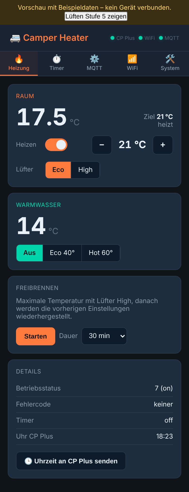
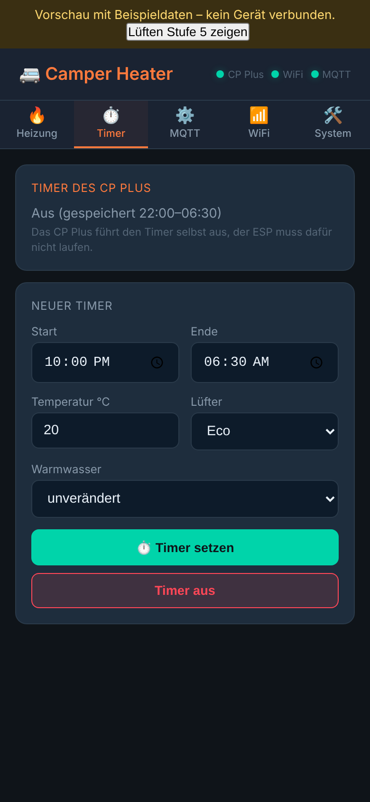
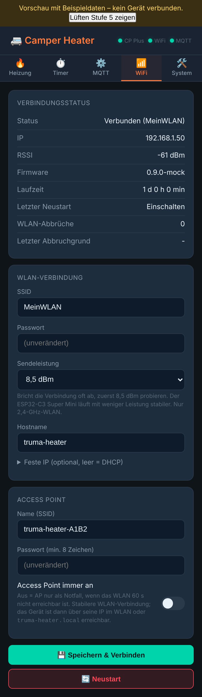
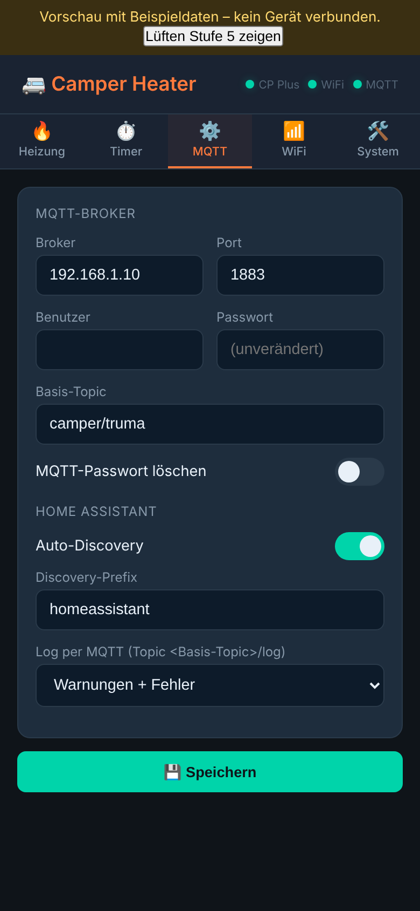
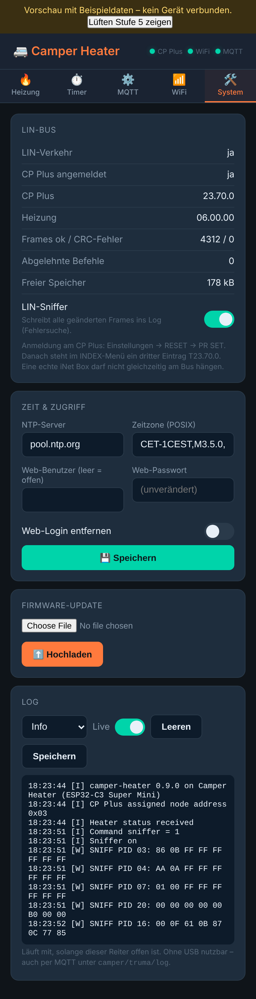

> [!WARNING]
> **IN ENTWICKLUNG – kein fertiges Projekt.** Am echten LIN-Bus noch nicht getestet. Nutzung auf eigenes Risiko.

# camper-heater

Truma-Heizung (Combi / Combi D, Vario Heat) per **MQTT** steuern – mit einem ESP32 am LIN-Bus, reines **Arduino**, ohne ESPHome.

- Der ESP ist **LIN-Slave** und meldet sich am CP Plus als **iNet Box** (T23.70.0) an.
- Das **CP Plus bleibt LIN-Master** und voll bedienbar. Änderungen am CP Plus erscheinen in MQTT, MQTT-Befehle erscheinen am CP Plus.
- Topics unter `camper/heater/...` wie bei den anderen Camper-Geräten, dazu Home-Assistant-Auto-Discovery (Klima-Entität zum Bedienen). Die Unterstruktur `control_status/...` und `set/...` folgt [mc0110/inetbox2mqtt](https://github.com/mc0110/inetbox2mqtt); wer dessen Topics braucht, stellt das Basis-Topic auf `service/truma`.
- Web-Oberfläche für Bedienung, Einstellungen, Log und Firmware-Update.

Protokoll-Logik portiert aus [skrebber/esphome-truma_inetbox](https://github.com/skrebber/esphome-truma_inetbox) (Fork von Fabian-Schmidt), basierend auf der Vorarbeit von [danielfett/inetbox.py](https://github.com/danielfett/inetbox.py) und [WomoLIN](https://github.com/muccc/WomoLIN).

## Voraussetzungen

- CP Plus **ab Version C4.xx** (ältere C3 können nur lesen, nicht schalten)
- **Keine echte iNet Box** am Bus, **kein iNet X** Bedienteil
- ESP32 mit LIN-Transceiver (TJA1020/TJA1021 o. ä.)

## Unterstützte Boards

In `truma_heater/config.h` ganz oben genau ein Board aktivieren:

| Profil | Board | LIN TX / RX | Arduino-Board |
|---|---|---|---|
| `BOARD_ESP32C3_SUPERMINI` (Standard) | ESP32-C3 Super Mini + LIN-Modul (Lochraster-Aufbau, siehe HARDWARE.md) | 4 / 3 | ESP32C3 Dev Module |
| `BOARD_SMARTAVAN` | smartavan heater controller | 16 / 17 | ESP32 Dev Module |
| `BOARD_ESP32_GENERIC` | ESP32 DevKit + LIN-Modul (Verdrahtung wie inetbox2mqtt, LEDs 4/15) | 17 / 16 | ESP32 Dev Module |
| `BOARD_ESP32S3_GENERIC` | ESP32-S3 + LIN-Modul | 17 / 18 | ESP32S3 Dev Module |
| `BOARD_ESP32C3_GENERIC` | ESP32-C3 + LIN-Modul | 21 / 20 | ESP32C3 Dev Module |

Pins lassen sich im jeweiligen Block in `config.h` anpassen. Optional: `LIN_CS_PIN` (Enable/SLP des Transceivers), `LIN_FAULT_PIN`, `MQTT_LED_PIN`, `LIN_LED_PIN`.

**Verdrahtung, Bus-Anschluss, Pins und Fallstricke: siehe [HARDWARE.md](HARDWARE.md).**

## Arduino IDE einrichten

1. Boardverwalter: **esp32 von Espressif, Version 3.x** (kompiliert mit 3.3).
2. Bibliotheken über den Bibliotheksverwalter installieren:
   - **PubSubClient** (Nick O'Leary)
   - **ArduinoJson** (Benoit Blanchon), Version 7.x
   - **ESP Async WebServer** (ESP32Async)
   - **Async TCP** (ESP32Async)
3. Ordner `truma_heater` öffnen (`truma_heater.ino`).
4. Board wählen (siehe Tabelle), **Partition Scheme: „Minimal SPIFFS (1.9MB APP with OTA)“** – lässt Platz für künftige Updates über die Weboberfläche.
5. Hochladen. Serieller Monitor: 115200 Baud.

Spätere Updates gehen ohne USB: In der Arduino IDE *Sketch → Kompilierte Binärdatei exportieren*, dann die `.bin` in der Weboberfläche unter **System → Firmware-Update** hochladen.

## Inbetriebnahme

1. Nach dem ersten Start öffnet der ESP den Access Point **`truma-heater-XXXX`** (Passwort `truma1234`). Verbinden, die Seite öffnet sich automatisch (sonst `http://192.168.4.1`).
2. Im Reiter **WiFi** WLAN (optional feste IP) eintragen → **Speichern & Verbinden**, danach im Reiter **MQTT** den Broker → **Speichern**. Der ESP32 kann nur **2,4-GHz-WLAN**.
   - Der Access Point läuft nur, solange kein WLAN eingerichtet ist oder das WLAN 60 s nicht erreichbar ist (Reiter **WiFi**: Name, Passwort und „Access Point immer an“ einstellbar). Im Notfall-Modus versucht der ESP alle 30 s für 10 s das WLAN, aber nie, solange ein Handy am Access Point hängt.
   - Bricht das WLAN oft ab: im Reiter **WiFi** die Sendeleistung auf 8,5 dBm stellen. Dort stehen auch Abbrüche, letzter Abbruchgrund und der Grund des letzten Neustarts.
3. ESP am LIN-Bus anschließen (RJ12-Verteiler zwischen CP Plus und Heizung, siehe [HARDWARE.md](HARDWARE.md)).
4. **Am CP Plus anmelden** (einmalig): Einstellungen → **RESET** → **PR SET** bestätigen. Das Display zeigt „INIT…“ und startet neu. Unter **INDEX** steht danach ein dritter Eintrag **T23.70.0**.
   - War vorher eine echte iNet Box angemeldet: zuerst ohne iNet Box einmal INIT ausführen, dann mit diesem Gerät.
5. In der Weboberfläche muss **„CP Plus verbunden“** grün sein. Nach ca. 30 s kommt der erste Heizungsstatus; die Uhrzeit wird dann automatisch per NTP ans CP Plus übertragen (und einmal täglich).

## Weboberfläche

Aufbau und Optik wie bei [camper-tanklevel](https://github.com/hflocki/camper-tanklevel): Heizung, Timer, MQTT, WiFi, System.

| Heizung | Timer | WiFi |
| --- | --- | --- |
|  |  |  |

| MQTT | System |
| --- | --- |
|  |  |

Jeder Reiter speichert nur seine eigenen Felder, danach startet das Gerät neu. Leere Passwortfelder behalten den gespeicherten Wert.

Zum Ausprobieren ohne Gerät: [`docs/mockup/truma-heater-mockup.html`](docs/mockup/truma-heater-mockup.html) herunterladen und im Browser öffnen. Das ist die echte Oberfläche aus der Firmware mit simulierten Daten; Knöpfe, Timer, Freibrennen und Sniffer reagieren. Nach Änderungen an `web_ui.h` neu erzeugen mit `python3 docs/gen_mockup.py` (nur Standardbibliothek).

## MQTT

Basis-Topic standardmäßig `camper/heater` (in den Einstellungen änderbar; bis Version 1.0 war es `service/truma`, bestehende Geräte behalten ihre Einstellung). Zustände werden **retained** veröffentlicht, Änderungen innerhalb einer Sekunde, alles einmal pro Minute.

### Status `camper/heater/control_status/<key>`

| Key | Werte | Bedeutung |
|---|---|---|
| `alive` | ON / OFF | CP Plus fragt dieses Gerät ab |
| `current_temp_room` | °C | Raumtemperatur |
| `target_temp_room` | 0, 5–30 | Raum-Zieltemperatur (0 = aus) |
| `heating_mode` | off / eco / high | Lüfterstufe |
| `current_temp_water` | °C | Wassertemperatur |
| `target_temp_water` | 0 / 40 / 60 / 200 | Warmwasser aus / eco / hot / boost |
| `water_mode` | off / eco / high | wie oben als Text |
| `energy_mix` | gas / mix / electricity | Energiequelle (Diesel = gas) |
| `el_power_level` | 0 / 900 / 1800 | Elektroleistung |
| `operating_status` | 0–9 | 0/1 aus, 4 Start/Nachlauf, ≥5 läuft |
| `operating_status_text` | Text | |
| `error_code` | Zahl | Fehlercode wie am CP Plus, ohne E/W und H (z. B. `212` für E212), 0 = keiner. Berechnung wie in inetbox.py, inetbox2mqtt und ESPHome. Kurz nach dem Start des CP Plus kommt `255` (im WomoLIN-Mitschnitt zu sehen). Bedeutung siehe Anleitung der Heizung |
| `heater_error` | ON / OFF | Fehler oder Warnung aktiv (jeder Code ≠ 0) |
| `clock` | hh:mm | Uhrzeit des CP Plus |
| `vent_level` | 0–10 | Lüftungsstufe (0 = kein Lüften). Nur bei Heizungen, die den LIN-Frame 0x20 nutzen, sonst nicht gesendet |
| `vent_mode` | off / 1–10 / eco / high | Rohwert dazu (eco/high = Lüfter beim Heizen) |
| `timer`, `timer_active` | hh:mm-hh:mm / off, ON/OFF | Timer des CP Plus |
| `timer_times`, `timer_temp_room`, `timer_heating_mode`, `timer_water_mode` | hh:mm-hh:mm, °C, eco/high, off/eco/high | Gespeicherte Timer-Einstellungen (auch bei Timer aus) |
| `hvac_mode`, `hvac_action`, `room_setpoint`, `fan_mode` | | für den HA-Thermostat; `hvac_action` = `fan`, wenn die Heizung ohne Raum- und Wasserheizung läuft (Lüften am CP Plus oder Nachlauf) |
| `decoke`, `decoke_remaining`, `decoke_minutes` | ON/OFF, min, min | Freibrennen |
| `cpplus_version`, `heater_version`, `release`, `rssi`, `lin_traffic` | | Diagnose |

Verfügbarkeit: `camper/heater/status` = `online` / `offline` (Last Will).

### Befehle `camper/heater/set/<key>`

| Key | Payload | Wirkung |
|---|---|---|
| `target_temp_room` | 0, 5–30 | 0 = Raumheizung aus, sonst einschalten mit dieser Temperatur |
| `heating_mode` | off / eco / high | Lüfterstufe; schaltet bei Bedarf ein (letzte Temperatur) |
| `target_temp_water` | 0 / 40 / 60 | Warmwasser |
| `water_mode` | off / eco / high | Warmwasser |
| `hvac_mode` | heat / off | Raumheizung an/aus mit letzter Temperatur + Lüfterstufe |
| `room_setpoint` | 5–30 | Solltemperatur; bei ausgeschalteter Heizung nur gemerkt |
| `fan_mode` | eco / high | Lüfterstufe; bei ausgeschalteter Heizung nur gemerkt |
| `energy_mix` / `el_power_level` | gas / mix / electricity, 0 / 900 / 1800 | nur bei Geräten mit E-Heizstab |
| `decoke` | ON / OFF | Freibrennen starten / beenden |
| `decoke_minutes` | 5–120 | Dauer des Freibrennens |
| `sync_clock` | 1 | Uhrzeit sofort ans CP Plus senden |
| `timer` | `22:00-06:30[,temp[,eco/high[,off/eco/high]]]`, `on`, `off` | Timer setzen. Fehlende Werte: bisherige Timer-Werte, sonst gemerkte Solltemperatur und Lüfterstufe. Warmwasser ohne Angabe bleibt unverändert |
| `timer_active` | ON/OFF | Timer mit den gespeicherten Zeiten ein- oder ausschalten |
| `sniffer` | ON / OFF | LIN-Sniffer (Diagnose, siehe unten), nach Neustart aus |
| `reboot` | 1 | Neustart |

Anders als bei inetbox2mqtt muss Temperatur und Lüfterstufe nicht gemeinsam gesendet werden – fehlende Werte werden sinnvoll ergänzt.

Beispiel:
```
mosquitto_pub -h <broker> -t camper/heater/set/target_temp_room -m 21
mosquitto_pub -h <broker> -t camper/heater/set/heating_mode -m high
mosquitto_sub -h <broker> -t 'camper/heater/control_status/#' -v
```

### Home Assistant

Mit aktivierter Auto-Discovery erscheint ein Gerät **„Truma Heater“** mit Thermostat (Aus/Heizen, Solltemperatur, Lüfter eco/high), Warmwasser-Auswahl, Timer (Textfeld `22:00-06:30,20,eco` plus Ein/Aus-Schalter), Freibrennen-Schalter, Sensoren und Diagnose. Die Heizungs-Entitäten sind nur verfügbar, wenn der ESP online ist **und** das CP Plus ihn abfragt.

## Timer

Der Timer des CP Plus lässt sich per MQTT (`set/timer`), in Home Assistant und in der Weboberfläche setzen: Start, Ende, Raumtemperatur, Lüfterstufe und optional Warmwasser. Das CP Plus führt den Timer selbst aus, der ESP muss dafür nicht laufen. Das Frame (Typ 0x3C, 18 Byte) ist gegen Community-Mitschnitte einer Original-iNet-Box (Timer per Truma-App setzen, ändern, ausschalten) geprüft und byte-gleich; esphome-truma_inetbox schickt 17 Byte, inetbox.py 24 Byte. Mit einer Diesel-Heizung noch nicht am Bus getestet.

## Freibrennen (Diesel)

Setzt 30 °C mit Lüfter **high** (Boost gibt es beim Diesel nicht) für die eingestellte Dauer und stellt danach die vorherigen Einstellungen wieder her. Wird während des Freibrennens am CP Plus oder per MQTT etwas geändert, endet es ohne Wiederherstellung.

## Geräteoptionen

In `config.h`:

- `HEATER_SUPPORTS_BOOST` – Lüfter-Boost (Gas-Combi), Standard `false`
- `WATER_SUPPORTS_BOOST` – Warmwasser-Boost, Standard `false`
- `HEATER_HAS_ELECTRIC` – E-Heizstab (Combi E), blendet die Energiequellen-Auswahl in HA ein
- `LIN_OBSERVER_MODE` – nur mithören, nie antworten (Fehlersuche)

**Eigene Werte ohne `config.h` zu ändern:** `truma_heater/config_local.h.example` nach `truma_heater/config_local.h` kopieren und dort z. B. ein eigenes AP-Passwort (`DEFAULT_AP_PASSWORD`) oder die Board-Auswahl eintragen. Die Datei wird automatisch eingebunden, von Git ignoriert und von Patches nie angefasst. WLAN- und MQTT-Zugangsdaten gehören weiterhin in die Weboberfläche.

## Fehlersuche

Weboberfläche → **System**:

- **LIN-Verkehr: nein** → Verkabelung, TX/RX vertauscht, 12 V am Transceiver, gemeinsame Masse.
- **LIN-Verkehr ja, CP Plus angemeldet: nein** → am CP Plus RESET → PR SET ausführen.
- **CRC-Fehler steigen ständig** → Störungen oder falsche Baudrate; Masse prüfen.
- **Abgelehnte Befehle** → das CP Plus hat eine Änderung abgelehnt (z. B. nicht unterstützter Modus).
- **smartavan-Board läuft an USB, aber nicht an 12–14 V** → das ist ein Hardware-Problem (Spannungsregler / Versorgung), keine Firmware-Frage. 3,3 V am ESP bei 12-V-Betrieb messen, auch während WLAN sendet.

## LIN-Sniffer

Zum Erforschen des Busses: Der Sniffer schreibt jeden Frame der übrigen PIDs (alles außer dem iNet-Box-Verkehr 0x18/0x3C/0x3D) ins Log, aber nur, wenn sich sein Inhalt ändert. Nach dem Einschalten kommt jeder PID einmal. Die Zeilen sind Warnungen (`SNIFF PID 07: 01 00 FF FF FF FF FF FF`), damit sie ohne Umstellen im Web-Log und im MQTT-Log landen.

Einschalten: Weboberfläche → **System → LIN-Sniffer** oder MQTT `set/sniffer` = `ON`. Nach einem Neustart ist er aus.

Bekannt aus den WomoLIN-Mitschnitten (CP Plus + Combi D6 E): PID 0x03 Soll-Raumtemperatur, 0x04 Soll-Wassertemperatur, 0x07 Lüfter (`01` eco, `02` high), 0x16 Ist-Werte (ändert sich ständig).

**Lüftungsstufe suchen:** Sniffer an, am CP Plus Lüften Stufe 1 → 5 → 10 → aus schalten, jeweils ~20 s warten und die Uhrzeit notieren. Danach das Log speichern (System → Log → Speichern).

## Logs ohne USB

- **Weboberfläche → System → Log:** läuft live mit (alle 2 s), solange der Reiter offen ist. Log-Level wählbar, Ausgabe lässt sich leeren und als Textdatei speichern.
- **MQTT:** Logzeilen gehen auf `camper/heater/log` (nicht retained). Standard: Warnungen und Fehler. Einstellbar im Reiter **MQTT → Log per MQTT** (Aus / Fehler / Warnungen / Info / Debug). In Home Assistant erscheint die letzte Meldung als Diagnose-Sensor.
- **Seriell (115200 Baud):** nur am Schreibtisch, siehe Hinweis zu USB in [HARDWARE.md](HARDWARE.md).

Zeitstempel sind Uhrzeit (sobald NTP synchronisiert ist), davor Sekunden seit Start (`+12s`).

## Aufbau des Codes

```
truma_heater/
├── truma_heater.ino     Setup und Hauptschleife
├── config.h             Board-Auswahl, Pins, Geräteoptionen
├── truma_protocol.h     Truma-Frames, Enums, Hilfsfunktionen
├── inetbox.h / .cpp     LIN-Slave + iNet-Box-Protokoll (eigener FreeRTOS-Task)
├── heater_control.*     Sollwert-/Lüfter-Speicher, Freibrennen, Befehlslogik
├── mqtt_ha.*            MQTT-Topics + Home-Assistant-Discovery
├── webserver.*          Weboberfläche, REST-API, OTA
├── web_ui.h             HTML der Weboberfläche
├── wifi_manager.*       WLAN, feste IP, Setup-AP
├── settings.*           Einstellungen im NVS
└── logger.*             Log über Serial + Puffer für die Weboberfläche
docs/
├── schaltplan*, lochraster*, wiring_*   Schaltpläne und Lochraster-Layouts (+ Generator-Skripte)
├── mockup/              klickbares Mockup der Weboberfläche + Screenshots
└── gen_mockup.py        erzeugt das Mockup aus web_ui.h
tests/                   Host-Tests und Replay der LIN-Mitschnitte (siehe tests/README.md)
```

Der LIN-Teil läuft in einem eigenen Task mit hoher Priorität, damit Antworten an das CP Plus rechtzeitig (wenige Millisekunden) rausgehen – unabhängig von WLAN, MQTT und Weboberfläche.

## Status

- Kompiliert mit Arduino-ESP32 3.x für ESP32, ESP32-S3 und ESP32-C3.
- LIN/iNet-Box-Protokoll am PC gegen echte Beispiel-Frames simuliert (Anmeldung, INIT, Status, Befehl).
- Gegen **echte Mitschnitte** eines CP Plus mit Combi D6 E und Original-iNet-Box geprüft (WomoLIN-Captures): 29 Mitschnitte, rund 6.900 Frames, alle fehlerfrei gelesen. Für alle 14 Befehle aus der Truma-App (13–22 °C, Lüfter eco/high, Heizung ein/aus) ist unser Heizungsbefehl im Inhalt byte-gleich mit dem der Original-iNet-Box. Siehe [tests/](tests/README.md).
- Zusätzlich 15 Community-Mitschnitte (ESPHome-Observer: Lüften Stufe 1–10, Klima AUTO, Timer Heizung/Klima per App und CP Plus, Uhrzeit) fehlerfrei gelesen.
- **Reines Lüften** (am CP Plus, Stufe 1–10) ist über die iNet-Box-Schnittstelle nicht steuerbar. Die Stufe steht nicht in den iNet-Box-Frames (dort nur „Heizung läuft“ → `hvac_action = fan`), aber bei manchen Heizungen im Frame CP Plus → Heizung (PID 0x20). Daraus liest die Firmware `vent_level` mit – in der Community an einer Combi (Gas) mit dem ESPHome-Sensor VENT_MODE für Stufe 1–10 bestätigt. Die Combi D6 E aus den WomoLIN-Mitschnitten nutzt PID 0x20 nicht; ob die eigene Heizung ihn schickt, zeigt der Sniffer.
- Timer setzen: unser Frame ist für Setzen (mit/ohne Warmwasser) und Ausschalten byte-gleich mit dem der Original-iNet-Box (Community-Mitschnitt, Truma-App).
- Uhrzeit: Die Original-iNet-Box stellt die Uhr nie selbst; das CP Plus meldet Änderungen sofort. Unser NTP-Uhrzeit-Setzen (Frame 0x14) ist nur gegen ESPHome geprüft.
- **Am echten LIN-Bus noch nicht getestet.**

## Fertige Firmware (GitHub Actions)

Jeder Push wird automatisch gebaut (`.github/workflows/build.yml`, Board-Paket und Bibliotheken in den hier genannten Versionen). Das Ergebnis liegt im Reiter **Actions** beim jeweiligen Lauf als Download. Ein Tag `v…` (z. B. `git tag v1.2.0 && git push --tags`) legt zusätzlich ein **Release** mit der `.bin` an, die sich direkt im Web-UI über das Firmware-Update einspielen lässt.

## Lizenz

GPL-3.0, siehe [LICENSE](LICENSE). Die Protokoll-Logik ist aus [skrebber/esphome-truma_inetbox](https://github.com/skrebber/esphome-truma_inetbox) (GPL-3.0, Fork von Fabian-Schmidt/esphome-truma_inetbox) portiert, das Setzen des Timers aus [havanti/esphome-truma](https://github.com/havanti/esphome-truma).
