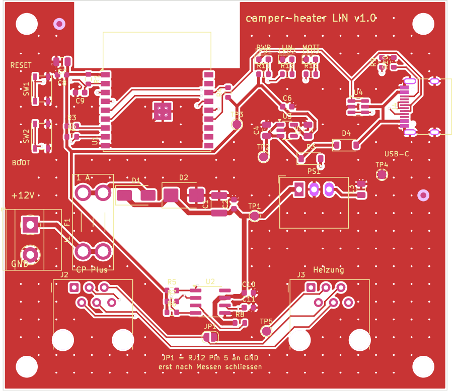
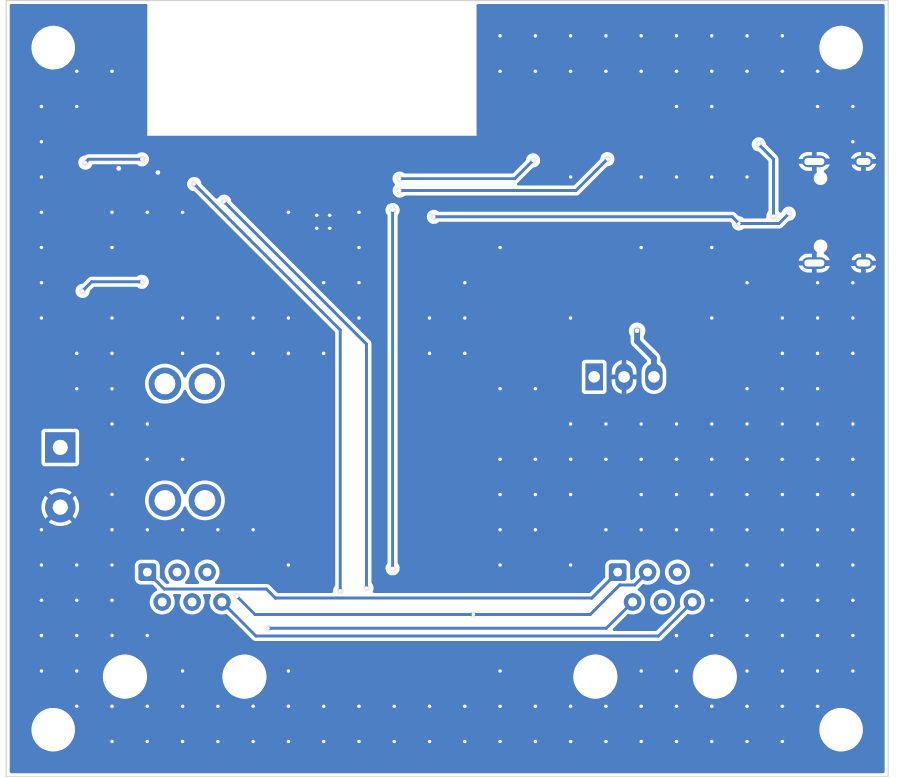

# camper-heater LIN – eigene Platine

Fertig bestückbare Platine für die camper-heater-Firmware: ESP32-C3-Modul, LIN-Transceiver, geschützte 12-V-Versorgung, USB-C zum Flashen und zwei RJ12-Buchsen. Der ESP meldet sich wie eine iNet Box als **Slave** an, das **CP Plus bleibt Master** und voll bedienbar.

> **Stand: Version 1.0, noch nicht gefertigt und nicht getestet.** Die Daten bestehen den Design-Check von KiCad (keine Fehler, alle Verbindungen geroutet). Für die erste Bestellung die kleinste Stückzahl wählen (5 Platinen, 2 davon bestückt) und vor dem Einbau die Prüfschritte unten machen.

| Oberseite | Unterseite |
| --- | --- |
|  |  |

Schaltplan: [`docs/schaltplan.pdf`](docs/schaltplan.pdf) · Gerber-Vorschau: [`docs/ansicht-gerber.png`](docs/ansicht-gerber.png)

## Was drauf ist

| Block | Bauteile | Zweck |
| --- | --- | --- |
| 12-V-Eingang | J1 Schraubklemme, **F1 Mini-Flachsicherung 1 A**, D1 Verpolschutz (Schottky 100 V), D2 TVS SMBJ22A | Kurzschluss, Verpolung und Spannungsspitzen beim Motorstart oder Laden |
| Versorgung | PS1 RECOM R-78HB5.0-0.5 (9–72 V → 5 V), D3/D4 + U3 AP2112K-3.3 | fertiges Wandler-Modul für Fahrzeugbordnetze, 3,3 V für den ESP. Strom wahlweise aus 12 V **oder** USB |
| ESP32 | U1 ESP32-C3-WROOM-02-N4, Taster RESET und BOOT, 3 LEDs | Antenne am Platinenrand, darunter kein Kupfer |
| LIN | U2 TJA1021T/20, C11 220 pF, Pull-ups | Slave-Beschaltung ohne Master-Widerstand, wie eine iNet Box |
| Bus | J2 + J3 RJ12 6P6C, alle 6 Kontakte 1:1 verbunden | Pin 3 = LIN, Pin 5 = Masse (wie bei havanti/esphome-truma) |
| USB-C | J4, U4 USBLC6-2SC6 | Flashen, serielles Log, Strom am Schreibtisch |

Maße: **75 × 66 mm**, 2 Lagen, 4 Befestigungslöcher M3. GPIO-Belegung: GPIO4 = LIN TX, GPIO3 = LIN RX, GPIO5 = SLP, GPIO6 = LED LIN (blau), GPIO7 = LED MQTT (gelb), grüne LED = 3,3 V vorhanden.

## Bestellen bei PCBWay

Dateien in [`fertigung/`](fertigung):

| Datei | Wohin bei PCBWay |
| --- | --- |
| `camper-heater-lin-gerber.zip` | „Quick-order PCB“ → **Add Gerber File** |
| `camper-heater-lin-bom.xlsx` | Assembly → **BOM** |
| `camper-heater-lin-cpl.csv` | Assembly → **Centroid / Pick & Place** |

**Platine** (Werte, die PCBWay beim Gerber meist selbst erkennt):
- Layers: **2**, Size: **75 × 66 mm**, Material: FR-4 TG130–150, Thickness: **1,6 mm**
- Min track/spacing: **6/6 mil** (Design nutzt 0,2 mm), Min hole size: **0,3 mm**
- Solder mask: beliebig (z. B. grün), Silkscreen: weiß, Surface finish: **HASL lead free**
- Copper weight: 1 oz, Via: tented, keine Sonderoptionen

**Bestückung** (Assembly Service anhaken):
- **Turnkey** (PCBWay besorgt alle Teile), Assembly side: **Top side**
- Number of unique parts: **28**, SMD-Teile **und** Through-Hole-Teile (J1, J2, J3, F1, PS1) → „Both“
- Quantity: z. B. **2**
- Bemerkung, die man ins Feld „Notes“ kopieren kann:
  > Please do not place JP1 (open solder jumper) and test points TP1–TP5, they are pads only. Fuse holder F1: only the holder (Keystone 3568), no fuse. Fiducials FID1/FID2 on top side. Please check the rotation of U1, U2, U3, U4 and the diodes against the silkscreen marks.

PCBWay prüft BOM und Bestückungsdatei vor der Fertigung und meldet sich bei Rückfragen, z. B. wenn ein Teil nicht lieferbar ist und ein Ersatz vorgeschlagen wird. Gleichwertige Ersatzteile sind in Ordnung, solange **Spannungsfestigkeit und Gehäuse** gleich bleiben (D2 SMBJ22A, C1 50 V, PS1 R-78HB5.0-0.5).

**Dazu kaufen:** eine Mini-Flachsicherung (ATM) **1 A**, ein kurzes RJ12-Kabel 6P6C (6 Adern, nicht nur 4), Kabel für 12 V und Masse.

## Vor dem ersten Einbau prüfen

1. **Sichtprüfung:** D1, D2 (Strich = Kathode) und U1–U4 wie auf dem Bestückungsdruck.
2. **Ohne Sicherung** mit dem Multimeter messen: J1 Pin 1 gegen Pin 2 darf **kein Kurzschluss** sein, ebenso TP1 (VBAT), TP2 (5 V) und TP3 (3,3 V) gegen TP4 (GND).
3. **Nur USB** anstecken (ohne 12 V): grüne LED an, TP3 ≈ 3,3 V. Firmware flashen (siehe unten).
4. **12 V über ein Labornetzteil mit Strombegrenzung** (z. B. 100 mA) oder direkt mit eingesetzter 1-A-Sicherung: TP1 ≈ 11,7 V, TP2 ≈ 4,7 V, TP3 = 3,3 V. Strom im Leerlauf rund 30–80 mA bei 12 V.
5. **RJ12-Kabel messen, bevor JP1 geschlossen wird:** Im Fahrzeug bei eingeschaltetem CP Plus am freien RJ12-Anschluss messen. Pin 5 muss 0 V gegen Fahrzeugmasse haben, Pin 3 (LIN) liegt in Ruhe bei etwa Bordspannung. **JP1 bleibt offen**, die Masse kommt über J1. Nur wenn die Verbindung ohne JP1 nicht klappt und Pin 5 nachgemessen Masse ist, JP1 mit einem Lötklecks schließen.

## Anschluss im Camper

- **Einfachster Weg:** Nur **J2** benutzen und mit einem RJ12-Kabel an die **freie Zubehörbuchse der Combi** stecken (dort steckt sonst die iNet Box). J3 bleibt frei.
- **Durchschleifen:** CP Plus → J2 und J3 → Heizung. Die Platine verhält sich dann wie ein 6-poliger Y-Verteiler. Dafür beide Kabel gleicher Art nehmen (beide 1:1 oder beide gekreuzt).
- **12 V:** J1 Pin 1 (+12 V) mit Plus aus dem Sicherungsverteiler, Pin 2 mit Masse. Die 1-A-Sicherung sitzt auf der Platine; eine zweite Sicherung am Verteiler schadet nicht.

## Firmware

Im Sketch [`../truma_heater/config.h`](../truma_heater/config.h) das Board-Profil wählen, am besten in `config_local.h`:

```cpp
#define BOARD_CAMPER_LIN_C3
```

Arduino IDE: Board **ESP32C3 Dev Module**, USB CDC On Boot **Enabled**, Partition Scheme **Minimal SPIFFS**. Zum ersten Flashen BOOT gedrückt halten, RESET kurz drücken, BOOT loslassen. Danach geht jedes Update per Web-UI oder OTA.

Am CP Plus einmal anmelden: Einstellungen → **RESET → PR SET**. Siehe [Inbetriebnahme](../README.md#inbetriebnahme).

## Selbst ändern

Die Platine wird komplett aus Skripten erzeugt, damit Änderungen nachvollziehbar bleiben:

| Datei | Inhalt |
| --- | --- |
| `tools/parts.py` | Bauteile, Teilenummern und alle Verbindungen (eine Quelle für Platine, BOM und Schaltplan) |
| `tools/place.py` | Positionen, Platinenumriss, Netzklassen, Beschriftung |
| `tools/route.py` | Autorouter (Freerouting) und Import |
| `tools/finish.py` | Masseflächen oben und unten, Durchkontaktierungen |
| `tools/make_outputs.py` | Gerber, Bohrdaten, BOM, Bestückungsdatei |
| `tools/schematic.py` | Schaltplan als PDF/SVG |
| `kicad/camper-heater-lin.kicad_pcb` | fertige Platine zum Öffnen in KiCad 7 oder neuer |

Neu bauen (Linux mit KiCad 7, Java 17+ und `xvfb-run`):

```bash
cd firmware/heater/pcb/tools
curl -LO https://github.com/freerouting/freerouting/releases/download/v1.9.0/freerouting-1.9.0.jar && mv freerouting-1.9.0.jar freerouting.jar
python3 -m venv --system-site-packages .venv && source .venv/bin/activate && pip install -r requirements.txt
./build_all.sh
```

Kleine Änderungen (Beschriftung, eine Leiterbahn) gehen auch direkt in KiCad an `kicad/camper-heater-lin.kicad_pcb`; danach in KiCad den Design-Check laufen lassen und die Fertigungsdateien neu exportieren.

## Lizenz

Wie der Rest von `firmware/heater`: GPL-3.0.
