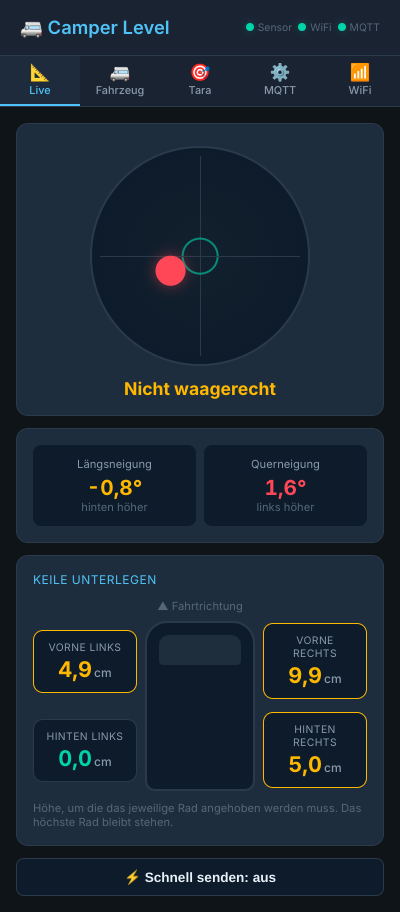
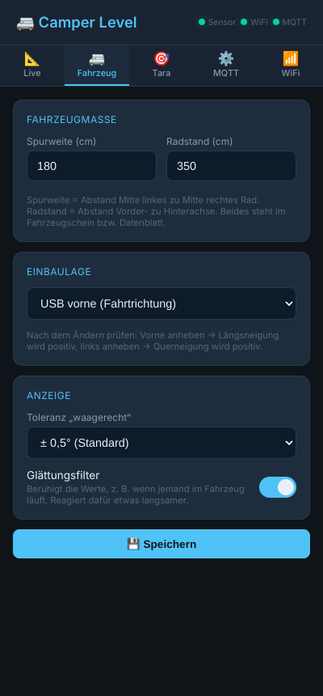
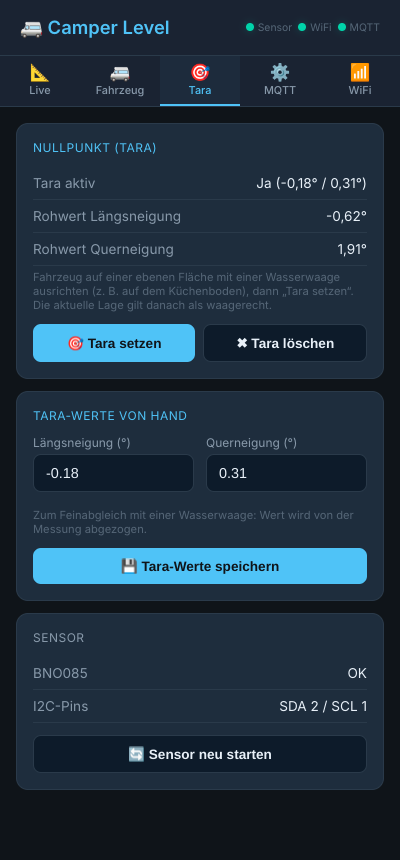

# Camper Level – Ausrichtung mit Keil-Empfehlung per MQTT

Firmware für einen ESP32 (ESP32-S3, ESP32-C3 oder klassischer ESP32) mit einem **Adafruit BNO085**, die Längs- und Querneigung des Wohnmobils misst und für **jedes der vier Räder** anzeigt, wie hoch der Keil sein muss, damit das Fahrzeug waagerecht steht.

- Werte per **MQTT** mit Home-Assistant-Discovery, Topics `camper/level/…` wie bei den anderen Geräten in diesem Repo
- Web-Oberfläche mit Wasserwaage, Draufsicht mit den vier Keilhöhen, Tara, Fahrzeugmaßen, MQTT- und WLAN-Einstellungen
- Wird direkt auf dem [Wandpanel](../display) und dem [RoadBuddy](../roadbuddy) angezeigt, dazu eine Kachel für Home Assistant (`ha-card/`)

> **Ursprung:** Dieses Projekt basiert auf dem [ESP32 Adafruit BNO085 Caravan-Levelsensor](https://github.com/klehnst/ESP32-Adrafruit-BNO085-HomeAssistant-Caravan-Levelsensor-MQTT) von **klehnst** – vielen Dank für die Vorarbeit (BNO085-Anbindung, Einbaulagen, Wasserwaagen-Oberfläche, HA-Kachel, 3D-Druck-Gehäuse). Wer einen **Wohnwagen** mit Stützrad nivellieren will, ist dort richtig: Der Wohnwagen-Modus ist hier bewusst entfernt.

## Web-Oberfläche

| Live | Fahrzeug | Tara |
|---|---|---|
|  |  |  |

## Was gegenüber dem Original anders ist

**Umbau auf Camper**
- Nur noch Wohnmobil mit vier Keilen; Wohnwagen-Modus (Stützrad, Achse–Stützrad, Keil links/rechts) entfernt
- Alles von `wowa` auf `camper` umbenannt: Sketch `camper_level.ino`, Topics `camper/level`, HA-Gerät „Camper Level“, Access Point `Camper-Level-XXXXXX`, Hostname `camper-level`
- Gleicher Aufbau wie die anderen Geräte: Web-Oberfläche im gemeinsamen Stil, Web-Login, Last Will mit QoS 1, `config_local.h` für eigene Passwörter und Pins, Reiter WiFi mit Sendeleistung und „AP nur als Notfall“

**Fehler behoben**
- **Keilhöhen waren nur halb so groß wie nötig.** Das Original hat die tiefen Räder nur auf die Höhe der Fahrzeugmitte angehoben. Da sich die hohe Seite nicht absenken lässt, muss jedes Rad auf das **höchste** Rad gebracht werden. Steht der Camper z. B. nur seitlich schief, braucht die tiefe Seite den vollen Höhenunterschied über die Spurweite, nicht den halben.
- **Die Konfiguration samt WLAN- und MQTT-Passwort war über `http://<ip>/config.json` für jeden im Netz abrufbar**, weil das ganze Dateisystem ausgeliefert wurde. Jetzt wird nur noch die Web-Oberfläche ausgeliefert.
- `/api/config` hat alle Passwörter im Klartext an den Browser geschickt – jetzt nie mehr.
- Der Glättungsfilter ließ sich schalten, wurde aber nirgends angewendet. Jetzt glättet er wirklich (gleitender Mittelwert).
- Die „Temperatur“ war ein Zufallswert aus einem unbeschalteten Analog-Pin – entfernt.
- Fehlte die Spurweite in der gespeicherten Konfiguration, wurde sie 0 und alle Keile auch.
- Neustart und Flash-Schreiben passieren nicht mehr im Web-Task (konnte den ESP aufhängen).
- Der BNO085 wird erneut gesucht, wenn er beim Start nicht gefunden wurde, statt bis zum nächsten Neustart auszufallen.
- Doppelte HA-Entitäten (Toleranz, Filter und MQTT-Tempo jeweils zweimal) zusammengefasst; Einstellungen werden nur bei Änderung und einmal pro Minute gesendet statt fünfmal pro Sekunde.
- „MQTT schnell“ (5 Hz) schaltet sich nach 10 Minuten selbst wieder ab.

## Hardware

- ESP32-S3, ESP32-C3 Super Mini oder ESP32 DevKit
- [Adafruit BNO085](https://www.adafruit.com/product/4754) (I2C, Adresse 0x4A)
- 3D-Druck-Gehäuse aus dem Original-Projekt unter [`3d-print/`](3d-print)

| BNO085 | ESP32 |
|---|---|
| VIN | 3V3 |
| GND | GND |
| SDA | `PIN_I2C_SDA` (Standard GPIO2) |
| SCL | `PIN_I2C_SCL` (Standard GPIO1) |

Die Standard-Pins gelten auch für die fertige `.bin` aus den Releases. Andere Pins (z. B. SDA GPIO1 / SCL GPIO2 oder ESP32-C3 GPIO4/GPIO10) in `config_local.h` eintragen und selbst bauen.

Den Sensor fest mit dem Fahrzeug verbinden. Die Einbaulage (flach oder an einer Wand, USB-Anschluss zeigt nach …) stellt man in der Web-Oberfläche ein.

## Arduino IDE

> **Eigene Passwörter, Pins, WLAN und Broker:** `config_local.h.example` im Sketch-Ordner nach `config_local.h` kopieren und anpassen. Die Datei geht nicht nach GitHub. Details in der [Haupt-README](../../README.md#eigene-einstellungen-config_localh).

Board-Paket: esp32 von Espressif **3.x** (getestet 3.3.2).

| Einstellung | Wert |
|---|---|
| Board | ESP32S3 Dev Module / ESP32C3 Dev Module / ESP32 Dev Module |
| USB CDC On Boot | Enabled (S3 / C3 mit nativem USB) |
| Partition Scheme | **Minimal SPIFFS (1.9MB APP with OTA/190KB SPIFFS)** |

**Libraries** (Bibliotheksverwalter)

| Library | Autor | Version |
|---|---|---|
| SparkFun BNO08x Cortex Based IMU | SparkFun | 1.0.6 |
| PubSubClient | Nick O'Leary | 2.8 |
| ArduinoJson | Benoit Blanchon | 7.4.2 |
| ESP Async WebServer | ESP32Async | 3.12.1 |
| Async TCP | ESP32Async | 3.5.0 |

**Hochladen**

1. `camper_level/camper_level.ino` öffnen, Board und Partition Scheme einstellen, Sketch hochladen.
2. Web-Oberfläche hochladen: Das LittleFS-Image aus `data/` (enthält `index.html.gz`) mit dem Plugin [arduino-littlefs-upload](https://github.com/earlephilhower/arduino-littlefs-upload) übertragen (Arduino IDE 2: `Strg/Cmd + Shift + P` → *Upload LittleFS to Pico/ESP8266/ESP32*). Danach startet das Gerät mit leeren Einstellungen bzw. den Werten aus `config_local.h`.

Die lesbare Quelle der Web-Oberfläche liegt in `web/index.html`. Nach Änderungen daran neu packen:

```
python3 tools/web/pack_web.py level      # im Repo-Hauptordner
```

Ohne das Repo-Werkzeug geht es auch so (im Sketch-Ordner `camper_level`): `gzip -9 -n -c web/index.html > data/index.html.gz`. Die GitHub Action prüft bei jedem Push, ob die gepackte Seite zur `index.html` passt.

## Erstbenutzung

1. Ohne WLAN-Daten startet der Access Point **`Camper-Level-XXXXXX`** (Passwort aus `config.h` bzw. `config_local.h`). Verbinden, `http://192.168.4.1` öffnen.
2. Reiter **WiFi**: WLAN eintragen, speichern. Reiter **MQTT**: Broker eintragen.
3. Reiter **Fahrzeug**: Spurweite, Radstand und Einbaulage eintragen. Prüfen: Fahrzeug vorne anheben → Längsneigung wird positiv; links anheben → Querneigung wird positiv. Stimmt eine Richtung nicht, andere Einbaulage wählen.
4. Reiter **Tara**: Fahrzeug auf einem sicher ebenen Platz mit einer Wasserwaage ausrichten, **Tara setzen**.

## Keile ablesen

Die Live-Seite zeigt für jedes Rad die nötige Keilhöhe. Das höchste Rad bekommt 0 cm, alle anderen werden auf seine Höhe gebracht. Die Werte gelten für die gerade gemessene Neigung: nach dem Auffahren auf die Keile ändern sie sich, bis „Waagerecht“ erscheint. Zum Einweisen auf dem Handy **Schnell senden** einschalten (5 Hz statt alle 2 s).

Die Wasserwaage zeigt wie eine echte Libelle: Die Blase wandert zur **hohen** Seite.

## MQTT / Home Assistant

Prefix (Web-UI) Standard `camper/level`:

| Topic | Wert |
|---|---|
| `<prefix>/status` | `online` / `offline` (Last Will) |
| `<prefix>/info` | Diagnose (retained, beim Verbinden und jede Minute): JSON mit `version`, `ip`, `mac`, `rssi`, `uptime` (s), `reset` (Grund des letzten Neustarts), `heap` |
| `<prefix>/pitch` | Längsneigung in °, positiv = vorne höher |
| `<prefix>/roll` | Querneigung in °, positiv = links höher |
| `<prefix>/wedge_fl`, `wedge_fr`, `wedge_rl`, `wedge_rr` | Keilhöhe in cm vorne links / vorne rechts / hinten links / hinten rechts |
| `<prefix>/is_level` | `ON`, wenn Längs- und Querneigung innerhalb der Toleranz liegen |
| `<prefix>/sensor` | `OK` / `ERROR` |
| `<prefix>/rssi` | WLAN-Signal |
| `<prefix>/tolerance`, `track_width`, `wheelbase`, `mount`, `tare_active`, `tare_pitch`, `tare_roll`, `filter_active`, `mqtt_fast` | Einstellungen (bei Änderung und einmal pro Minute) |

**Befehle** (`PRESS` bzw. Wert, nicht retained):

| Topic | Payload |
|---|---|
| `<prefix>/cmd/tare/set` | `PRESS` – aktuelle Lage als waagerecht speichern |
| `<prefix>/cmd/tare_reset/set` | `PRESS` |
| `<prefix>/cmd/sensor_restart/set` | `PRESS` – BNO085 neu starten |
| `<prefix>/cmd/tolerance/set` | `0.1` … `5` |
| `<prefix>/cmd/track_width/set`, `wheelbase/set` | cm |
| `<prefix>/cmd/mount/set` | Name der Einbaulage, z. B. `Wand links` |
| `<prefix>/cmd/tare_pitch/set`, `tare_roll/set` | `-10` … `10` |
| `<prefix>/cmd/filter/set`, `mqtt_speed/set` | `ON` / `OFF` / `TOGGLE` |

In Home Assistant erscheint ein Gerät „Camper Level“. Beim ersten Verbinden löscht die Firmware die Einträge der Original-Firmware (`wowa_level`), damit kein zweites, totes Gerät stehen bleibt.

## Home-Assistant-Kachel

`ha-card/camper-level-card.js` zeigt Längs- und Querneigung mit kippenden Fahrzeugbildern, die vier Keile und optional einen Schnell-Modus-Knopf.

1. `camper-level-card.js` nach `/config/www/camper-level-card/` kopieren, die Bilder aus `ha-card/img/` nach `/config/www/camper-level-card/img/`.
2. *Einstellungen → Dashboards → ⋮ → Ressourcen*: `/local/camper-level-card/camper-level-card.js` als JavaScript-Modul hinzufügen.
3. Karte „Camper Ausrichtung“ hinzufügen und die Entitäten wählen: Längs- und Querneigung, die vier Keile, „Waagerecht“ als Level-Status, „MQTT schnell (5 Hz)“ als Boost-Schalter.

Bestehende Dashboards mit `custom:wowa-level-card` funktionieren weiter.

## Serieller Monitor

115200 Baud. Befehle: `read` (Neigung und Keile), `tare`, `notare`, `sensor` (BNO085 neu starten), `noauth` (Web-Login entfernen), `help`.

## Updates ohne USB

| Was | Wie |
|---|---|
| Firmware | Arduino IDE → *Sketch → Kompilierte Binärdatei exportieren*, die `.bin` im Web-UI unter **WiFi → Firmware- & Web-Update** hochladen (Neustart), oder per Netzwerkport in der IDE (OTA-Passwort) |
| Web-Oberfläche | `data/index.html.gz` im Web-UI hochladen – ersetzt nur die Seite, ohne Neustart, Einstellungen bleiben |
| Komplettes LittleFS-Image | Nur per USB oder IDE-Netzwerkport; löscht dabei auch die Einstellungen (`config.json`) |

## Sicheres Firmware-Update und Ereignisse

Seit 2.3.0 trägt jede Firmware eine Kennung (`CAMPER-FW:level:<version>:<chip>;`, `fwcheck.*` aus `firmware/_common`). Im Web-UI unter **WiFi → Firmware- & Web-Update** steht die installierte Version. Eine gewählte Datei wird schon im Browser geprüft und beim Hochladen im Gerät noch einmal, bevor etwas aktiviert wird:

| Datei | Ergebnis |
| --- | --- |
| `.bin` dieses Geräts | Gerät, Version und Vergleich mit der installierten (neuer / gleich / älter, bei gleich oder älter mit Rückfrage) |
| `.merged.bin` aus der Arduino IDE | abgelehnt: das ist das komplette Flash-Abbild für USB, fürs Web-Update die `.bin` ohne „merged“ nehmen |
| `.bin` eines anderen Geräts oder Chips | abgelehnt, z. B. „Firmware für „tanklevel“, dieses Gerät ist „level““ |
| `.bin` ohne Kennung (ältere Firmware, fremde Datei) | gesperrt, mit „Ohne Kennung hochladen“ trotzdem möglich (für ein Downgrade auf eine Version vor 2.3.0) |
| `data/index.html.gz` | Web-Oberfläche, ohne Neustart |

Schlägt etwas fehl, nennt die Meldung den Grund statt nur „Update failed“. Die Karte **Ereignisse** darunter zeigt die letzten 24 Ereignisse: Start mit Grund (Einschalten, Absturz, Watchdog …), WLAN und MQTT verbunden/getrennt, Uploads mit Ergebnis, Rückfall und gespeicherte Einstellungen (`evlog.*`). Das Log bleibt bei Neustart, Absturz und Update erhalten, bei Stromausfall ist es leer. Updates über den Netzwerkport der Arduino IDE werden nicht geprüft, aber ebenfalls protokolliert.

## Absicherung gegen Aussperren

Damit das Gerät erreichbar bleibt, ohne dass jemand hinmuss (`safeguard.*` aus `firmware/_common`):

- **Rückfall nach Update:** Nach einem Firmware-Update über das Web-UI oder den IDE-Netzwerkport läuft die neue Version auf Probe. Hat sie nach 5 Minuten kein WLAN oder startet sie mehr als dreimal neu, startet der ESP wieder die vorherige Firmware (sie liegt noch im zweiten App-Bereich). Ab 1 Minute stabilem WLAN gilt die neue Version als gut. Flashen per USB wird nie zurückgerollt.
- **WLAN-Änderung mit Rückweg:** Werden SSID, Passwort geändert, während das Gerät verbunden ist, merkt es sich die funktionierenden Werte. Klappt die Verbindung mit den neuen nach dem Neustart nicht (etwa 1 Minute), setzt es die alten wieder ein und startet neu. Ist das Gerät beim Ändern gar nicht verbunden (Einrichtung über den Setup-AP), gelten die neuen Werte sofort.
- Was zuletzt passiert ist, steht im Web-UI unter **WiFi → Verbindungsstatus** in der Zeile **Absicherung**.

Der Schutz greift erst bei Updates, die von dieser Version **aus** gemacht werden. Das Update auf diese Version selbst ist noch nicht abgesichert.

## Versionen

| Version | Änderungen |
|---|---|
| 2.3.0 | Sichere Updates: Firmware-Kennung, Prüfung der Datei im Browser und im Gerät (falsches Gerät, falscher Chip, .merged.bin, zu groß), Fehlergrund im Klartext, installierte Version und Ereignis-Log im Web-UI |
| 2.2.0 | Absicherung gegen Aussperren: Rückfall auf die vorherige Firmware, wenn ein Update kein WLAN bekommt; geänderte WLAN-Daten werden zurückgesetzt, wenn sie nicht funktionieren |
| 2.1.2 | Standard-Pins SDA GPIO2 / SCL GPIO1, damit die Release-.bin ohne eigene `config_local.h` den Sensor findet |
| 2.1.0 | Firmware (.bin) und Web-Oberfläche (index.html.gz) im Web-UI unter WiFi hochladbar, ohne USB; Arduino-OTA-Dateisystem-Upload hängt LittleFS vorher aus |
| 2.0.0 | Fork als camper-level: nur Wohnmobil mit vier Keilen, korrigierte Keilberechnung, Sicherheitslücken geschlossen, Filter funktioniert, Topics und Oberfläche wie die anderen camper-mqtt-Geräte |
| 1.x | Original [WoWa-Level](https://github.com/klehnst/ESP32-Adrafruit-BNO085-HomeAssistant-Caravan-Levelsensor-MQTT) von klehnst |

## Fertige Firmware

Wird im Haupt-Repo per GitHub Actions gebaut, siehe [Fertige Firmware](../../README.md#fertige-firmware).

## Lizenz

Das Original-Projekt von klehnst enthält derzeit keine Lizenzangabe. Die Rechte an den übernommenen Teilen (Sensor-Grundlogik, Einbaulagen, HA-Kachel, Bilder, 3D-Druck-Dateien) liegen bei ihm.
